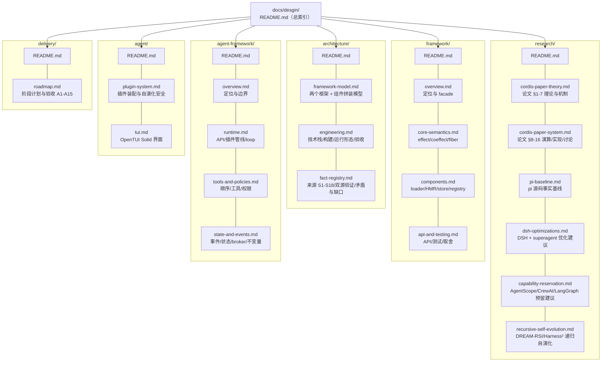

# zeta-agent 设计文档集

> **文档定位**：总入口。按 6 个主题目录组织，每个目录自带 `README.md` 索引。文档之间用相对链接交叉引用，并配有 UML 图（用例/类/组件/部署/对象/时序/活动/状态机）。
> **检索截止**：2026-11-19。**组织规范**：无数字前缀；每个子目录一个 `README.md`；文档颗粒度对齐（总览/机制/组件/API/取舍四档）。

## 目录导航

| 目录 | 回答什么 | 入口 |
| --- | --- | --- |
| **research** | 事实是什么（论文、pi 基线、外部参照、能力预留） | [research/README.md](./research/README.md) |
| **architecture** | 我们决定怎么做（框架模型、工程约束、事实登记） | [architecture/README.md](./architecture/README.md) |
| **framework** | 通用框架 `@zeta-agent/framework` 怎么设计 | [framework/README.md](./framework/README.md) |
| **agent-framework** | Agent 框架 `@zeta-agent/agent-framework` 怎么设计 | [agent-framework/README.md](./agent-framework/README.md) |
| **agent** | 极简 harness 的插件装配与 TUI | [agent/README.md](./agent/README.md) |
| **delivery** | 按什么顺序做、如何验收 | [delivery/README.md](./delivery/README.md) |

## 完整文档树



## UML 概览：文档集关系

```mermaid
flowchart TB
    subgraph R["research（事实源）"]
        R1["cordis-paper-theory/system"]
        R2["pi-baseline"]
        R3["dsh-optimizations"]
        R4["capability-reservation"]
        R5["recursive-self-evolution（新）"]
    end
    subgraph A["architecture（决策）"]
        A1["framework-model"]
        A2["engineering"]
        A3["fact-registry"]
    end
    subgraph F["framework（通用框架）"]
        F1["overview · core-semantics"]
        F2["components · api-and-testing"]
    end
    subgraph AF["agent-framework（Agent 框架）"]
        AF1["overview · runtime"]
        AF2["tools-and-policies · state-and-events"]
    end
    subgraph AG["agent（应用形态）"]
        AG1["plugin-system · tui"]
    end
    subgraph D["delivery（落地）"]
        D1["roadmap"]
    end
    R --> A
    A --> F --> AF --> AG --> D
    R3 --> F
    R4 --> AF
    A3 -.核验.> R
```

## 核心概念速查

| 概念 | 一句话 | 权威文档 |
| --- | --- | --- |
| 两个框架 | 通用框架 + Agent 框架，各自内部由组件拼装，对应用只暴露 facade | [framework-model.md](./architecture/framework-model.md#4-两个框架-应用形态组件拼装模型) |
| 复刻而非引入 | 不引入任何上游 Cordis 包；`@zeta-agent/cordis` 是自研组件命名 | 本文下方"依赖边界" |
| revertible effect | 每个上下文变换带逆，按 LIFO 组合 | [core-semantics.md](./framework/core-semantics.md#4-核心原语-ctxeffect) |
| reactive coeffect | 上下文变化按依赖规格分类为 activating/deactivating/neutral | [core-semantics.md](./framework/core-semantics.md#6-依赖注入与隔离) |
| fiber 生命周期 | O-Insert → L-Begin → L-Iter/Finish → L-Leave/Divert → L-Unload → guard | [core-semantics.md](./framework/core-semantics.md#7-生命周期状态机) |
| 汇合性 Thm 80 | 最终状态只取决于最终配置 | [cordis-paper-system.md](./research/cordis-paper-system.md#9-元理论五条承重保证) |
| 万物皆插件 | provision/instantiation/coeffect 操作全部归约为 `ctx.effect` | [core-semantics.md](./framework/core-semantics.md#4-核心原语-ctxeffect) |
| 能力预留 | 薄 harness、厚框架；预留契约不预留实现 | [capability-reservation.md](./research/capability-reservation.md#1-设计哲学薄-harness厚框架) |
| 递归自演化 | 改什么/如何评估/如何晋升；约束可变面 + 无退化晋升（研究轨预留） | [recursive-self-evolution.md](./research/recursive-self-evolution.md#1-为什么这两个项目重要) |

## 依赖边界（重要）

我们是**复刻 Cordis 论文**并自行实现其语义，**不直接引入任何 Cordis 包**（无论 npm 的 `cordis` / `@cordisjs/*`，还是 deepseek-harness 的 `@deepseek-ai/cordis`）。`@zeta-agent/cordis` 是**我们自己实现并命名的组件包**，与上游 Cordis 包无依赖关系。S12/S13 只作为**只读参考蓝本**，其源码不进入我们的依赖树。

## 推荐阅读路径

- **理论先行**：[research/cordis-paper-theory.md](./research/cordis-paper-theory.md) → [cordis-paper-system.md](./research/cordis-paper-system.md) → [architecture/framework-model.md](./architecture/framework-model.md) → [framework](./framework/README.md) → [agent-framework](./agent-framework/README.md) → [agent](./agent/README.md) → [delivery](./delivery/README.md)
- **实现先行**：[architecture/engineering.md](./architecture/engineering.md) → [research/pi-baseline.md](./research/pi-baseline.md) → [framework/core-semantics.md](./framework/core-semantics.md) → [agent-framework/runtime.md](./agent-framework/runtime.md) → [delivery/roadmap.md](./delivery/roadmap.md)
- **评审先行**：[architecture/fact-registry.md](./architecture/fact-registry.md) → [delivery/roadmap.md](./delivery/roadmap.md) → 各目录 README

## 总验证入口

1. 事实来源与分级 → [architecture/fact-registry.md](./architecture/fact-registry.md)
2. 矛盾与未验证项 → [fact-registry.md §4/§5](./architecture/fact-registry.md#4-矛盾与争议显式并列)
3. 验收判据 → [delivery/roadmap.md §4](./delivery/roadmap.md#4-验收标准)
4. 每条设计的交叉引用 → 各文档末尾"文档关系"表

## 待用户裁决的问题（汇总）

| ID | 问题 | 建议 | 出处 |
| --- | --- | --- | --- |
| O-9 | 发射类工具默认策略 | 默认 withhold（事务内 enqueue + commit 后派发 + 幂等键） | [plugin-system.md](./agent/plugin-system.md#13-风险与开放问题) |
| G3/G4 | Bun 模块缓存驱逐、OpenTUI 平台可用性实测 | 阶段 0/4 实测 | [fact-registry.md §5](./architecture/fact-registry.md#5-缺口与未验证项) |

## 交付状态

- ✅ 文档集已按 6 目录重构；每目录带 README 索引；文档无数字前缀。
- ✅ 434+ 条交叉引用按新路径重写；UML 图覆盖用例/类/组件/部署/对象/时序/活动/状态机。
- ✅ 事实来源 S1-S18 集中登记于 [fact-registry.md](./architecture/fact-registry.md)。
- ⏳ 代码尚未开工，按 [delivery/roadmap.md](./delivery/roadmap.md) 阶段 0-5 执行。
