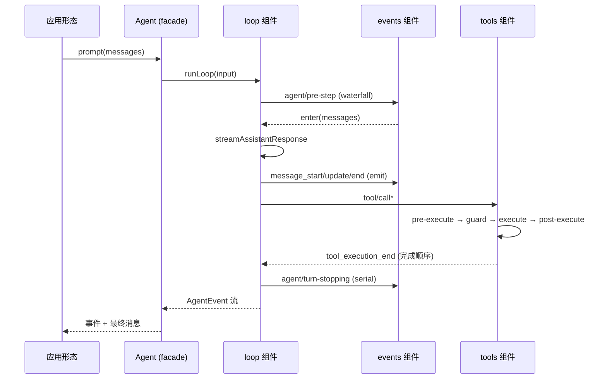
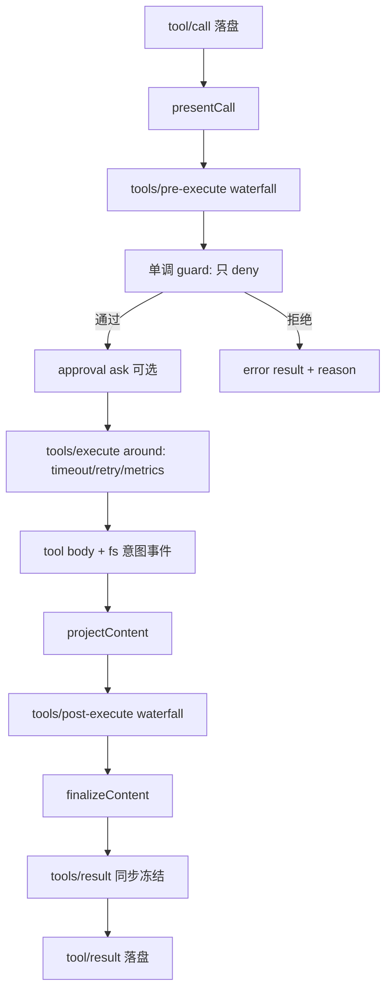

# Agent 框架设计（agent-framework）

> **目录定位**：`@zeta-agent/agent-framework` 的**内部组件与对外 facade**。由 loop/inbox/tools/decision/session/stream 等组件拼装，构建在通用框架 facade 之上；零内置工具、零 provider、零持久化。
> **所属索引**：[总索引](../README.md)　|　**架构依据**：[architecture/framework-model.md](../architecture/framework-model.md)

## 文档清单

| 文档 | 内容 | 粒度 |
| --- | --- | --- |
| [overview.md](./overview.md) | 定位、包边界与依赖、facade 出口 | 总览 |
| [runtime.md](./runtime.md) | 公开 API、AgentPlugin 管线、runLoop、取消与中断 | 运行时 |
| [tools-and-policies.md](./tools-and-policies.md) | 顺序敏感、工具流水线、权限与沙箱 hook | 工具与策略 |
| [state-and-events.md](./state-and-events.md) | 事件协议、状态管理、模型 broker、不变量与风险 | 状态与事件 |

## 时序图（一次 prompt 的完整链路）

## 活动图（工具流水线）

## 跨目录关系

- 上游：[architecture/framework-model.md](../architecture/framework-model.md)、[framework](../framework/README.md) 的 facade。
- 下游：[agent/plugin-system.md](../agent/plugin-system.md) 用插件装配出具体 agent；[agent/tui.md](../agent/tui.md) 订阅事件。
- 不变量清单：[research/pi-baseline.md](../research/pi-baseline.md) 与 [state-and-events.md](./state-and-events.md)。
