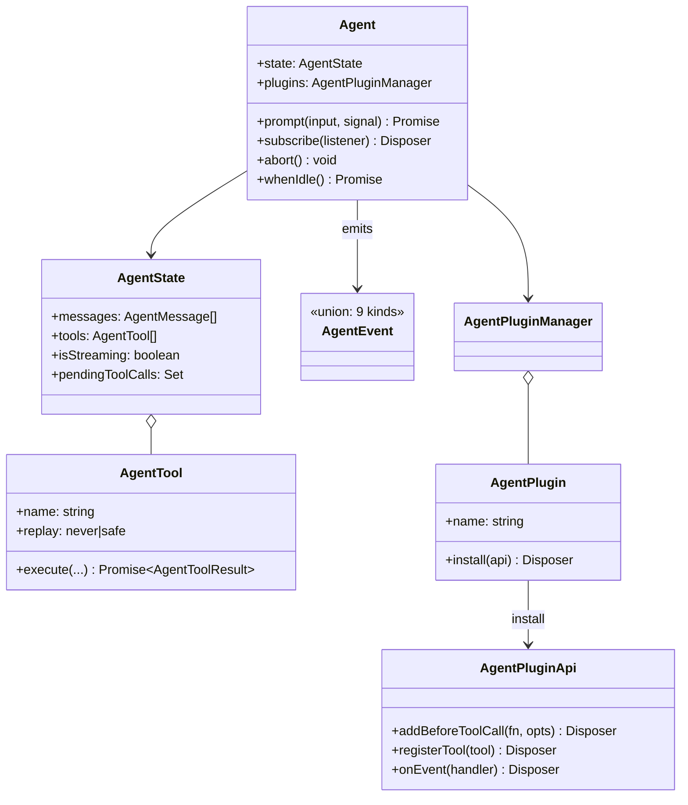
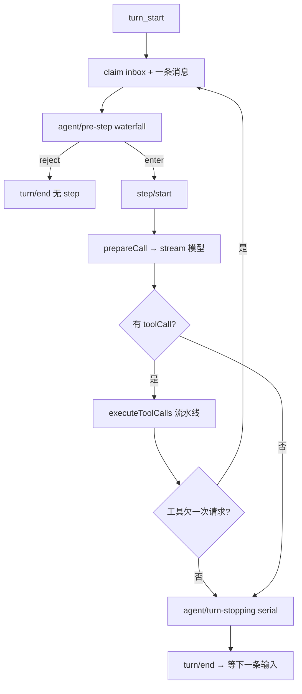

# 运行时：API、插件管线与 loop

> **文档定位**：运行时：API、插件管线与 loop（从 `05-Agent开发框架层设计.md` 拆分/重命名而来，内容保持原样，链接已按新结构重写）。
> **所属索引**：[本目录索引](./README.md) · [总索引](../README.md)
> **来源分级**：一手来源为 [在线论文](https://arxiv.org/abs/2608.25512v1) 与 [GitHub 源码](https://github.com/earendil-works/pi)（逐文件链接见正文）；汇总见 [事实登记](../architecture/fact-registry.md)。

## 目录

- [3 公开 API 草案](#3-公开-api-草案)
- [4 AgentPlugin 管线：替代 monkey-patch](#4-agentplugin-管线替代-monkey-patch)
- [5 Agent loop 作为 effect iterator](#5-agent-loop-作为-effect-iterator)
- [6 取消与中断](#6-取消与中断)

## 3 公开 API 草案

### 3.1 事件协议（保持 10 种事件，原样语义）

```ts
export type AgentEvent =
  | { type: "agent_start" }
  | { type: "agent_end"; messages: AgentMessage[] }
  | { type: "turn_start" }
  | { type: "turn_end"; message: AgentMessage; toolResults: ToolResultMessage[] }
  | { type: "message_start"; message: AgentMessage }
  | { type: "message_update"; message: AgentMessage; assistantMessageEvent: AssistantMessageEvent }
  | { type: "message_end"; message: AgentMessage }
  | { type: "tool_execution_start"; toolCallId: string; toolName: string; args: unknown }
  | { type: "tool_execution_update"; toolCallId: string; toolName: string; args: unknown; partialResult: unknown }
  | { type: "tool_execution_end"; toolCallId: string; toolName: string; result: unknown; isError: boolean; durationMs?: number };
```

> **P0 修订（[10 CORE-1](../research/dsh-optimizations.md#3-核心运行时优化core)）**：事件**派发模式是一等契约**，不再默认全部按序 await。定义 `DispatchMode = 'emit'|'parallel'|'serial'|'bail'|'waterfall'`。建议映射：`message_end`/`tool_execution_end`→`emit`（快速通知）、`beforeToolCall`/`afterToolCall`/`prepareRequest`→`waterfall`（around + `next()`，缺 next 短路）、`agent_end` 屏障→`serial`（依次 await）。
>
> **来源校正（[cordis 源码验证](../research/cordis-source-verification.md)）**：五模式本身是 cordis 官方事实（`packages/core/src/events.ts`）；但**`@mode` 装饰器是 deepseek-harness 变体的做法，官方不存在**。官方静态约束来自 `interface Events` 的 TypeScript 声明合并 + `@ts-expect-error` 类型测试。我们采用声明合并方案，`@mode` 仅作变体参考。`parallel` 模式须用 `Promise.allSettled` 聚合成 `AggregateError`（官方行为），不要简单 `Promise.all`。

保持两条铁律（[pi-baseline §9](../research/pi-baseline.md#9-重构必须保留的不变量清单)）：

- `tool_execution_end` 按**完成顺序** emit；toolResult 消息与 `turn_end.toolResults` 按 **assistant 源码顺序**落盘。
- assistant `message_end` 是工具 preflight 前的屏障。

### 3.2 状态

```ts
export interface AgentState {
  readonly systemPrompt: string;                 // 由 transcript system 消息回放
  model: Model<Api>;
  thinkingLevel: ThinkingLevel;
  tools: AgentTool<any>[];                       // 赋值 slice() 拷贝
  messages: AgentMessage[];                      // 赋值 slice() 拷贝
  readonly isStreaming: boolean;
  readonly streamingMessage?: AgentMessage;
  readonly pendingToolCalls: ReadonlySet<string>;
  readonly errorMessage?: string;
}
```

`CustomAgentMessages` declaration merging 保留；`AgentMessage = Message | CustomAgentMessages[keyof ...]`。

### 3.3 工具

```ts
export interface AgentTool<P extends object = object, D = any> extends Tool<P> {
  label: string;
  prepareArguments?: (args: unknown) => Static<P>;
  outputSchema?: object;                         // 机器可读、不发模型
  execute(id: string, params: Static<P>, signal?: AbortSignal, onUpdate?: (r: D) => void): Promise<AgentToolResult<D>>;
  replay?: "never" | "safe";                     // 交给持久化插件的语义钩子
  executionMode?: "sequential" | "parallel";
  exposure?: "direct" | "model-only" | "codemode" | "deferred" | "hidden"; // 借鉴 coding-agent
  namespace?: string;
  defaultActive?: boolean;
}
```

`AgentToolResult` 保持 `content/details/structuredContent?/usage?/isError?/terminate?`。参数类型通过 `Static<P>` 推导，不绑定具体 schema 库（pi 的测试已验证 TypeBox 形状兼容而 core 不依赖 TypeBox）。

### 3.4 Agent 类与插件

```ts
export class Agent {
  readonly state: AgentState;
  readonly plugins: AgentPluginManager;           // 新增：有序管线
  subscribe(listener: (event: AgentEvent, signal?: AbortSignal) => void | Promise<void>): () => void;
  prompt(messages: AgentMessage[] | string, signal?: AbortSignal): Promise<AgentMessage[]>;
  continue(signal?: AbortSignal): Promise<AgentMessage[]>;
  steer(messages: AgentMessage[]): void;          // QueueMode
  followUp(messages: AgentMessage[]): void;
  abort(): void;
  waitForIdle(): Promise<void>;
  reset(): void;
}

export interface AgentPlugin {
  readonly name: string;
  readonly version?: string;
  install(api: AgentPluginApi): void | (() => void);  // 返回 disposer = 逆
}

export interface AgentPluginApi {
  registerTool(tool: AgentTool<any>): () => void;
  onEvent(handler: (event: AgentEvent, signal?: AbortSignal) => void | Promise<void>): () => void;
  addConverter(fn: Converter): () => void;
  addContextTransform(fn: ContextTransform): () => void;
  addBeforeToolCall(fn: BeforeHook): () => void;
  addAfterToolCall(fn: AfterHook): () => void;
  addTurnBoundary(fn: FinishTurn): () => void;
  addPrepareRequest(fn: PrepareRequest): () => void;
  addPrepareNextTurn(fn: PrepareNextTurn): () => void;
  provideSteering(source: QueueSource): () => void;
  provideFollowUp(source: QueueSource): () => void;
  provideStreamFn(fn: StreamFn): () => void;
  declareToolLoadout(tools: AgentTool<any>[]): void; // 对齐 transcript 声明
  useContext(): CoreContextLike | undefined;        // 注入的 ctx（若有）
  readonly events: EventBus;                        // 插件间共享事件总线
}
```

**每个注册都返回 disposer**——这是论文 revertible effect 的直接落地（[cordis-paper §4](../research/cordis-paper-theory.md#4-可撤销效应revertible-effects)）：插件卸载时，逆按 LIFO 撤销它的全部注册。若上层注入了 `ctx`，插件也可用 `ctx.effect` 把这些注册纳入 fiber 生命周期，实现 agent 插件的热重载。


## 4 AgentPlugin 管线：替代 monkey-patch

### 4.1 问题

pi 的上层用链式 monkey-patch：

```ts
const previous = this.agent.prepareRequest;
this.agent.prepareRequest = (req, signal) => { /* 新逻辑 */; return previous?.(req, signal); };
```

问题：顺序隐式、卸载困难、多次包装产生深链、与 fiber 生命周期无关。

### 4.2 方案

`AgentPluginManager` 维护**按注册顺序排列的 hook 数组**，`runLoop` 只调用组合后的集合：

```ts
type HookChain<T> = {
  add(fn: T, priority?: number): Disposer;          // priority 决定顺序，默认注册序
  run(input: Input, signal?: AbortSignal): Promise<Input>;  // 依次 await
};
```

规则：

1. **顺序确定**：`priority` 数值升序，同值按注册顺序；组合结果可打印为插件名列表，便于调试"谁在改我的上下文"。
2. **await 屏障**：每个 hook 都 `await`；与 pi 的 listener 屏障语义一致。
3. **no-throw 契约**：hook 必须返回安全回退值而非抛错（沿用 pi 的约定，[pi-baseline §9](../research/pi-baseline.md#9-重构必须保留的不变量清单) 第 6 条）；抛错被归一化并产生 `isError` 事件。
4. **可逆**：每个 `add` 返回 disposer，按 LIFO 撤销。
5. **兼容层**：保留 `agent.prepareRequest = fn` 等字段赋值形式，内部转换为一个名为 `legacy:<field>` 的插件（优先级最低），老调用方零改动。

### 4.3 与 fiber 的关系

插件可以作为 fiber 安装：

```ts
const fiber = ctx.use(agentPluginComponent, { plugin: myPlugin, agent });
// fiber.apply 中：api.registerTool(...) → yield 逆；ctx.effect 自动跟踪
```

于是"热重载一个工具/权限/提示词插件"与"热重载一个普通组件"是同一套机制（[framework §7](../framework/core-semantics.md#7-生命周期状态机)）。这是 pi 两套扩展系统（coding-agent `ExtensionAPI` 与 durable `Extension/Registry`）的统一答案：两者都变成 `AgentPlugin` + fiber。


## 5 Agent loop 作为 effect iterator

### 5.1 映射

论文的 effect iterator（[cordis-paper §4.3](../research/cordis-paper-theory.md)）`ℑΓ = Γ → Γ × (Γ→Γ) × Maybe(ℑ)` 在 agent 里对应：

| 论文概念 | agent 对应 |
| --- | --- |
| 一次迭代 | 一个 turn（或一次工具调用） |
| 正向变换 `f` | 向 transcript 追加消息、更新 state |
| 产出的逆 `g` | 撤销该 turn 的状态变更（用于回滚/重试） |
| 续延 `Just(i′)` | 下一轮（有工具调用 / steering / follow-up） |
| `Nothing` | `{action:"end"}` 或硬退出 |
| guard / 迭代边界 | `AbortSignal` 与"target 稳定性检查" |

**关键限制**：transcript 与工具副作用不可物理回滚（论文的 observation equivalence，[cordis-paper §6.2](../research/cordis-paper-theory.md)）。因此 agent 的逆只撤销**框架内部状态**（pendingToolCalls、streamingMessage、临时 tool loadout），不撤销已发射的 AssistantMessage 或工具外部副作用。 external 副作用按 [plugin-system §6](../agent/plugin-system.md#6-工具副作用的边界分类) 处理。

### 5.2 runLoop 伪代码（保持 pi 顺序）

```ts
async function* agentIterator(input: AgentInput, api: AgentPluginApi): EffectIterator {
  let lastCompletedTurn;
  let explicitContinuation = false;
  let pending = [...(await api.pollSteering())];
  while (true) {
    while (hasMoreToolCalls || pending.length) {
      if (lastCompletedTurn) {
        const update = await api.prepareNextTurn(lastCompletedTurn);  // 插件链
        apply(update);
        pending.push(...(await api.pollSteering()));                  // 再轮询一次
        emit({ type: "turn_start" });
      }
      for (const msg of declareToolChanges([...prepared, ...pending])) {
        emit({ type: "message_start", message: msg });
        emit({ type: "message_end", message: msg });
        appendToTranscript(msg);
      }
      pending = [];
      const request = await api.prepareRequest(buildRequest(), signal); // 不轮询队列
      const assistant = await streamAssistantResponse(request, signal); // 映射事件
      if (assistant.stopReason === "error" || assistant.stopReason === "aborted") {              // 硬退出
        const decision = await api.finishTurn(turn, signal);
        emit({ type: "turn_end", ... }); emit({ type: "agent_end", messages }); return;
      }
      const toolCalls = assistant.content.filter(c => c.type === "toolCall");
      const results = assistant.stopReason === "length"
        ? failAll(toolCalls)                                            // 截断一律不执行
        : await executeToolCalls(toolCalls, api, signal);
      appendToolResultsInSourceOrder(results);                          // 与完成顺序解耦
      lastCompletedTurn = { message: assistant, toolResults, context, newMessages };
      const decision = await api.finishTurn(lastCompletedTurn, signal);
      emit({ type: "turn_end", message: assistant, toolResults });
      if (decision?.action === "end") { emit({ type: "agent_end", messages }); return; }
      explicitContinuation = decision?.action === "continue";
      pending.push(...(await api.pollSteering()));
      if (toolCalls.length || pending.length) explicitContinuation = false;
    }
    const followUps = await api.pollFollowUp();
    if (followUps.length) { pending = followUps; continue; }
    if (explicitContinuation) { await oneContextOnlyRequest(signal); }
    else break;
  }
  emit({ type: "agent_end", messages });
}
```

**注意**：上述顺序必须与 [pi-baseline §4.3](../research/pi-baseline.md#4-earendil-workspi-agent-core极简-agent-运行时) 的 11 步逐字对应；任何改动都需要 §13 的等价测试。


## 6 取消与中断

- `signal` 贯穿 `prompt/continue/stream/executeToolCalls/hooks/subscribe`；abort 时 `streamFn` 产出 `stopReason:"aborted"`，工具在 `prepare` 与执行前各检查一次（pi 的 `agent-loop.ts:716-724, 623-631`）。
- `AgentPlugin` 的 hook 收到 signal；长时间 hook 必须配合。
- abort 与 `error` 都是**硬退出**，不能被 `finishTurn` 的 continue 推翻。
- 若上层注入了 ctx，`ctx.effect` 的 `armed` 门控可同时停止在途迭代（[framework §4](../framework/core-semantics.md#4-核心原语-ctxeffect)）；这是"取消一个 agent turn"的统一路径。


## UML 视图

### 图 1：Agent 框架核心类型（类图）



### 图 2：runLoop 决策流（活动图）



## 文档关系

| 关系 | 文档 |
| --- | --- |
| 所属目录索引 | [./README.md](./README.md) |
| 全局索引 | [总索引](../README.md) |
| 事实来源 | [事实登记与交叉验证矩阵](../architecture/fact-registry.md) |
