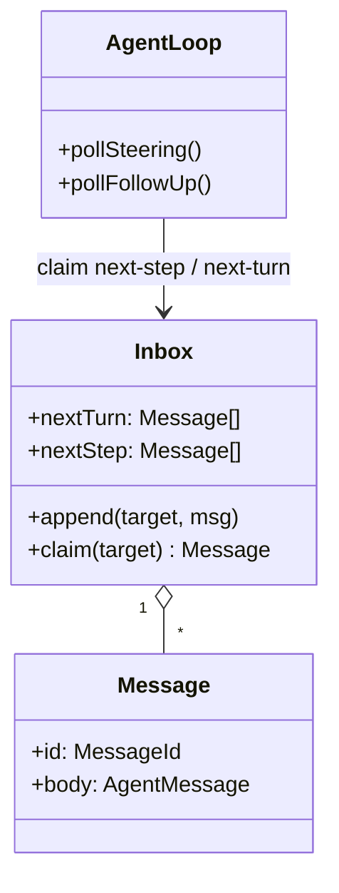
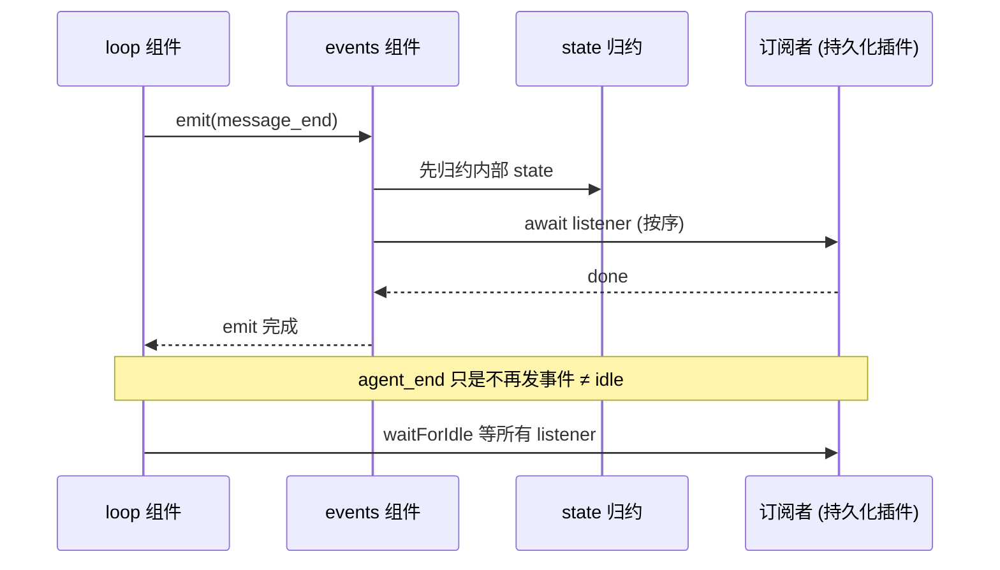

# 状态与事件：协议、持久化与模型服务

> **文档定位**：状态与事件：协议、持久化与模型服务（从 `05-Agent开发框架层设计.md` 拆分/重命名而来，内容保持原样，链接已按新结构重写）。
> **所属索引**：[本目录索引](./README.md) · [总索引](../README.md)
> **来源分级**：一手来源为 [在线论文](https://arxiv.org/abs/2608.25512v1) 与 [GitHub 源码](https://github.com/earendil-works/pi)（逐文件链接见正文）；汇总见 [事实登记](../architecture/fact-registry.md)。

## 目录

- [10 事件协议与屏障语义](#10-事件协议与屏障语义)
- [11 状态管理与持久化边界](#11-状态管理与持久化边界)
- [12 模型服务作为 broker](#12-模型服务作为-broker)
- [13 测试策略与不变量等价清单](#13-测试策略与不变量等价清单)
- [14 风险与开放问题](#14-风险与开放问题)
- [15 交叉引用与验证](#15-交叉引用与验证)

## 10 事件协议与屏障语义

- `subscribe(listener)` 按注册顺序 `await`；listener 收到当前 run 的 signal。
- `processEvents` 先归约 state，再 await listener——`pendingToolCalls` 等状态在事件发出时已经一致（pi e2e 测试 63-101）。
- `agent_end` ≠ idle；`prompt()`/`waitForIdle()` 等所有 listener 完成。持久化插件挂在这里做提交屏障（[pi-baseline §4.3](../research/pi-baseline.md#4-earendil-workspi-agent-core极简-agent-运行时)）。
- 无 active run 时 listener 被调用应抛错（pi 的 `"Agent listener invoked outside active run"`），保留。
- 低层 API `runAgentLoop(emit)` / `AgentEventSink` 保留：只保序、不等待异步处理；需要屏障时用 `Agent` 类。

## 11 状态管理与持久化边界

- `state.tools/messages` 赋值时 `slice()` 拷贝；直接 push 到返回数组会改变当前 state（pi 语义，保留）。
- `systemPrompt` 由 transcript 回放得到；工具声明通过 `declareToolChanges` 以 delta 对齐（pi 测试 164/212/247/282）——**保持 system 消息是单一事实源**。
- 状态 mutator **不产生事件**（pi 测试 309-329）。
- `AgentTool.replay?: "never"|"safe"` 原样保留：这是论文"durable intent exists but outcome unknown"的语义钩子，交给持久化插件解释（[plugin-system §5](../agent/plugin-system.md#5-会话与持久化插件)）。

## 12 模型服务作为 broker

论文的 service broker（[cordis-paper-system §12.2](../research/cordis-paper-system.md#12-讨论边界复用权限语言与循环依赖)）对应：

- `StreamFn` 是唯一模型入口；provider 插件向 broker 注册实现；broker 对 agent 呈现稳定接口。
- 切换后端（如从 OpenAI 换到 Anthropic）只换 broker 内部 routing，**不触发工具/agent 重载**——与排他绑定形成对比。
- 跨进程 provider 必须走异步契约（论文警告同步暴露会阻塞调用方）。
- `onPayload/onResponse/onProviderStreamEvent` 是观察钩子，保留给遥测插件。

## 13 测试策略与不变量等价清单

**先于实现**：为 [pi-baseline §9](../research/pi-baseline.md#9-重构必须保留的不变量清单) 的 12 条每条写两个测试——`legacy` 版（字段赋值）与 `plugin` 版（管线），断言事件序列与状态一致。

**两组 12 条的命名区分（勿混淆）**：

- **agent-core 12 条**（本节清单，pi-baseline §9）：实现于 `packages/agent-framework/src/runtime/invariants.spec.ts`，测试名前缀 `inv-core-`，对应 roadmap A6。
- **工具流水线 12 条**（权限/依赖/终止等工具执行不变量）：实现于 `packages/agent-framework/src/tools/invariants.spec.ts`，测试名前缀 `inv-tool-`。

两组各有 12 条 × legacy/plugin = 24 个测试，但语义完全不同，A6 仅指 agent-core 组。

| # | 不变量 | 测试要点 |
| --- | --- | --- |
| 1 | assistant message_end 屏障 | preflight 前 listener 已完成 |
| 2 | 完成顺序 vs 源码顺序解耦 | 延迟工具完成顺序与 toolResult 顺序相反 |
| 3 | error/aborted 硬退出 | continue 无效 |
| 4 | end 不清队列 | 队列保留、无 prepareNextTurn |
| 5 | continue 保证一次请求 | 已有自然请求时不叠加 |
| 6 | hook no-throw | 抛错被归一化，有安全回退 |
| 7 | streamFn 不抛错 | 失败走流协议 |
| 8 | 迟到 onUpdate 丢弃 + durationMs 边界 | settle 后更新忽略 |
| 9 | core 无持久化/provider 依赖 | 依赖图检查 |
| 10 | terminate 全批次规则 | 混合批次继续 |
| 11 | runToolCall 走 hooks 无事件 | 嵌套调用的 hook 序列 |
| 12 | system 消息单一事实源 | 声明 delta 对齐 |

额外新增（插件化特有）：

- 插件注册/卸载的 LIFO 逆序断言；
- 插件顺序冲突（环）检测；
- 同 id 工具插件替换后 transcript 声明同步更新；
- 插件版 hook 与 legacy 版行为等价（同一输入事件序列）。

## 14 风险与开放问题

| 风险 | 缓解 |
| --- | --- |
| 顺序漂移（最大风险） | §13 等价测试先于实现；组合结果可打印 |
| 插件管线与字段赋值双轨导致分叉 | legacy 统一转为名为 `legacy:*` 的插件，只有一条执行路径 |
| 插件卸载时工具正在执行 | 逆只撤销注册；在途执行持有旧工具引用直到完成（chord 的"旧工作跑旧代码"思想） |
| hook 链过长影响性能 | 链在 run 开始时编译为一个组合函数；实测基准后再优化 |
| 与 core fiber 双向依赖 | 仅类型导入 + 构造注入（§2） |

**开放问题**：
- O-7：插件 hook 的 `priority` 默认值与冲突解决策略？建议：默认 100，冲突时按注册顺序并报告（不静默）。
- O-8：`AgentPlugin.install` 返回的 disposer 是否自动注册为 `ctx.effect` 的逆？建议：注入 ctx 时自动，否则由调用方负责。

## 15 交叉引用与验证

| 本文设计 | 上游依据 | 下游验证 |
| --- | --- | --- |
| 10 事件 / 状态 / 工具类型 | [pi-baseline §4.2](../research/pi-baseline.md#4-earendil-workspi-agent-core极简-agent-运行时) | §13 等价测试 |
| runLoop 顺序 | [pi-baseline §4.3](../research/pi-baseline.md#4-earendil-workspi-agent-core极简-agent-运行时) | 逐条对照 |
| 插件逆注册 | [cordis-paper §4](../research/cordis-paper-theory.md#4-可撤销效应revertible-effects)、[framework §4](../framework/core-semantics.md#4-核心原语-ctxeffect) | LIFO 断言 |
| 顺序敏感声明 | [cordis-paper §7.2](../research/cordis-paper-theory.md) | 环检测测试 |
| 模型 broker | [cordis-paper-system §12.2](../research/cordis-paper-system.md#12-讨论边界复用权限语言与循环依赖) | 后端切换不 reload |
| 权限/intercept | [cordis-paper-system §12.3](../research/cordis-paper-system.md#12-讨论边界复用权限语言与循环依赖) | 策略热更新测试 |
| 会话插件落地 | [06](../agent/plugin-system.md) | 集成测试 |
| UI 事件消费 | [07](../agent/tui.md) | 帧快照 |
| 迁移阶段 | [08](../delivery/roadmap.md) | 阶段验收 |

**返回索引**：[00 索引与交叉验证](../README.md)

## UML 视图

### 图 1：inbox 双队列（对象图）

### 图 2：事件屏障语义（时序图）

## 文档关系

| 关系 | 文档 |
| --- | --- |
| 所属目录索引 | [./README.md](./README.md) |
| 全局索引 | [总索引](../README.md) |
| 事实来源 | [事实登记与交叉验证矩阵](../architecture/fact-registry.md) |
