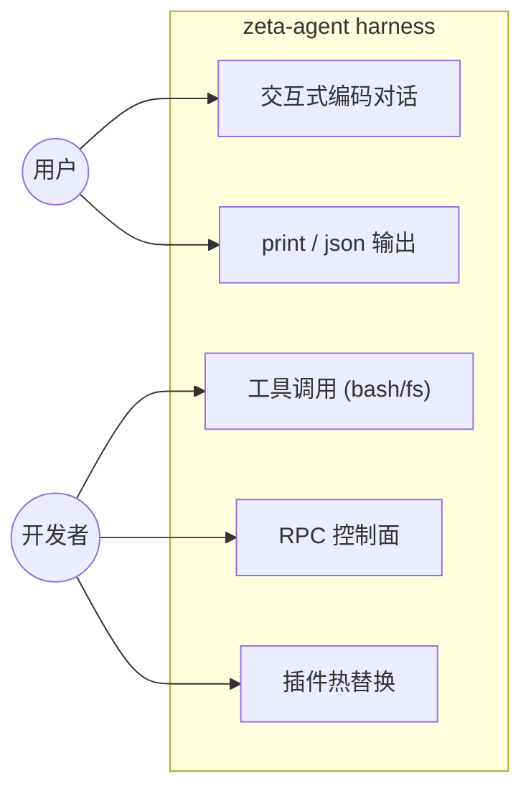
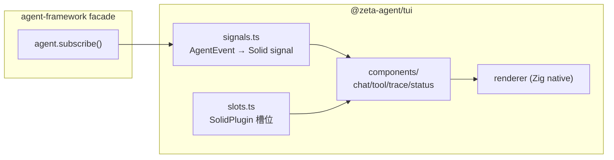

# Agent 实现与 TUI（agent）

> **目录定位**：用插件装配出**极简 harness**，以及用 OpenTUI/SolidJS 实现的终端界面。两者都是"应用形态"，只调用两个框架的 facade API，不深入内核组件。
> **所属索引**：[总索引](../README.md)　|　**框架依据**：[agent-framework](../agent-framework/README.md)

## 文档清单

| 文档 | 内容 | 粒度 |
| --- | --- | --- |
| [plugin-system.md](./plugin-system.md) | 插件清单、工具/技能/提示词/会话/权限/MCP/模式插件、装配流程、自演化安全 | 插件系统 |
| [tui.md](./tui.md) | OpenTUI Solid 架构、signal 桥、插件槽位、主题/快捷键、测试 | TUI |
| [security.md](./security.md) | 安全与多租户（缺口 4+3）：威胁模型、执行隔离、egress、凭证、审计、错误模型 | 缺口补全 |

## 用例图（极简 harness 当前做什么）

## 组件图（UI 插件槽位）

## 跨目录关系

- 上游：[agent-framework](../agent-framework/README.md) 提供 `createAgent()` 与事件；[framework](../framework/README.md) 提供 `ctx.slots`。
- 部署与运行形态：[architecture/engineering.md](../architecture/engineering.md)。
- 落地阶段：[delivery/roadmap.md](../delivery/roadmap.md)。
