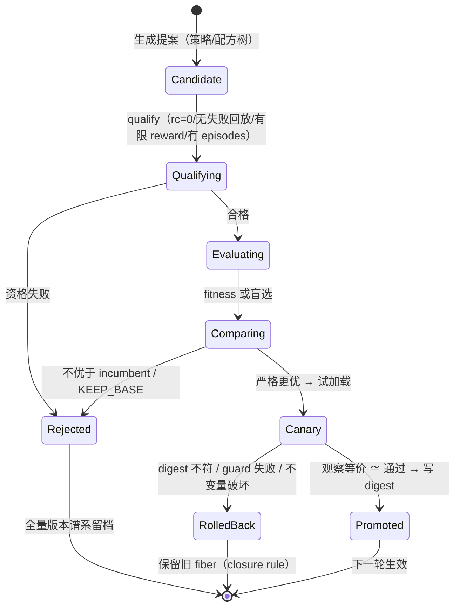
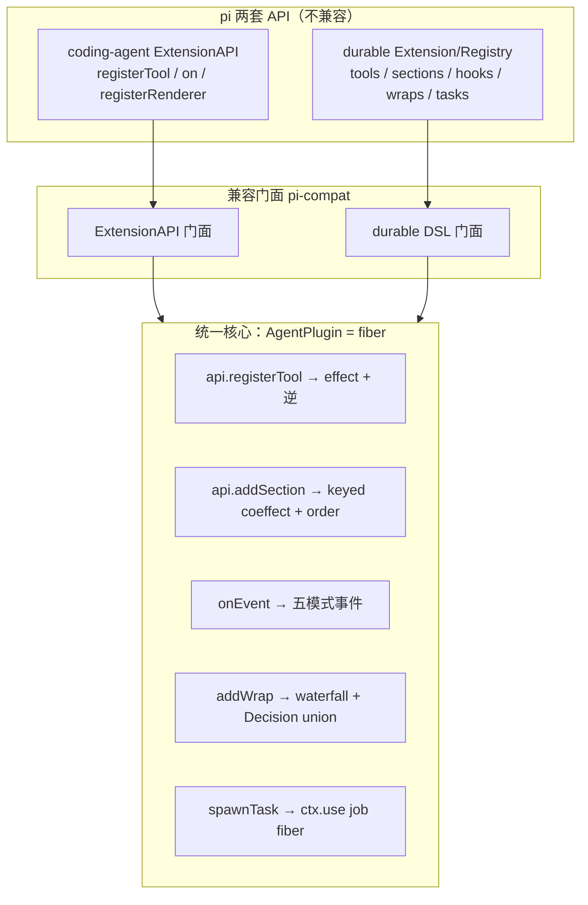

# Agent 插件系统

> **文档定位**：Agent 插件系统（从 `06-Agent实现层设计.md` 拆分/重命名而来，内容保持原样，链接已按新结构重写）。
> **所属索引**：[本目录索引](./README.md) · [总索引](../README.md)
> **来源分级**：一手来源为 [在线论文](https://arxiv.org/abs/2608.25512v1) 与 [GitHub 源码](https://github.com/earendil-works/pi)（逐文件链接见正文）；汇总见 [事实登记](../architecture/fact-registry.md)。

## 目录

- [1 定位：agent = 一组插件的装配](#1-定位agent-一组插件的装配)
- [2 插件清单与分类](#2-插件清单与分类)
- [3 工具插件：内置工具也走插件](#3-工具插件内置工具也走插件)
- [4 技能、提示词、主题插件](#4-技能提示词主题插件)
- [5 会话与持久化插件](#5-会话与持久化插件)
- [6 工具副作用的边界分类](#6-工具副作用的边界分类)
- [7 权限、信任与沙箱](#7-权限信任与沙箱)
- [8 自演化与安全管理](#8-自演化与安全管理)
- [9 MCP 与 provider 插件](#9-mcp-与-provider-插件)
- [10 模式插件（interactive / print / json / rpc）](#10-模式插件interactive-print-json-rpc)
- [11 装配流程](#11-装配流程)
- [12 两套扩展系统的统一](#12-两套扩展系统的统一)
- [13 风险与开放问题](#13-风险与开放问题)
- [14 交叉引用与验证](#14-交叉引用与验证)

## 1 定位：agent = 一组插件的装配

pi 的 `coding-agent` 把 agent-core + ai + tui + 扩展系统 + 内置工具 + 会话 + 模式编译成一个 CLI（[pi-baseline §5.3](../research/pi-baseline.md#5-earendil-workspi-coding-agent完整-cli-与扩展系统)）。我们把它拆成：

- `@zeta-agent/agent`：**只提供插件集合与装配函数** `createAgent(options)`；
- `apps/zeta-cli`：只做参数解析、登录、加载配置、启动；不含业务逻辑（[framework-model/engineering §4.4](../architecture/framework-model.md)）。

**核心命题**：pi 中已经插件化的东西（工具、provider、MCP、命令、渲染、事件、资源路径）继续是插件；pi 中**硬编码**的东西（内置工具、模式、CLI 子命令、压缩策略、会话存储、资源解析器）也改造为插件（[pi-baseline §8](../research/pi-baseline.md#8-已插件化-vs-仍硬编码)）。


## 2 插件清单与分类

按论文"万物皆插件"的三类划分：

| 类别 | 插件 | 对应 pi 机制 | 可交换性 |
| --- | --- | --- | --- |
| **工具插件** | `builtin:read/bash/edit/write`, `codemode`, `tool-search`, `mcp__*`, 用户工具 | `registerTool` + builtin extensions | ✅ 唯一 id + 逆删除 |
| **服务插件** | `model:broker`, `session:store`, `skills:registry`, `prompts:registry`, `themes:registry`, `memory` | `registerProvider` / resource loader / durable docs | ✅ 注册表 compose |
| **策略插件** | `permissions`, `trust`, `compaction`, `prompt-sections`, `tool-hooks` | `beforeToolCall`/`afterToolCall`、`session_before_compact` | ❌ 显式顺序 |
| **模式插件** | `mode:interactive`, `mode:print`, `mode:json`, `mode:rpc` | `AppMode` 联合类型 + if/else | ❌ 互斥，运行时选一 |
| **UI 插件** | TUI 组件/widget/footer/header 贡献 | `ExtensionUIContext` / `setWidget` | ✅ 槽位 |

每个插件都是一个 `AgentPlugin`（[agent-framework §4 AgentPlugin 管线](../agent-framework/runtime.md#4-agentplugin-管线替代-monkey-patch)）+ 可选的 fiber component（需要热重载/生命周期时）。


## 3 工具插件：内置工具也走插件

pi 的内置工具 `read/bash/edit/write` 是编译期 import + 字符串名数组（`core/tools/index.ts`、[sdk.ts:28-40](https://github.com/earendil-works/pi/blob/main/sdk.ts#L28-L40)、[agent-session.ts:3820](https://github.com/earendil-works/pi/blob/main/agent-session.ts#L3820)）。改造：

```ts
export const readTool = defineToolPlugin({
  name: "builtin:read",
  replaceable: true,
  tool: { name: "read", label: "Read file", parameters: obj({ path: str() }), execute: ... },
});
```

- 与 `codemode`/`tool-search`/`mcp` 一样是 `builtin:*` 插件，进 `BUILTIN_PLUGINS` 清单（替代硬编码数组）。
- `replaceable: true` + `omitReplacedPlugins()`：第三方插件同工具名时整包替换（pi 已有的 `omitReplacedExtensions()` 思路）。
- 工具描述、snippets、guidelines 通过 `@zeta-agent/framework` 注册表贡献给 system prompt section（[agent-framework §7](../agent-framework/tools-and-policies.md#7-顺序敏感部分中间件与提示词)）。
- `exposure`（direct/model-only/codemode/deferred/hidden）、`namespace`、`defaultActive`、`prepareLoadout` 全部保留。
- 工具执行中的资源获取（打开文件句柄、建立 watch）通过 `ctx.effect` 跟踪；卸载工具插件时逆自动撤销注册与资源（[framework §4](../framework/core-semantics.md#4-核心原语-ctxeffect)）。

**工具热插拔**：`agent.plugins.registerTool()` 返回 disposer；若用 fiber 安装，则 `ctx.use(toolComponent, config)` 的 deactivate 自动撤销工具声明，并通过 `declareToolLoadout()` 更新 transcript 的 toolsAdded/toolsRemoved（pi 的 `declareToolChanges` 语义，[agent-framework §11](../agent-framework/state-and-events.md#11-状态管理与持久化边界)）。


## 4 技能、提示词、主题插件

pi 的 `SKILL.md`、`prompt templates`（Markdown + frontmatter）、`themes`（JSON + schema）由 `DefaultResourceLoader` 统一加载，扩展只能通过 `resources_discover` **追加路径**而不能换解析器（[pi-baseline §5.2](../research/pi-baseline.md)）。

改造为**注册表 + 解析器插件**：

| 资源 | 注册表键 | 解析器插件 | 贡献方式 |
| --- | --- | --- | --- |
| Skills | `@zeta-agent/skills:registry` | `parser:skill-md` | `ctx.set(registryKey, [...skills])`，watchable |
| Prompts | `@zeta-agent/prompts:registry` | `parser:prompt-md` | 同上 |
| Themes | `@zeta-agent/themes:registry` | `parser:theme-json` | 同上（TUI 消费） |
| Agents files | `@zeta-agent/agents:registry` | `parser:agents-md` | 同上 |

- 解析器本身是插件：`defineParserPlugin({kind:"skill", parse(source)})`，可替换（例如用 YAML 技能格式）。
- 发现路径来自 entry 配置 + 插件贡献（`resources_discover` 等价事件），**路径与解析器都插拔**。
- 版本通过 `accepts` 映射；格式不匹配 → 插件 `FAILED`，不破坏其他资源。
- 主题/翻译等由核心插件提供（chord 的 `chord.themes` / `chord.translations` 模式），TUI 通过槽位消费（[07](./tui.md)）。


## 5 会话与持久化插件

pi 有两套持久化：`SessionManager`（JSONL 会话树，coding-agent）与 `pi-durable`（多后端 + 文档 + 任务）。统一为**会话插件 + storage 插件**：

```ts
export interface SessionPlugin extends AgentPlugin {
  readonly storage: StorageAdapter;              // jsonl | sqlite | indexeddb | memory（借鉴 durable）
  append(entry: ConversationEntry): Promise<void>;
  commit(tx: (draft) => void): Promise<Commit>;
  transcript(): Promise<AgentMessage[]>;
}
```

- 会话事件挂在 `agent_end` 的 **awaited listener** 上（pi 的屏障语义，[agent-framework §10](../agent-framework/state-and-events.md#10-事件协议与屏障语义)），保证落盘先于 `prompt()` resolve。
- `AgentTool.replay?: "never"|"safe"` 由会话插件解释（论文"意图存在但结果未知"的重放语义，[core-semantics §7.4 FAILED 与取消](../framework/core-semantics.md#74-失败与取消)）。
- 压缩策略也是插件：`addTurnBoundary` + `addContextTransform`，pi 的 `session_before_compact` 保留为插件事件。

### 5.1 Typed recap 与压缩事务（CT-2/CT-3/CT-8，来源 [harness-optimization-papers.md §3.2-3.3](../research/harness-optimization-papers.md#3-you-dont-need-long-context压缩与-sssm)）

压缩产物**不是自由文本摘要，而是 typed recap schema**——论文 Appendix A/G 实证"良好压缩是为后续执行精心挑选的简报，而非叙事摘要"：

```ts
interface SemanticRecap {
  objective: string;                       // 逐字/近逐字任务副本（属 system 单一事实源）
  establishedFacts: { text: string; kind: 'observation' | 'unverified' }[]; // 严格区分
  appliedChanges: { file: string; what: string; verified: boolean }[];
  verification: { check: string; result: string }[];
  deadEnds: string[];                       // 不要重复的失败路径
  remainingPlan: string[];                  // 有序子目标 + 立即下一步 + 完成条件
  narrowRetrieveCommand?: string;           // 内容被截断时给窄命令取回，而非 dump 全文
}
```

**压缩事务**：surface `replace` 先经 Offloader（AS-9）把待裁剪块外置为 `workspace:///` URI，再原子替换为带指针的 recap 节点；session 记录压缩血缘（threshold / recap / URI 列表 / 压缩前 token 数）支持审计；压缩纳入 `agent_end` 的 awaited listener 屏障，落盘先于 `prompt()` resolve。压缩后 replay：工具结果若能由 `(kind,key)` 幂等重建则标 `safe`，否则其**已验证事实必须写入 recap**。

**两种模式**：默认 **EoCC**（阈值触发，对应 `compactionThreshold`），实验性 **SAC**（每动作一次，峰值上下文降到 7–9K）——两模式共享同一 recap schema。约束：压缩阈值必须与 `maxOutputBytes` 联动（论文中 Qwen 3 Coder Next 因 verbose 轨迹在紧阈值下崩塌）。语义状态必须是**可解释自然语言**（SSSM 的核心），不塞进不可解释的向量。

> 注意：论文明确"良好压缩 ≠ 长上下文无用"——长输入任务的收益主要来自**选择性读取**而非压缩（CT-9：一等工具 `doc-read` 6000/8000 有界窗口 + `grep -n` + `doc-stats`）。且 evidence store（研究轨）**禁止有损摘要**（SE-M2：Meta-Harness Table 3 实证 Summary 档 38.7 反低于 Scores-only 41.3）。
- 会话是 coeffect provider（`@zeta-agent/session:store`），agent 的提示词插件声明依赖它；store 更换时依赖方按 target/committed view 自动重激活（[cordis-paper §5.2](../research/cordis-paper-theory.md)）。


## 6 工具副作用的边界分类

论文 §12.1（[cordis-paper-system §12.1](../research/cordis-paper-system.md#12-讨论边界复用权限语言与循环依赖)）的"获取 / 发射"是工具设计的硬约束：

| 类别 | 工具动作 | 自动撤销？ | 处理方式 |
| --- | --- | --- | --- |
| 获取 | `read` 打开文件句柄、建立 watch、注册监听器、建连接池 | ✅ | 放进 `ctx.effect` 的 yield 逆，fiber 卸载时撤销 |
| 发射 | `bash` 执行命令、`write` 写外部文件、发消息、调外部 API | ❌ | 视为 `idΓ`；需 **withhold** 或 **compensation** |
| 混合 | 打开 scratch 文件后写入 | 部分 | 获取可撤；写入走补偿（删除文件） |

**实现规则**：

- 工具插件在 `execute` 中只能把"获取"注册为 `ctx.effect`；若把"发射"的补偿放进逆，必须显式声明 `compensate: true`，并由应用提供观察等价 `≃`（论文的补偿要求比 `≃` 更粗的等价，需重新证明交换性）。
- `bash`/`write` 类工具的默认策略是 **withhold**：在 turn 确定提交后才执行发射（类似 output commit），或让用户审批后执行。
- **P0 修订（[10 SUP-1/2](../research/dsh-optimizations.md#5-域层与治理优化sup)）**：withhold 不是布尔开关，而是 `effects` 服务插件的机制——**领域事务内 `enqueue(kind,key,payload)`（durable intent），commit 后才由 adapter 派发**；`(kind,key)` 唯一、保留 `seq` 队列位置、`generation` 守卫防误删、指数退避、`Later` 表示正常等待不算失败、幂等键 + receipt 达成"事实上一次"。这同时实现了 `AgentTool.replay: "never"|"safe"` 的"意图存在但结果未知"语义。core 保持无 I/O，`effects` 放在 `@zeta-agent/agent` 服务插件层。
- 这与 pi 现状不同（pi 无权限系统，工具直接以用户权限运行，[01 README 权限段]）——是我们引入的**新语义**，属于设计推断，需用户确认策略默认值。


## 7 权限、信任与沙箱

pi 明确无内置权限系统（README：以启动用户权限运行）。论文给出三层方案（[cordis-paper-system §12.3](../research/cordis-paper-system.md#12-讨论边界复用权限语言与循环依赖)）：

1. **能力式门禁**：`ctx[key]` 只允许访问声明过的依赖；未声明访问抛错。`inject` 声明 = capability request，可在加载前审查。
2. **拦截做细粒度策略**：`ctx.intercept(key, metadata)` 给依赖附加元数据（文件系统路径白名单、数据库只读），provider 在调用时 consult；**拦截增删不触发 reload**。
3. **外部沙箱**：不可信代码用 QuickJS/WASM（pi 的 codemode）、独立进程或容器；host 侧 bridge 是普通 fiber，能力可衰减。

`permissions` 插件实现为 `beforeToolCall` 链 + `ctx.intercept` 元数据：

```ts
definePlugin({
  name: "@zeta-agent/agent/permissions",
  order: ["@zeta-agent/framework/capability-check", "self"],  // 顺序敏感，显式声明
  install(api) {
    const d = api.addBeforeToolCall(({ toolCall, args }) => {
      const policy = api.useContext()?.intercept(policyKey, ...);
      return policy.allows(toolCall.name, args) ? undefined : { block: true, reason: "denied" };
    });
    return () => d();
  },
});
```

- 信任门控（pi 的 `project-trust.ts`）作为启动期插件，与 `\u001b` 命令审批一起工作。
- 沙箱插件复用 `pi-codemode` 的 QuickJS/WASM 思路：模型生成的 JS 在沙箱里运行，**唯一能力是调用注入的工具**（[pi-baseline §7 codemode](../research/pi-baseline.md#7-生态包ai-durable-schema-mcp-env-codemode-telemetry-evals)）。


## 8 自演化与安全管理

论文结论把 self-evolving agent harness 列为首要未来方向（[cordis-paper-system §14](../research/cordis-paper-system.md#14-与本项目目标的关系)）：agent 持续生成并替换自身 harness 组件。我们的架构已具备前提（fiber 可卸载、依赖反应式重激活、汇合性保证），但**第一版只做受控自演化**：

| 能力 | 状态 | 机制 |
| --- | --- | --- |
| 运行时加载新工具/技能插件 | ✅ 支持 | `ctx.use` + entry reconciliation |
| 运行时卸载/替换插件并显式回滚 | ⚠️ 受控 | `ctx.effect` 逆 + LIFO + guard；build/evaluate 失败保留旧 artifact，apply 失败目标 fiber 留 FAILED |
| 依赖方自动重激活 | ✅ 支持 | target/committed view + notify |
| agent 自己写插件代码并加载 | ⚠️ 受控 | 必须经过：沙箱构建 → 静态环检测 → 权限审查 → 试加载（可回滚）→ 人工/策略批准后才持久化 |
| 失败自修改自动重试 | ✅ 下次变更重试 | apply 失败留 FAILED；下次文件变更触发重试，不自动回滚 |

**安全护栏**：

1. 生成的代码在沙箱中构建/求值（chord 的 `vm.Script` + 无 module cache 思路，[framework §8](../framework/components.md#8-组件加载器与-hmr)）；
2. 依赖环静态检测（[framework-model/engineering §6.3](../architecture/framework-model.md)）；
3. 新插件的 `inject` 声明即 capability 清单，编排器审查后才批准；
4. build/evaluate/exports 失败 → 保留旧 committed artifact；apply 失败 → 仅目标 fiber `FAILED`，下次文件变更重试；
5. 支持显式回滚：entry 记录变更前 digest，回滚 = 重新加载旧 digest 的 fiber；apply 失败不承诺自动回滚，critical root 可增加 shadow-apply/compensation。

> 关键风险：论文自己承认"一个错误自修改可能禁用恢复所需的进程"（[cordis-paper §2.3](../research/cordis-paper-theory.md)）。因此**必须先保证 loader/HMR 本身是不可替换的核心插件**（required root，chord 的 app root 模式），agent 只能替换普通插件。

### 8.1 递归自演化：研究轨预留

第一版产品只做上面的**受控热替换**。但论文把 self-evolving harness 列为首要方向，且两个新参考项目——[DREAM-RSI](../research/recursive-self-evolution.md#2-dream-rsi约束可变面的自演化) 与 [Harness²](../research/recursive-self-evolution.md#3-harness²harness-作为可编辑配方)——给出了"如何生成、评估、晋升并递归改进 harness"的完整机制（详见 [recursive-self-evolution.md](../research/recursive-self-evolution.md)）。框架必须**预留原语**，未来可插拔地装入，而不改框架本身。

**四个核心问题的答案（来自两个项目）**：

| 问题 | DREAM-RSI 的答案 | Harness² 的答案 | 我们的预留 |
| --- | --- | --- | --- |
| 改什么 | 只改单一决策文件 `method.py`，其余冻结 | 8 组件可编辑配方树 | `StrategyPlugin` 白名单 + `EditableSurface` 元契约 |
| 如何评估 | 冻结 trace + Eq.1 适应度（有分数） | 同任务行为对比 + 盲选（无 ground truth） | `fitness` seam + 无分数 `ProbeView` + 独立 judge |
| 如何晋升 | 资格门禁 + incumbent 参赛 + 严格更优 + sha256 | KEEP_BASE + confounded 优先 | `qualify → rank → promoteIfBetter` + digest |
| 如何防退化 | 单调改进 + 版本谱系 + RESUME | 预算恒等式 + 单次重试 + 全程 fallback | 原子替换 + 重放不变量 + 可审计 notes |

**关键结论**：两个项目都刻意避开运行时热替换（研究焦点是"改得对不对"）。**我们既有 fiber 热替换（切得安全），又需补"改得对不对"机制**——两者结合才是完整自演化设计。

### 8.2 晋升状态机（UML）



**晋升不变量**：① incumbent 永远参赛，只有严格更优才替换；② 晋升前后必须满足观察等价 `≃`（[cordis-paper §6.2](../research/cordis-paper-theory.md#6-上下文范式context-paradigm)）；③ Thm 80 的汇合判据不覆盖 emissions，晋升只改变配置、不改变已发射副作用；④ 任一失败保留旧 fiber 且全量留档可审计。

### 8.3 递归控制护栏

- **可演化面白名单**：agent 只能改 `StrategyPlugin.editable` 列出的文件；loader/HMR/fiber 核心/capability gate 是 required root，绝对不可替换；
- **递归深度/频率上限**：每轮 `maxAttempts` 与全局 `maxCycles` 双重预算，防止自修改无限递归或禁用恢复路径；
- **stage-scoped 权限**：探索阶段最小权限（files only），学习阶段加 shell，emission 工具走 withhold；
- **防 ground truth 泄漏**：grader verdict / rubric / score 不得进入改进上下文，tripwire 命中即抛错（SE-H8）；
- **经验库隔离**：per-domain 且 per-mode 各持一个 ExperienceLibrary，只读更早任务（SE-H10），避免跨租户/跨模式污染。

> 完整 28 条建议（SE-D1..12、SE-H1..16）见 [recursive-self-evolution.md §5](../research/recursive-self-evolution.md#5-对现有设计的优化建议)。研究轨落地批次见该文 §6；默认产品 profile 不启用自动代码生成，完整路线实现研究轨但保持默认禁用。


## 9 MCP 与 provider 插件

- MCP：pi 的 `createMcpExtension()` 把 MCP server 的工具注册为 `mcp__<server>__<tool>`，监听 `session_start/before_agent_start/tool_call/turn_start/mcp_servers_change/session_shutdown`（[pi-baseline §5.2](../research/pi-baseline.md)）。我们做成 `mcp` 插件：server 配置是一个 coeffect（`@zeta-agent/mcp:servers`），工具注册是逆可撤销的 effect，server 变化时工具自动重激活。
  **实现状态（2026-11-25）**：`packages/agent/src/plugins/mcp/` 已实现 initialize/initialized 握手、JSON-RPC 取消与超时、stdio/HTTP+SSE/socket transport、OAuth grant（复用 T-14 CredentialBroker）、tools_changed generation/debounce、resources/prompts/roots 与 inputSchema/outputSchema 双结果投影；复用权限门禁、withhold/durable、egress 默认拒绝与 ExecutionBackend 会话绑定。证据：`packages/agent/src/plugins/mcp/{protocol,transport,connection,oauth-grant,plugin-projection,conformance,mcp-e2e}.spec.ts`。MCP 默认不装配；真实 OAuth token endpoint 与 stdio/socket 字节传输仍由宿主注入，provider function-calling schema 对动态工具的投影按最终 active registry 生成。
- Provider：`registerProvider`/`registerNativeProvider`/`registerVirtualModel` 保留；底层走 `@zeta-agent/agent-framework` 的 `StreamFn` broker（[agent-framework §12](../agent-framework/state-and-events.md#12-模型服务作为-broker)）。模型目录由生成式 catalog + `accepts` 版本映射管理。


## 10 模式插件（interactive / print / json / rpc）

pi 的 `AppMode` 是联合类型 + if/else 分派（[pi-baseline §8](../research/pi-baseline.md#8-已插件化-vs-仍硬编码)）。改造为**模式插件**：

```ts
export interface ModePlugin extends AgentPlugin {
  readonly name: "mode:interactive" | "mode:print" | "mode:json" | "mode:rpc" | (string & {});
  run(session: AgentSessionLike, ui: UIPluginHost): Promise<number>;  // 退出码
}
```

CLI 按参数选择并加载一个模式插件；其余模式插件不加载（互斥）。这样新增模式无需改 CLI 主流程。`print/json/rpc` 模式不加载 TUI 插件，保证无终端环境下完整可用（[framework-model/engineering §9](../architecture/engineering.md#9-运行形态cli-sdk-rpc-静默模式)）。


## 11 装配流程

```
apps/zeta-cli/main.ts
  → parseArgs() → 选 ModePlugin
  → createLoader(config entries)          # @zeta-agent/framework
  → loader.load()                         # 并行加载 modules；fiber 按依赖激活
  → ctx.use(agentRuntimeComponent)        # agent 的"根 fiber"
      → 根 fiber 的 apply 中：
          ctx.use(modelBrokerPlugin)       # 服务插件
          ctx.use(sessionPlugin)           # 持久化
          ctx.use(toolPlugins...)          # 工具（builtin + 用户）
          ctx.use(skillPlugin/promptPlugin/themePlugin)
          ctx.use(permissionPlugin)        # 策略（顺序敏感）
          ctx.use(uiPlugin)                # TUI 槽位贡献（仅 interactive）
      → createAgent({ streamFn, plugins: [...], ctx })
  → modePlugin.run(session, ui)
```

与 pi 启动链的对应：pi 的 `createAgentSessionServices()`（ModelRuntime + Settings + ResourceLoader）→ `createAgentSession()` → `_bindExtensionCore` → `_refreshToolRegistry` → `buildSystemPrompt()` → mode 分派（[pi-baseline §5.3](../research/pi-baseline.md)）。我们的差异是**每一步都是 fiber 插件而非硬编码调用**。


## 12 两套扩展系统的统一

pi 最大的架构决策点：coding-agent 的 `ExtensionAPI` 与 durable 的 `Extension{tools,sections,hooks,wraps,tasks}` 是**两套不兼容系统**（[pi-baseline §8](../research/pi-baseline.md#8-已插件化-vs-仍硬编码)）。本节论证：**它们可以统一，且必须从第一天统一**——分裂是 pi 两个包各自演化的历史事故，不是本质差异。

### 12.1 为什么不兼容（事实对比）

| 维度 | coding-agent `ExtensionAPI` | durable `Extension/Registry` |
| --- | --- | --- |
| 注册模型 | 进程内 jiti 加载，命令式 `registerTool/on` | 声明式聚合 + `Registry.install` 按名安装 |
| 生命周期 | 跟 CLI session（`/reload` 重建 runner） | 跟 durable Harness/commit（checkpoint/replay） |
| 覆盖语义 | `order` + `omitReplaced` 替换内置 | 同名 tool 后者覆盖前者 |
| 持久化 | 扩展不持久化，纯内存 runner | registry 不持久化，会话只存扩展名 |
| 事件语义 | 40+ 种 `ExtensionEvent` | `hook/hookTask/section/wrap` DSL |

### 12.2 为什么能统一（理论依据）

Cordis 把 **provision、instantiation、coeffect 操作全部归约为 `ctx.effect`**（[论文 §10](../research/cordis-paper-system.md#10-实现cordis-三层架构与十一个算法)）。因此"注册一个工具"与"注册一个 hook"在运行时是同一种东西——一个**带 exact disposer 的可逆 effect**。两套 API 的差异只是外表，底下可以是同一套机制。

### 12.3 统一映射

| pi 两侧的概念 | 统一后的原语 |
| --- | --- |
| `registerTool` / `Extension.tools` | `AgentPlugin` + `api.registerTool`（fiber 注册，带 exact disposer） |
| `Extension.sections` | 带 `order` 元数据的 keyed coeffect，由 `compose` 排序 |
| `on(event)` / `Extension.hooks` | 通用框架五模式事件总线（静态约束来自 `interface Events` 声明合并，见 cordis 源码验证） |
| `wrapSection/wrapTool` | Decision union + waterfall（单调 guard、beforeBuiltins 顺序位） |
| `Extension.tasks` | `ctx.use` 的后台 job fiber |
| `Registry.install` | Seam provider + `ctx.set(registryKey)` + `compose` |
| 会话只存扩展名 | entry 只存 `id/url`，按名重解析 |



### 12.4 四个真实难点与解法

1. **同名覆盖 vs 单源 provider**：durable"同名 tool 后者覆盖"与 Cordis O-Insert"一键一 provider"冲突。解法：用 realm/scope 区分——不同扩展在各自 realm 提供同名工具，由 registry `compose` 按显式 `order` 决定胜者，把隐式"后到覆盖"改为显式声明。
2. **section 有序 vs 同键可交换**：论文的独立性要求同键操作可交换，但 prompt section 天生有序。解法：section 不是"同一 key 上的多次操作"，而是每个 section 有自己的 key + `order` 元数据，`compose` 时排序——操作恢复可交换性。
3. **replay 语义**：durable `AgentTool.replay: "never"|"safe"` 对应论文"意图存在但结果未知"，需要 effects 插件提供 durable intent（事务内 enqueue、commit 后派发、幂等键），见 [DSH 优化 SUP-1](../research/dsh-optimizations.md#5-域层与治理优化sup)。
4. **注册表持久化**：durable"只存扩展名"与我们的 entry 只存 `id/url` 天然一致，无需改动。

### 12.5 迁移路径

不是运行时桥接两套系统，而是**一个扩展概念 + 两个兼容门面**：`pi-compat` 把旧 `ExtensionAPI` 和旧 `Extension/Registry` 的调用都翻译成 `AgentPlugin` 注册。用户现有扩展继续可用，但内部只有一条执行路径。兼容门面按 [08 路线图](../delivery/roadmap.md) 延后到阶段 5，先完成内部统一。


## 13 风险与开放问题

| 风险 | 缓解 |
| --- | --- |
| 发射类工具无法自动回滚 | 明确 withhold/compensation 策略，默认 withhold；用户审批 |
| 自演化误删核心插件 | 核心 loader/root 标记 required，不可被 agent 替换 |
| 两套扩展兼容层复杂 | 分阶段：先统一内部，再做兼容门面（[08](../delivery/roadmap.md)） |
| 权限默认策略改变用户体验 | 提供宽松/严格两档配置，**权限门禁**默认沿用 pi 行为（无限制）以免破坏现有用法；严格档可选。注意这与 O-9（**发射交付**默认 withhold）是两个独立维度：门禁管"能不能调工具"，交付管"副作用何时落盘" |
| 技能/主题解析器替换引入安全面 | 解析器插件也需沙箱与信任门控 |

**开放问题**：
- O-9（已按 [10 SUP-2](../research/dsh-optimizations.md#5-域层与治理优化sup) 重新建议）：默认 **withhold（事务内 enqueue + commit 后派发 + 幂等键）**，审计为附带能力；允许 profile 配置为"直接执行"以兼容 pi 习惯，但这不再是默认值。
- O-10：durable 兼容门面是否进入第一版？建议第二阶段。


## 14 交叉引用与验证

| 本文设计 | 上游依据 | 下游验证 |
| --- | --- | --- |
| 内置工具插件化 | [pi-baseline §8](../research/pi-baseline.md#8-已插件化-vs-仍硬编码) | 工具名冲突替换测试 |
| 资源解析器插件化 | [pi-baseline §5.2](../research/pi-baseline.md) | 自定义解析器加载测试 |
| 会话屏障 | [agent-framework §10](../agent-framework/state-and-events.md#10-事件协议与屏障语义) | 落盘先于 prompt resolve |
| 获取/发射分类 | [cordis-paper-system §12.1](../research/cordis-paper-system.md#12-讨论边界复用权限语言与循环依赖) | 工具分类审查 |
| 权限/intercept | [cordis-paper-system §12.3](../research/cordis-paper-system.md#12-讨论边界复用权限语言与循环依赖) | 拦截热更新不 reload |
| 自演化护栏 | [cordis-paper §2.3](../research/cordis-paper-theory.md) | 故障注入 + 回滚测试 |
| MCP/provider | [plugin-system §9](./plugin-system.md#9-mcp-与-provider-插件) | 切换后端不 reload |
| TUI 消费 UI 插件 | [07](./tui.md) | 槽位热替换 |
| 迁移阶段 | [08](../delivery/roadmap.md) | 阶段验收 |

**返回索引**：[00 索引与交叉验证](../README.md)


## 文档关系

| 关系 | 文档 |
| --- | --- |
| 所属目录索引 | [./README.md](./README.md) |
| 全局索引 | [总索引](../README.md) |
| 事实来源 | [事实登记与交叉验证矩阵](../architecture/fact-registry.md) |
