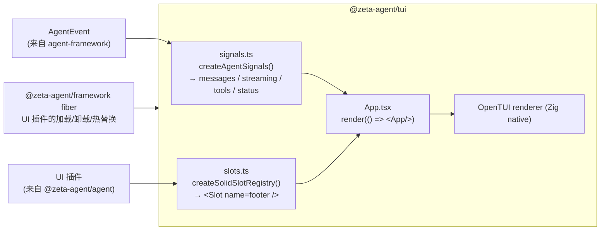

# TUI 设计（OpenTUI 与 SolidJS）

> **实现状态（2026-11-21 更新）**：OpenTUI 0.9.3 + SolidJS 为仓库**默认且唯一发布实现**。交互 TUI 经 `renderTui()` 用 OpenTUI 官方 `render()` 在终端原生绘制；早期自研 ASCII 字符串渲染（`frame.ts` 的 `+---+` 边框，事实上的 StringBackend）已**删除**，不再产出字符画边框。同时公开 `RendererBackend` seam 与 `createTui({ backend })`，供**用户自带** Ink / TermUI / REPL 后端按同一契约接入——仓库自身不提供任何替代后端。native 在 CI 不可用时测试标 skip、`--print` 无头模式绕开，这不是"降级后端"。2026-11-21 增补：运行时 TSX 插件加载与官方 Solid slots 已实测通过（T-01/T-02），以受控 seam（`runtime-plugin-loader.tsx`/`slots-native.tsx`）承载，facade string 槽位契约保持不变。
> **文档定位**：TUI 设计（OpenTUI 与 SolidJS）（从 `07-TUI设计.md` 拆分/重命名而来，链接已按新结构重写）。
> **所属索引**：[本目录索引](./README.md) · [总索引](../README.md)
> **来源分级**：一手来源为 [在线论文](https://arxiv.org/abs/2608.25512v1) 与 [GitHub 源码](https://github.com/earendil-works/pi)（逐文件链接见正文）；汇总见 [事实登记](../architecture/fact-registry.md)。

## 目录

- [1 定位与替换目标](#1-定位与替换目标)
- [2 OpenTUI Solid 事实基础](#2-opentui-solid-事实基础)
- [3 架构：renderer / signal 桥 / 插件槽位](#3-架构renderer-signal-桥-插件槽位)
- [4 AgentEvent → Solid signal 映射](#4-agentevent-solid-signal-映射)
- [5 插件 UI 槽位](#5-插件-ui-槽位)
- [6 与 pi-tui 的对应关系](#6-与-pi-tui-的对应关系)
- [7 主题、语言与快捷键](#7-主题语言与快捷键)
- [8 生命周期、清理与热替换](#8-生命周期清理与热替换)
- [9 测试策略](#9-测试策略)
- [10 无 TUI 的运行形态](#10-无-tui-的运行形态)
- [11 风险与开放问题](#11-风险与开放问题)
- [12 交叉引用与验证](#12-交叉引用与验证)

## 1 定位与替换目标

pi 的 `@earendil-works/pi-tui` 是自研命令式组件模型：`Component.render(width): string[]`、`handleInput`、`invalidate()`，由 `TuiMainScreen.doRender()` 做行级差分（[pi-baseline §6](../research/pi-baseline.md#6-earendil-workspi-tui自研差分渲染)）。它已经支持扩展通过 `ExtensionUIContext.setWidget/setFooter/custom/setEditorComponent` 替换 UI。

目标栈要求用 OpenTUI 与 SolidJS 替代它。替换的收益：

- 差分渲染由 OpenTUI 的 Zig 原生核心完成（只更新变化的 cell），我们不再维护 `doRender()` 的 600 行差分逻辑；
- Solid 的细粒度响应式天然对应论文的"值级 reactivity"（FRP/signals，[cordis-paper-system §13](../research/cordis-paper-system.md#13-相关工作定位) 的 related work 段）——但我们要保持**组件级生命周期语义**由 fiber 管，signal 只负责值级更新；
- OpenTUI 自带 **Solid plugin slots**（`createSolidSlotRegistry` / `Slot` / `createSlot` / `SolidPlugin`），与"万物皆插件"直接契合。


## 2 OpenTUI Solid 事实基础

以下全部来自官方文档（[engineering §3.3](../architecture/engineering.md#33-opentui-与-solidjs) 附链接，访问 2026-11-19）：

| 事实 | 说明 |
| --- | --- |
| `@opentui/solid` 0.9.3 | `solid-js` peer `^1.9.12`，建议 ≥1.9.16（Seroval 安全公告） |
| 安装/配置 | `bun install solid-js@^1.9 @opentui/solid`；`tsconfig`: `jsx:"preserve"`, `jsxImportSource:"@opentui/solid"`；`bunfig.toml`: `preload=["@opentui/solid/preload"]` |
| 入口 | `await render(() => <App />)`；`render` 不返回 disposer，渲染器销毁负责 dispose Solid root |
| Hooks | `useRenderer()`, `useKeyboard(handler, {release?})`, `onResize`, `onFocus/onBlur`, `useTerminalDimensions()`, `usePaste`, `useSelectionHandler`, `useTimeline()` |
| 特殊组件 | `Portal`, `Dynamic`；自定义 renderable 用 `extend({...})` + `declare module "@opentui/solid"` |
| 插件槽位 | `createSolidSlotRegistry(renderer, context, options?)`, `Slot`, `createSlot()`, `SolidPlugin<TSlots,TContext>`；运行时 TSX 插件需 `@opentui/solid/runtime-plugin-support` |
| 测试 | `testRender(() => <App />, {width,height})` → `renderOnce()` + `captureCharFrame()`；必须 `renderer.destroy()` |
| 组件 | `text`, `box`, `input`, `textarea`, `select`, `<tab_select>`, `scrollbox`, `code`, `markdown`, `diff` 等 |


## 3 架构：renderer / signal 桥 / 插件槽位



**三层分离**：

1. **signal 桥**：把 AgentEvent 映射为 Solid signal（值级更新）；
2. **槽位注册表**：插件贡献 UI 片段（`JSX.Element`），用 OpenTUI 的 Solid slots；
3. **根组件**：布局与终端事件处理，不含业务逻辑。


## 3.5 渲染后端 seam（可插拔，仅服务用户扩展）

`@zeta-agent/tui` 公开稳定的 `RendererBackend` 契约与 `createTui` 注入点：

```ts
interface RendererBackend {
  render(frame: FrameState): Frame;
  testRender(app: () => FrameState, opts: TestRenderOptions): Promise<TestHandle>;
  destroy(): void;
}
function createTui(options?: { backend?: RendererBackend }): TuiHandle;
```

- **唯一发布实现**：`OpenTuiBackend`（默认）；OpenTUI 原生调用集中在 `backend-opentui.tsx`（`testRender`）与 `runtime.tsx`（`renderTui`）。三条渲染路径如实区分（见下方"渲染路径"）。
- **seam 面向用户**：用不惯 OpenTUI 的用户可自带 Ink / TermUI / 纯 REPL 后端，经 `createTui({ backend })` 注入，遵循同一契约即可替换；仓库不发布这些替代实现。
- **共享契约测试**：`backendContractTests(factory)` 对任意后端跑同一组断言（定宽定高、帧快照稳定、destroy 幂等），只用 `FrameState` 抽象不引用 OpenTUI 类型。
- **渲染路径（三条，如实定位）**：
  - `OpenTuiBackend.render(frame)`：**无终端环境下的稳定字符串快照投影**——对 `FrameState.lines/hud` 做定宽裁剪/补齐后 `join("\n")` 得到 `Frame.snapshot`，**不调用任何 OpenTUI/native API**。供快照断言与无 TTY 场景使用，不声称是原生渲染。
  - `OpenTuiBackend.testRender(node)`：包装 `@opentui/solid` 官方 `testRender`（`renderOnce` → `captureCharFrame` → `renderer.destroy`），用于真实帧快照稳定性测试。
  - `renderTui(options)`：OpenTUI 官方 `render()` + 自建 `CliRenderer` + Solid signal + `<box>/<scrollbox>/<text>/<input>` 终端原生绘制；返回 `RuntimeTuiHandle`（`appendMessage` / `waitForExit` / `destroy`）。CLI 交互 TUI 默认走此路径；早期画 `+---+` 边框的 ASCII `frame.ts` 已删除。
- **边界**：业务组件（`slots/signal/virtual/hud/frame-state/backend`）零直接 import `@opentui/solid`，由 `scripts/guard-architecture.mjs` 静态守护。运行时插件 API（`@opentui/core/runtime-plugin`、`@opentui/solid/runtime-plugin-support`）仅允许在受控 seam 文件 `runtime-plugin-loader.tsx`/`slots-native.tsx` 中直接 import，已列入守护白名单（T-02）。

## 4 AgentEvent → Solid signal 映射

保持 pi 的事件顺序语义（[agent-framework §10](../agent-framework/state-and-events.md#10-事件协议与屏障语义)）是硬约束：signal 更新必须发生在 `await` listener 之前或之内，不能把异步消费者甩在后面。

```ts
export function createAgentSignals(agent: Agent) {
  const [messages, setMessages] = createSignal<AgentMessage[]>([]);
  const [streaming, setStreaming] = createSignal<AgentMessage | null>(null);
  const [pendingTools, setPendingTools] = createSignal<ReadonlySet<string>>(new Set());
  const [status, setStatus] = createSignal<"idle" | "streaming" | "tool">("idle");

  const dispose = agent.subscribe((event) => {
    switch (event.type) {
      case "message_start": setStreaming(event.message); break;
      case "message_update": setStreaming(event.message); break;  // partial 快照
      case "message_end": setStreaming(null); setMessages(m => [...m, event.message]); break;
      case "tool_execution_start": setPendingTools(s => new Set(s).add(event.toolCallId)); setStatus("tool"); break;
      case "tool_execution_end": setPendingTools(s => { const n = new Set(s); n.delete(event.toolCallId); return n; }); break;
      case "agent_start": setStatus("streaming"); break;
      case "agent_end": setMessages(event.messages); setStatus("idle"); break;
      // turn_start/turn_end 可挂 side-effect 信号（如状态栏）
    }
  });
  onCleanup(dispose);
  return { messages, streaming, pendingTools, status };
}
```

**注意**：

- `message_update` 携带 partial 快照（pi 的 `AssistantMessageEvent`），Solid 用 `setStreaming(event.message)` 触发精细更新，OpenTUI core 只重绘变化 cell。
- 工具事件按**完成顺序**更新 signal（pi 语义），但已落盘的 toolResult 消息按源码顺序（agent-core 保证）。
- 订阅 disposer 挂 `onCleanup`——TUI 卸载时不留 listener（对应 fiber 逆）。


## 5 插件 UI 槽位

> **实现状态（2026-11-21 更新，T-01/T-02）**：运行时 TSX 插件加载与官方 Solid slots 已在本轮**实测通过**（AC-01）：`packages/tui/src/runtime-plugin-loader.tsx` 封装 `ensureRuntimePluginSupport`/`createRuntimePlugin`/`loadRuntimePlugin`，`packages/tui/src/slots-native.tsx` 包装官方 `createSolidSlotRegistry`/`createSlot`/`Slot`。测试证明插件加载后 Slot UI 可见、热卸载后恢复、坏插件渲染失败时旧 UI 保留（closure rule）。这两个文件是唯一允许直接 import 运行时插件 API 的**受控 seam**，已列入 `scripts/guard-architecture.mjs` 白名单；业务文件仍零直接 `@opentui` import。facade 的 string 槽位契约（`slots.ts` 的 `createSlotRegistry()`，IF-05）**保持不变**，官方 Solid slots（IF-03）作为受控 seam 并存，二者不冲突。D-04/O-11 原"延期"结论已由实测收敛为"本轮验证通过"。

使用 OpenTUI 官方 Solid slots（事实 API）：

```ts
import { createSolidSlotRegistry, Slot, type SolidPlugin } from "@opentui/solid";

export type ZetaSlots = {
  header: undefined;
  footer: undefined;
  message: { message: AgentMessage };
  tool: { toolCall: ToolCall };
  editor: undefined;
  overlay: undefined;
};

const registry = createSolidSlotRegistry<CliRenderer, ZetaSlots, SlotContext>(renderer, {
  context: { agent, signals, theme },
});

export function registerUiPlugin(plugin: SolidPlugin<ZetaSlots, SlotContext>) {
  registry.register(plugin);
  return () => registry.unregister?.(plugin);  // 逆：若官方 API 支持；否则用 fiber dispose 管理
}
```

组件侧：

```tsx
<box>
  <Slot name="header" />
  <scrollbox>
    <For each={signals.messages()}>{(m) => <Slot name="message" props={{ message: m }} />}</For>
  </scrollbox>
  <Slot name="footer" />
</box>
```

**插件贡献方式**：

- `@zeta-agent/agent` 的 UI 插件（如工具渲染器、主题、状态栏）导出 `SolidPlugin<ZetaSlots, SlotContext>`；
- 它们由 `ctx.use(uiPluginComponent, config)` 加载，fiber 的 `apply` 中调用 `registry.register()` 并 `yield` 逆（unregister）；
- 热替换 UI 插件时：fiber 卸载 → 逆注销槽位 → 新 fiber 注册新槽位；OpenTUI 只重绘变化部分（chord 的"插件 CSS 与代码一起热替换"模式）。
- 运行时加载 TSX 插件需按官方文档引入 `@opentui/solid/runtime-plugin-support`，并配置 Bun 的 module map 与信任边界——这是 [framework §8](../framework/components.md#8-组件加载器与-hmr) HMR 与 OpenTUI 插件支持的交汇点，需实测。

**与 pi 的 `registerMessageRenderer/registerToolRenderer/registerMarkdownTransformer` 对应**：这些都变成 `Slot` 贡献；`setWidget/setFooter/setHeader/custom` 变成对应槽位名。pi 的"扩展可完全替换 editor"用 `editor` 槽位实现。


## 6 与 pi-tui 的对应关系

| pi-tui / coding-agent | zeta / OpenTUI | 说明 |
| --- | --- | --- |
| `Component.render(width): string[]` | Solid 组件 → OpenTUI renderable | 不再手写行数组 |
| `TuiMainScreen.doRender()` 行级差分 | OpenTUI core 的 cell 级更新 | 删除自研差分 |
| `Component.handleInput` | `useKeyboard()` / `usePaste()` | 官方 hooks |
| `invalidate()` | Solid signal 自动触发 | 无需手动失效 |
| `OverlayOptions/OverlayHandle` | `<Portal mount={renderer.root}>` | 官方特殊组件 |
| `SelectList` | `<select>` / `<tab_select>` | 官方组件 |
| `Editor` | `<input>` / `<textarea>` + 自定义 renderable | 可 `extend()` |
| `ExtensionUIContext.setWidget/setFooter/custom` | `Slot` 槽位 | 插件贡献 |
| `Theme`（JSON + schema） | `theme` 注册表 + `@zeta-agent/themes:registry` 插件（[plugin-system §4](./plugin-system.md#4-技能提示词主题插件)） | 主题本身是插件 |
| OKLCH/OKHSL 颜色工具 | OpenTUI 自带颜色；必要时保留工具函数 | 视 API 覆盖情况 |

**迁移注意**：pi 的 `StdinBuffer`、`keys.ts` 借鉴了 OpenTUI（MIT），迁移后直接使用官方实现，删除本地副本。


## 7 主题、语言与快捷键

- **主题**：`@zeta-agent/themes:registry` 插件提供主题对象；TUI 通过 `SlotContext.theme` 消费。切换主题 = `ctx.set(themeKey, newTheme)` → notify → 订阅组件更新（不重启 TUI fiber）。
- **语言/翻译**：chord 的 `Translations`/`LocaleChoice` 模式（[pi-baseline §3](../research/pi-baseline.md#3-earendil-workschord对象运行时与插件)），做成注册表插件；`formatTime/formatNumber` 保留为工具函数。
- **快捷键**：`useKeyboard` 订阅 + 插件注册的 keymap（`@zeta-agent/keymap:registry`，有序 coeffect——快捷键冲突需显式优先级）。pi 的 `KeybindingsManager`/`KeyId/matchesKey` 逻辑保留为纯函数，UI 层用 Solid hook 接入。


## 8 生命周期、清理与热替换

- `await render(() => <App />)` 在初始挂载后 resolve，**不返回 disposer**；若由我们创建 renderer，组件内用 `useRenderer()` 取得并在关闭时 `renderer.destroy()`（官方文档）。
- `renderer.destroy()` 会 dispose Solid root，触发 `onCleanup`——我们在 signal 桥与槽位注册处挂 `onCleanup(disposer)`，与 fiber 的逆一致。
- `render()` 传入已有 renderer 时，Solid 采用但**不取得所有权**；创建者负责销毁（官方文档）——CLI 的根 fiber 持有 renderer，卸载时销毁。
- 热替换 UI 插件：fiber dispose → 插件逆 → 槽位注销 → 新 fiber 注册 → OpenTUI 增量重绘。避免整屏重建。
- 失败：UI 插件求值失败 → `FAILED` fiber，旧 UI 槽位保留（closure rule 思想），不黑屏。


## 9 测试策略

用 OpenTUI 官方 `testRender`（无需真实终端）：

```ts
import { testRender } from "@opentui/solid";
import { expect, test } from "bun:test";

test("renders transcript", async () => {
  const setup = await testRender(() => <App api={fakeAgent()} />, { width: 80, height: 24 });
  try {
    await setup.renderOnce();
    expect(setup.captureCharFrame()).toContain("Hello");
  } finally {
    setup.renderer.destroy();
  }
});
```

覆盖：

1. **帧快照**：消息流、工具状态、状态栏、overlay；
2. **事件顺序**：构造交错的工具完成事件，断言 UI 与 pi 语义一致（完成顺序 vs 源码顺序）；
3. **插件槽位**：加载/卸载 UI 插件，断言槽位贡献出现/消失；
4. **热替换**：换主题/工具渲染插件，断言帧变化且无残留；
5. **键盘**：`useKeyboard` 事件触发命令；
6. **resize**：`onResize` 后布局正确。


## 10 无 TUI 的运行形态

print/json/rpc 模式（[framework-model/engineering §9](../architecture/engineering.md#9-运行形态cli-sdk-rpc-静默模式)、[plugin-system §10](./plugin-system.md#10-模式插件interactive-print-json-rpc)）**不加载 `@zeta-agent/tui`**：

- 只订阅 AgentEvent 输出文本/JSON；
- 不创建 renderer，不 preload Solid；
- 保证在无 TTY、CI、远程执行环境下完整可用。

这也让论文 Thm 80 的汇合测试可以在无 UI 的纯逻辑环境跑。


## 11 风险与开放问题

| 风险 | 缓解 |
| --- | --- |
| OpenTUI native 依赖跨平台/CI 不可用 | `testRender` 无终端测试；CI 用 `--print` 模式；native 不可用时测试标 skip（非 ASCII 降级后端）；文档标注平台矩阵 |
| Solid 与 fiber 生命周期双轨 | `onCleanup` 与 fiber 逆统一：UI 插件一律通过 fiber 加载，cleanup 即逆 |
| 运行时 TSX 插件加载复杂 | 已验证可行：Bun 下动态导入 TSX + 官方 `runtime-plugin-support` + Solid slots 均可用，封装于受控 seam（T-01/T-02）；pi 采用 jiti + 命令式 UI 的不同路线，仅作行为语义参考 |
| 槽位 API 版本变化（0.9.x） | 锁定 `@opentui/*` 同版本；封装在 `@zeta-agent/tui` 内，上层不直接依赖 |
| 主题/语言插件切换引发整树重绘 | 用 signal 精细更新；实测帧差异 |

**开放问题**：
- O-11（已收敛，T-01）：UI 插件允许运行时加载 TSX——实测 `loadRuntimePlugin` 动态导入 `.tsx` 插件并注入官方 Solid Slot 成功，热卸载与失败保留旧 UI 均通过；实现位于受控 seam，不影响 facade string 契约。
- O-12：是否保留 pi 的 alt-screen 模式？OpenTUI 的默认渲染模型不同，需实测决定；initial 只实现主屏幕模式。


## 12 交叉引用与验证

| 本文设计 | 上游依据 | 下游验证 |
| --- | --- | --- |
| AgentEvent → signal | [agent-framework §10](../agent-framework/state-and-events.md#10-事件协议与屏障语义) | 事件顺序测试 |
| 插件槽位 | OpenTUI 官方文档（[engineering §3.3](../architecture/engineering.md#33-opentui-与-solidjs)）、[plugin-system §2](./plugin-system.md#2-插件清单与分类) | 槽位热替换测试 |
| 与 pi-tui 对照 | [pi-baseline §6](../research/pi-baseline.md#6-earendil-workspi-tui自研差分渲染) | 功能清单覆盖 |
| fiber 生命周期承载 UI 插件 | [framework §7](../framework/core-semantics.md#7-生命周期状态机) | onCleanup = 逆 |
| 主题/语言注册表 | [plugin-system §4](./plugin-system.md#4-技能提示词主题插件) | 切换不重启测试 |
| 无 TUI 模式 | [framework-model/engineering §9](../architecture/engineering.md#9-运行形态cli-sdk-rpc-静默模式) | CI 冒烟 |
| 迁移阶段 | [08](../delivery/roadmap.md) | 阶段验收 |

**返回索引**：[00 索引与交叉验证](../README.md)


## 文档关系

| 关系 | 文档 |
| --- | --- |
| 所属目录索引 | [./README.md](./README.md) |
| 全局索引 | [总索引](../README.md) |
| 事实来源 | [事实登记与交叉验证矩阵](../architecture/fact-registry.md) |
