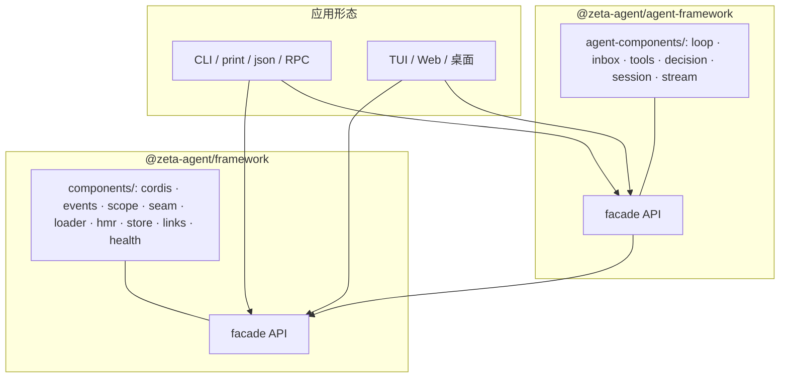
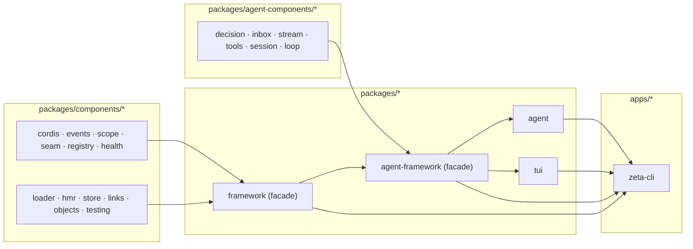

# 架构与工程决策（architecture）

> **目录定位**：把 [research](../research/README.md) 的事实转化为**架构决策与工程约束**——两个框架的边界、组件依赖、技术栈、事实登记与验收判据。本目录回答"我们决定怎么做"。
> **所属索引**：[总索引](../README.md)　|　**事实来源**：[research](../research/README.md)

## 文档清单

| 文档 | 内容 | 粒度 |
| --- | --- | --- |
| [framework-model.md](./framework-model.md) | 两个框架 + 应用形态、组件拼装模型、monorepo 目录、依赖约束 | 架构决策 |
| [engineering.md](./engineering.md) | 技术栈事实、包命名/版本、turbo 构建图、运行形态、迁移映射、风险与验收 | 工程约束 |
| [fact-registry.md](./fact-registry.md) | 来源 S1-S16、事实登记、双源验证、矛盾、缺口、自检门 | 事实核验 |

## 组件图（两个框架 + 应用形态）

## 部署图（workspace 包分布）

## 跨目录关系

- 上游：[research](../research/README.md) 提供论文与项目事实。
- 下游：[framework](../framework/README.md)、[agent-framework](../agent-framework/README.md) 实现本目录的决策；[agent](../agent/README.md)、[delivery](../delivery/README.md) 装配与落地。
- 验收判据在 [engineering.md](./engineering.md) 与 [delivery/roadmap.md](../delivery/roadmap.md)。
