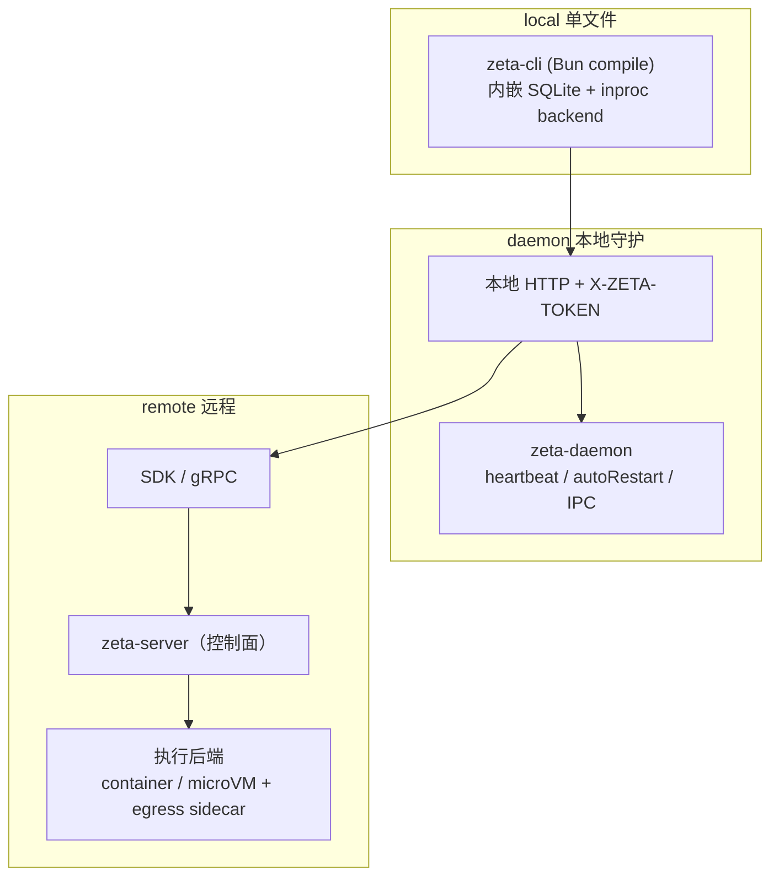

# 工程化：技术栈、构建与验收

> **文档定位**：工程化：技术栈、构建与验收（从 `03-总体架构与技术栈.md` 拆分/重命名而来，内容保持原样，链接已按新结构重写）。
> **所属索引**：[本目录索引](./README.md) · [总索引](../README.md)
> **来源分级**：一手来源为 [在线论文](https://arxiv.org/abs/2608.25512v1) 与 [GitHub 源码](https://github.com/earendil-works/pi)（逐文件链接见正文）；汇总见 [事实登记](../architecture/fact-registry.md)。

## 目录

- [3 技术栈事实核对](#3-技术栈事实核对)
- [7 包包名与版本策略](#7-包包名与版本策略)
- [8 构建任务图（turbo.json 草案）](#8-构建任务图turbojson-草案)
- [9 运行形态：CLI / SDK / RPC / 静默模式](#9-运行形态cli-sdk-rpc-静默模式)
- [9.1 部署拓扑与三态运行](#91-部署拓扑与三态运行缺口-7-补全)
- [9.2 性能预算、Profiling 与回归门禁](#92-性能预算profiling-与回归门禁缺口-6-补全)
- [9.3 评测与基准体系](#93-评测与基准体系缺口-5-补全)
- [10 与 pi 的映射与迁移策略](#10-与-pi-的映射与迁移策略)
- [11 风险、回滚与开放问题](#11-风险回滚与开放问题)
- [12 验收标准](#12-验收标准)

## 3 技术栈事实核对

### 3.1 Bun + TypeScript

- 当前工作区 `zeta-agent` 已由 `bun init` 骨架发展为 Bun monorepo（bun v1.4.2），`package.json` 为 ESM、`@types/bun: latest`、`typescript: ^5.9.2`、`bun.lock` 已生成（本地事实，2026-11-24 核对）。
- Bun 原生支持 TypeScript/TSX 执行与 workspaces，`bunfig.toml` 可配置 preload——OpenTUI Solid 绑定**要求** `preload = ["@opentui/solid/preload"]`（官方，见下）。
- **工具链事实来源**：工作区 `package.json` / `bun.lock`；OpenTUI 官方文档 `https://opentui.com/docs/bindings/solid/`（访问 2026-11-19）。

### 3.2 Turborepo

官方事实（Turborepo Docs，`https://turborepo.dev/docs/crafting-your-repository/structuring-a-repository` 与 `/configuring-tasks`，访问 2026-11-19）：

- Bun 工作区写法：根 `package.json` 中 `"workspaces": ["apps/*", "packages/*"]`；需要根 `turbo.json` 与 lockfile（Bun 用 `bun.lock`）。
- 任务声明在 `turbo.json` 的 `tasks` 中；`"dependsOn": ["^build"]` 表示先构建依赖包再构建本包；同包内任务依赖用不带 `^` 的字符串；`"outputs": ["dist/**"]` 才能缓存产物；`dev` 任务应设 `"cache": false, "persistent": true`。
- 推荐根脚本用 `turbo run build`（而非 `turbo build`），避免与子命令冲突；根 `devEngines.packageManager` 可锁定 bun 版本。
- Turborepo 不支持嵌套包（`apps/**` / `packages/**`），需 `packages/*` + `packages/group/*` 且不建 group 的 `package.json`。

→ 我们的 `turbo.json` 草案见 [§8](#8-构建任务图turbojson-草案)。

### 3.3 OpenTUI 与 SolidJS

官方事实（OpenTUI Docs，`https://opentui.com/docs/`、`/docs/bindings/solid/`、`/docs/api/solid/`、`/docs/plugins/solid/`，访问 2026-11-19）：

- OpenTUI 是 **Zig 编写的原生终端 UI 核心 + TypeScript 绑定**：渲染组件树、Flexbox 布局、处理终端输入、只更新变化的 cell；**OpenCode 在生产中使用它**。
- `@opentui/solid` 当前版本 **0.9.3**（npm 元数据，访问 2026-11-19），`solid-js` peer `^1.9.12`；官方建议用 ≥1.9.16（早期 1.9.x 依赖有安全公告的 Seroval）。安装：`bun install solid-js@^1.9 @opentui/solid`。
- **版本差异说明**：opencode 实装锁定 `0.8.4`（core/keymap/solid 同步，`solid-js@1.9.17`），是它自己锁定的旧版本，与本设计采用的最新版 0.9.3 不冲突；两版 slot API 是否兼容需实测（[opencode 调研](../research/platform-engineering.md)）。opencode 默认分支是 `dev`（不是 `main`），引用其源码链接须用 `blob/dev/`。
- 配置：TS `jsx: "preserve"`, `jsxImportSource: "@opentui/solid"`；Bun `bunfig.toml` 加 `preload = ["@opentui/solid/preload"]`。
- 入口：`import { render } from "@opentui/solid"; await render(() => <App />)`；`render` 不返回 disposer，渲染器销毁负责 dispose Solid root 与 `onCleanup`。
- Hooks：`useRenderer()`, `useKeyboard()`, `onResize()`, `onFocus/blur`, `useTerminalDimensions()`, `usePaste`, `useSelectionHandler`, `useTimeline()`；特殊组件 `Portal`, `Dynamic`。
- **插件槽位**（与"万物皆插件"高度契合）：`createSolidSlotRegistry(renderer, context, options?)`, `Slot`, `createSlot()`, `SolidPlugin<TSlots,TContext>`；运行时加载 TSX 插件需 `import "@opentui/solid/runtime-plugin-support"`。
- 自定义 renderable：`extend({ custom_box: BoxRenderable })` + `declare module "@opentui/solid" { interface OpenTUIComponents { ... } }`。
- 测试：`testRender(() => <App />, {width, height})` + `renderOnce()` + `captureCharFrame()`（可配合 `bun:test`）。
- 组件：Text / Box / Input / Textarea / Select / TabSelect / ScrollBox / Code / Markdown / Diff 等；Solid 用 snake_case 多词标签（`<tab_select>`）。

→ TUI 设计详见 [07](../agent/tui.md)。

### 3.4 版本与锁定策略（推断）

| 依赖 | 建议约束 | 理由 |
| --- | --- | --- |
| bun | `devEngines.packageManager` 固定 `bun@1.4.2`（或团队统一版本） | 复现性；OpenTUI preload 与 native 渲染器对运行时敏感 |
| typescript | `^5.9.2` | 工作区现状 |
| turbo | `latest` → 锁定到具体版本后写入 lockfile | 官方建议 |
| solid-js | `^1.9.16`（官方安全建议 ≥1.9.16） | Seroval 安全公告 |
| @opentui/solid + core | `^0.9.3`，同版本对齐 | 两者版本同步发布 |


## 7 包包名与版本策略

- **组织名统一为 `zeta-agent`**：npm scope 使用 `@zeta-agent/*`（内部包），根工作区包名 `zeta-agent`，CLI 二进制名 `zeta-agent`。
  - 原因：`zeta` 已被注册，不得使用 `@zeta/*` scope；避免与既有 `zeta` 包名/命令冲突（二进制名一并统一，如仍需 `zeta` 作为短命令可在 CLI 内做 alias）。
  - 全部 coeffect 键的命名空间前缀同步为 `@zeta-agent/...`（如 `@zeta-agent/tools:registry`），见 [framework-model §6.2 键命名空间](./framework-model.md#62-键命名空间防止-key-collision)。
- 内部包版本统一（如 `0.1.0`），用 workspace 协议引用：`"@zeta-agent/framework": "workspace:*"`（Bun 支持）。
- 所有包 `"type": "module"`，`exports` 至少 `"."` 与 `"./package.json"`；子路径按需开放（如 `@zeta-agent/framework/objects`）。
- 外部依赖锁定：精确版本写入 lockfile；`bun install --frozen-lockfile` 用于 CI。
- 与 pi 相同：external deps pin，internal deps workspace range（参考 pi README 供应链段落）。


## 8 构建任务图（turbo.json 草案）

```json
{
  "$schema": "https://turborepo.dev/schema.json",
  "tasks": {
    "build": {
      "dependsOn": ["^build"],
      "outputs": ["dist/**"]
    },
    "typecheck": {
      "dependsOn": ["^build"],
      "outputs": []
    },
    "test": {
      "dependsOn": ["build"],
      "outputs": ["coverage/**"]
    },
    "dev": {
      "cache": false,
      "persistent": true
    }
  }
}
```

根 `package.json` 脚本：

```json
{
  "private": true,
  "workspaces": ["apps/*", "packages/*", "packages/components/*", "packages/agent-components/*"],
  "devEngines": { "packageManager": { "name": "bun", "version": "1.4.2" } },
  "scripts": {
    "build": "turbo run build",
    "typecheck": "turbo run typecheck",
    "test": "turbo run test",
    "dev": "turbo run dev"
  },
  "devDependencies": { "turbo": "<pinned>", "typescript": "^5.9.2" }
}
```

任务顺序由 `dependsOn: ["^build"]` 自动得到 `cordis → {events, scope, registry, store…} → {loader, hmr} → framework facade → {decision, inbox, stream} → {tools, session} → loop → agent-framework facade → {agent, tui} → cli`，与 [§5.1 依赖图](./framework-model.md#51-组件子包清单与依赖图c-方案) 一致。`build` 产物放各包 `dist/**`；`dev` 不缓存。分组目录 `components/`、`agent-components/` 自身无 `package.json`，不产生 turbo 任务，只作为 workspace glob 的容器。


## 9 运行形态：CLI / SDK / RPC / 静默模式

| 形态 | 入口 | 说明 |
| --- | --- | --- |
| 交互 CLI | `apps/zeta-cli` + `@zeta-agent/tui` | 默认形态；OpenTUI 渲染 |
| SDK | `@zeta-agent/agent` 的 `createAgent()` | 供外部程序嵌入；事件流可订阅 |
| print / JSON | CLI flag `--print` / `--json` | 不启动 TUI，输出最终消息或 JSON 事件 |
| RPC | CLI `--rpc` | 通过 stdin/stdout JSON-RPC 暴露 agent 控制面（参照 pi 的 RPC 文档） |

所有形态共享同一个 `ctx` + fiber loader；TUI 只是众多 observer 之一。这保证论文 Thm 80 的汇合判据可在无 UI 的测试中验证。

### 9.1 部署拓扑与三态运行（缺口 7 补全）

> 来源：[platform-engineering.md §7](../research/platform-engineering.md#7-部署形态缺口-7)（opencode / OpenSandbox / cordis daemon 调研）。

**三态运行形态**（沿用 §9 的 facade，仅部署拓扑不同）：

| 形态 | 部署单元 | 适用场景 | 参考 |
| --- | --- | --- | --- |
| **local 单文件** | `zeta-cli` 单二进制（内嵌 SQLite + inproc backend + prompts/skills/schema） | 离线 / air-gapped / 个人使用 | opencode `Bun.build({compile})` |
| **daemon 本地守护** | `zeta-daemon` 本地 HTTP + token + IPC heartbeat/autoRestart | 多客户端共享、IDE/桌面接入 | OpenSandbox execd / cordis daemon |
| **remote 远程** | SDK/gRPC + 远程执行后端（容器/microVM） | 团队/云端、不可信代码 | OpenSandbox server + execd |



**实现状态（2026-11-25）**：local 单文件发布物由 `scripts/build-local.ts` 以 Bun compile 生成 12 target，manifest 记录 SHA-256 与主二进制/嵌入资源架构；daemon 为 HTTP + token + IPC heartbeat/autoRestart（`packages/deploy/src/daemon.ts`）；remote 提供 SDK 与远程 backend（`packages/deploy/src/remote.ts`），走 `/rpc` 的 HTTP JSON-RPC 并映射 gRPC 风格状态码，**不是 wire-level gRPC**（A30 待裁决）。readiness/liveness/configDigest 接真实 runtime/RPC，configDigest 由 `canonical.ts` 的 canonical encoding + SHA-256 生成。默认装配仅 local；daemon/remote 需显式启用。逐项状态见 [capability-matrix.md](../delivery/capability-matrix.md) 与 [release-runbook.md](../delivery/release-runbook.md)。

**运营契约（以 coze 为反面教材）**：
- 框架暴露 `AgentRuntime.readiness() / liveness() / configDigest()` seam，`--rpc` 可直接查询（coze 后端无探针、密钥明文注入）；
- 容器部署配 liveness/readiness probe + 资源限制 + Recreate 滚动策略；密钥走 Secret 引用而非明文 `value`；
- 灰度/回滚沿用 [plugin-system §8.2 晋升状态机](../agent/plugin-system.md#82-晋升状态机uml)：`qualify → canary → digest 校验 → promote/rollback`；
- 单文件二进制须做**架构校验**：`NativeArch.verify(file, arch)` 校验主镜像与所有嵌入资源同架构（opencode 真实事故：ARM64 Windows 嵌入 x64 dll 导致终端打不开）；
- 12 target 矩阵：`os (linux/darwin/win32) × arch (arm64/x64) × libc (glibc/musl) × avx2 baseline`；原生资源用 `import with {type:"file"}` 嵌入；
- 启动关键路径：重模块（OTLP 五件套、Sentry）用 `await import()`，写测试断言"首帧不 await telemetry、产物无顶层 sentry import"。

### 9.2 性能预算、Profiling 与回归门禁（缺口 6 补全）

> 来源：[platform-engineering.md §6](../research/platform-engineering.md#6-性能缺口-6)（opencode 调研）。

**性能预算**（定义可强制的上限，非事后实测）：
```ts
interface PerformanceBudget {
  maxSteps?: number;              // turn 内最大步骤
  maxToolCalls?: number;          // 单次执行工具调用数
  maxOutputBytes?: number;        // 输出裁剪（boundOutput）——须与压缩阈值联动，见下
  // CT-1（论文 arXiv:2611.05306 §2.4.1）：单一 maxContextTokens 拆为双阈值 + peak 指标
  totalContextLimit?: number;     // 硬终止线
  compactionThreshold?: number;   // 越过即触发压缩，为压缩 turn 预留空间
  peakLiveContextTokens?: number; // 一等预算指标：成本/延迟/内存由 peak 决定而非累计量
  maxWallMs?: number; maxCpuMs?: number; maxMemBytes?: number;
}
```
`ctx.effect` 在工具/turn 边界检查预算：越过 `compactionThreshold` 先触发压缩，超 `totalContextLimit` 才 degrade/kill，并落审计事件。

> **来源（[harness-optimization-papers.md §3.1](../research/harness-optimization-papers.md#3-you-dont-need-long-context压缩与-sssm)）**：后期 token 成本最高 7x（货币/吞吐换算，延迟约 2x）；256K→16K 的收益由 **peak live context** 决定。论文实证频繁压缩几乎不损精度（22 个阈值配置中最多 5 个损失 >2pt），但 Qwen 3 Coder Next 在 16K/12K 从 53.0% 崩塌到 3.6%——因此 `compactionThreshold` 必须与 `maxOutputBytes` 联动，保证 verbose 轨迹仍有工作空间。

**Profiling 工具**：TUI Debug HUD（`monitorEventLoopDelay` + cpu/rss ring + p99，见 [observability.md §6](../framework/observability.md#6-debug-hud-与诊断)）；首帧时间（TimeToFirstDraw）；effect/fiber 派发延迟。

**回归门禁**：引入 `perf` turbo 任务（与 build/test 同级）：
- 基准用中位数 + min、warm-up、交错抗 JIT、`--base <main> --head .` 对比；
- CI 卡阈值（延迟/内存/首帧），参考 opencode `strobe` 与 `script/bench.ts`；
- 长会话虚拟滚动（`@tanstack/solid-virtual`）避免 `For each={messages()}` 全量挂载——见 [tui.md §4](../agent/tui.md#4-agentevent-solid-signal-映射) 的性能约束。

**TUI 帧率**：`CliRendererConfig { targetFps:60, gatherStats:false, openConsoleOnError:false }`，全屏动画期间临时降到 30 并恢复。

### 9.3 评测与基准体系（缺口 5 补全）

- 承接 pi-evals（[pi-baseline §7](../research/pi-baseline.md#7-生态包ai-durable-schema-mcp-env-codemode-telemetry-evals) 记录的 vitest-evals/docker/plan/report）；
- 自演化的 fitness function、实验隔离、A/B 判定、回归门禁见 [recursive-self-evolution.md §5](../research/recursive-self-evolution.md#5-对现有设计的优化建议) 的 SE-D5/H11；
- 评测数据治理：trace pool 冻结、防泄漏（按 iterNNN 顺序重放），与 [observability §7](../framework/observability.md#7-观测不破坏-thm-80) 的旁路约束一致。


## 10 与 pi 的映射与迁移策略

| pi 包 | 本项目对应 | 处理方式 |
| --- | --- | --- |
| `@earendil-works/chord` | `@zeta-agent/framework` | 借鉴对象/契约/文档/store/link/插件重载思想；用 Cordis effect/coeffect 统一替代其插件机制 |
| `@earendil-works/pi-agent-core` | `@zeta-agent/agent-framework` | 保留事件协议/loop 顺序/工具流水线；把 hook 字段升级为插件管线 |
| `@earendil-works/pi-coding-agent` | `@zeta-agent/agent` + `apps/zeta-cli` | 拆开：业务逻辑做插件，CLI 只装配 |
| `@earendil-works/pi-tui` | `@zeta-agent/tui` | 用 OpenTUI Solid 替代自研差分渲染；保留"插件贡献 UI"思想 |
| `@earendil-works/pi-ai` | `@zeta-agent/agent-framework` 的 `StreamFn` 注入 + 可选 `@zeta-agent/providers` 插件 | 模型层外置为 broker 插件（[cordis-paper-system §12.2](../research/cordis-paper-system.md#12-讨论边界复用权限语言与循环依赖)） |
| `@earendil-works/pi-durable` | `@zeta-agent/framework/store` + session 插件 | 持久化作为 coeffect provider，而非 core 依赖 |
| `@earendil-works/pi-schema` | 用 TS 类型 + `defineKey`/JSON Schema 生成 | 直接依赖 typebox 或原生 schema 生成器，保持类型推导 |

**迁移不是逐文件翻译**，而是按"两个框架 + 应用形态"重新划分边界；每个 pi 机制的落点在 [02](../research/pi-baseline.md) 的对照表给出。


## 11 风险、回滚与开放问题

| 风险 | 触发条件 | 缓解 | 来源 |
| --- | --- | --- | --- |
| 顺序语义漂移 | hook 从"字段赋值"改成"插件管线"后顺序变化 | 先为 [02](../research/pi-baseline.md) 列出的每条不变量建立插件版等价测试 | 推断 |
| OpenTUI native 依赖在 CI 不可用 | 平台/架构不匹配 | 用 `testRender` 做无终端测试；CLI 提供 `--print` 绕开 TUI | 官方文档 |
| Bun 与 Node 生态兼容 | 某些 provider SDK 只测 Node | 运行时通过 `StreamFn` 抽象隔离；必要时在 worker 里跑 Node 兼容层 | 推断 |
| 过度设计 | 过早抽象通用工具层 | 两个 facade 包 + 组件子包，公共代码就地导出 | KISS |
| 恢复承诺过头 | 把"发射"当成可撤销 | 明确 withhold/compensation 策略（[cordis-paper-system §12.1](../research/cordis-paper-system.md#12-讨论边界复用权限语言与循环依赖)） | 论文 |
| 版本漂移 | solid-js <1.9.16 的 Seroval 公告 | 锁 `^1.9.16` | 官方文档 |

**开放问题**：
- O-1：`@zeta-agent/agent-framework` 是否允许运行时依赖 `@zeta-agent/framework`？建议仅类型导入，待 [agent-framework §2](../agent-framework/overview.md#2-包边界与依赖) 论证后定案。
- O-2：chord 风格 object runtime 放在 L1 全量实现，还是先只做 ctx/fiber + store 的最小集？建议后者（YAGNI），[framework §9](../framework/components.md#9-对象运行时与跨进程边界可选子路径) 给出可选升级路径。
- O-3：观察等价 `≃` 在我们的 ctx 中如何定义？建议以"键上的公开操作测试结果"为准，见 [09](./fact-registry.md)。


## 12 验收标准

1. **结构**：`turbo run build/typecheck/test` 全绿；`bun.lock` 提交；依赖图无环。
2. **论文对齐**：[09](./fact-registry.md) 中每条 P1-P10 都能指向实现文件与测试。
3. **汇合性**：同配置不同加载顺序 → 相同观察状态（Thm 80 判据）。
4. **可逆性**：随机加载/卸载插件后，所有 `ctx.effect` 的逆都被调用一次且仅一次；无残留绑定。
5. **顺序不变量**：[02](../research/pi-baseline.md) §9.3 的每条 agent-core 不变量都有插件版测试。
6. **TUI**：`testRender` 帧快照覆盖主要交互；插件槽位贡献的 UI 可热替换。
7. **无 UI 可运行**：`--print/--json` 模式完整可用。


## 文档关系

| 关系 | 文档 |
| --- | --- |
| 所属目录索引 | [./README.md](./README.md) |
| 全局索引 | [总索引](../README.md) |
| 事实来源 | [事实登记与交叉验证矩阵](../architecture/fact-registry.md) |
