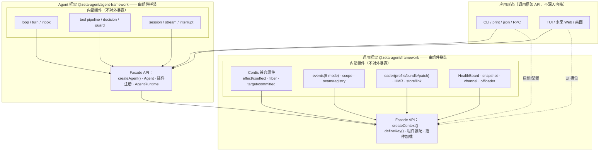
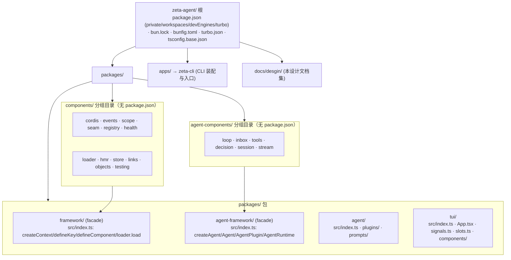
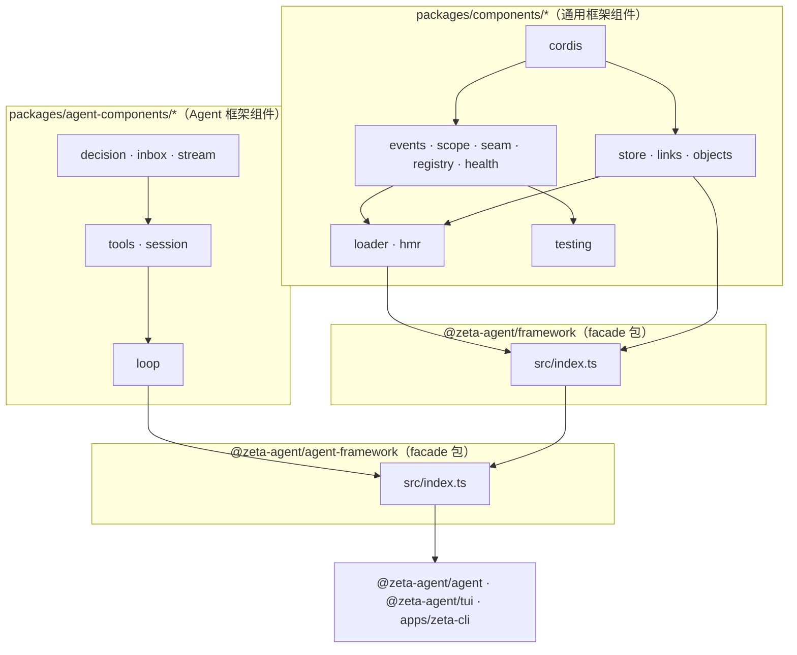
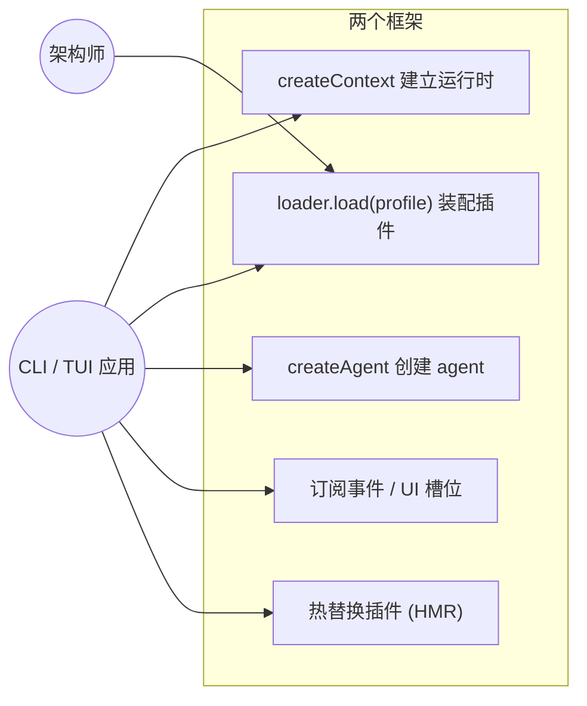
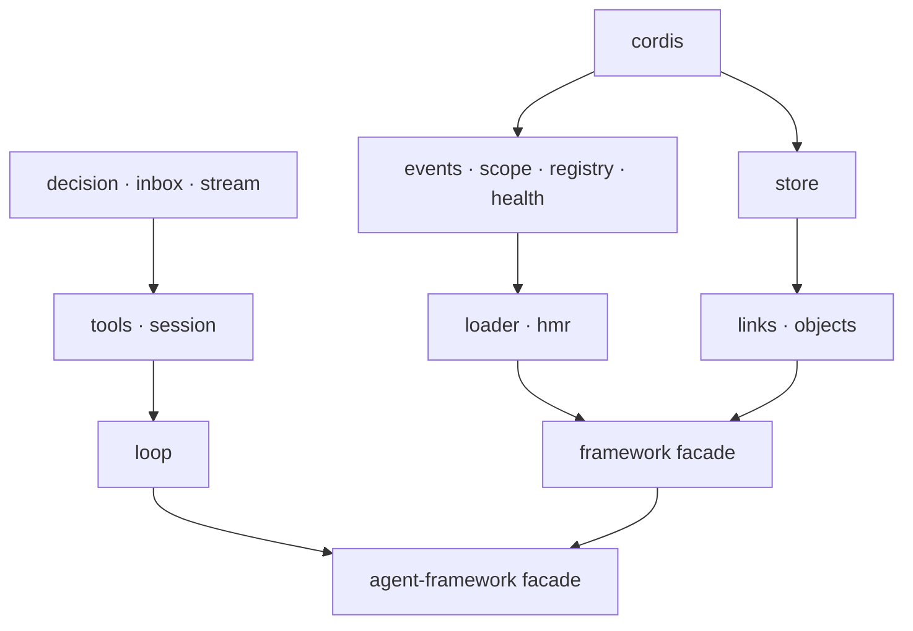

# 框架模型：两个框架与组件拼装

> **文档定位**：框架模型：两个框架与组件拼装（从 `03-总体架构与技术栈.md` 拆分/重命名而来，内容保持原样，链接已按新结构重写）。
> **所属索引**：[本目录索引](./README.md) · [总索引](../README.md)
> **来源分级**：一手来源为 [在线论文](https://arxiv.org/abs/2608.25512v1) 与 [GitHub 源码](https://github.com/earendil-works/pi)（逐文件链接见正文）；汇总见 [事实登记](../architecture/fact-registry.md)。

## 目录

- [1 目标与边界](#1-目标与边界)
- [2 从论文推导出的十条工程原则](#2-从论文推导出的十条工程原则)
- [4 两个框架 + 应用形态（组件拼装模型）](#4-两个框架-应用形态组件拼装模型)
- [5 monorepo 目录草案](#5-monorepo-目录草案)
- [6 依赖约束与分层](#6-依赖约束与分层)
- [13 交叉引用与验证](#13-交叉引用与验证)

## 1 目标与边界

### 1.1 目标

按用户规划，依次交付四层，每层都可独立使用、独立测试：

1. **开发框架层**（类 `@earendil-works/chord`）：提供上下文、fiber 生命周期、可撤销 effect、响应式 coeffect、依赖注入与隔离、声明式组件加载器、HMR。
2. **Agent 开发框架层**（类 `@earendil-works/pi-agent-core`）：在开发框架之上提供 agent loop、工具流水线、事件协议、状态机、可替换 hook——**核心保持极简，工具/模型/策略全部外置**。
3. **Agent 实现层**：在开发框架与 agent 框架之上实现具体 agent（内置工具、技能、会话、权限、工作流）。
4. **TUI 层**：用 OpenTUI + SolidJS 实现终端界面，UI 片段本身也是插件贡献。

### 1.2 明确不做

- 不做 Web ORM、不做通用后端框架；开发框架只提供动态组合语义（与 Cordis "meta-framework" 定位一致，见 [cordis-paper §10.0](../research/cordis-paper-theory.md)）。
- **产品轨**：第一版不实现自演化 agent 的自动代码生成与部署；只保证**架构允许**运行时组件替换（见 [plugin-system §8](../agent/plugin-system.md#8-自演化与安全管理)）。
- **研究轨（预留）**：框架预留递归自演化所需 seam（策略白名单、DecisionSurface、fitness/judge、资格门禁、ExperienceLibrary），未来可插拔装入，无需改框架。两个参考项目 DREAM-RSI 与 Harness² 的机制见 [recursive-self-evolution.md](../research/recursive-self-evolution.md)，研究轨批次见 [roadmap 阶段 6](../delivery/roadmap.md#阶段-6递归自演化研究轨可选后续)。
- 不引入多余抽象层（KISS/DRY/YAGNI）：四层各一个包，共享类型就地导出，不设 `@zeta-agent/types` 之类空壳包。

### 1.3 成功判据（论文给出的黄金判据）

最终静止状态只取决于最终配置，与加载/卸载顺序无关（Thm 80，[cordis-paper §9](../research/cordis-paper-system.md#9-元理论五条承重保证)）。我们将它作为端到端验收测试：同一组插件用不同顺序加载、替换、回滚，最终 ctx 的观察状态必须一致。

## 2 从论文推导出的十条工程原则

| # | 原则 | 论文依据 | 违反后果 | 详文档 |
| --- | --- | --- | --- | --- |
| P1 | **唯一变更入口**：所有上下文修改走 `ctx.effect` | [cordis-paper §10.0](../research/cordis-paper-theory.md) | 出现无法撤销的副作用，时间可组合性失效 | [framework §4](../framework/core-semantics.md#4-核心原语-ctxeffect) |
| P2 | **逆在施加点返回**，LIFO 累积 | [cordis-paper §4.2](../research/cordis-paper-theory.md) | 逆在不匹配的状态上执行 | [framework §5](../framework/core-semantics.md#5-撤销协议与-lifo-累积器) |
| P3 | **声明依赖与提供**，provider 唯一 | [cordis-paper §8.1](../research/cordis-paper-theory.md) | 依赖不明确、键冲突 | [framework §6](../framework/core-semantics.md#6-依赖注入与隔离) |
| P4 | **target / committed view 用 provider uid** | [cordis-paper §10.3](../research/cordis-paper-theory.md) | 同值替换无法被检测 | [framework §7](../framework/core-semantics.md#7-生命周期状态机) |
| P5 | **撤回延迟到消费者去活之后**（guard） | Thm 70，[cordis-paper §9](../research/cordis-paper-system.md#9-元理论五条承重保证) | teardown 读到已撤销依赖 | [framework §7](../framework/core-semantics.md#7-生命周期状态机) |
| P6 | **惯性状态机**：转换中不被打断，完成再检查 target | [cordis-paper §10.3](../research/cordis-paper-theory.md) | 半加载状态、竞态 | [framework §7](../framework/core-semantics.md#7-生命周期状态机) |
| P7 | **同键操作必须可交换**，顺序敏感显式声明 | [cordis-paper §7.2](../research/cordis-paper-theory.md) | 交错加载后状态依赖顺序 | [agent-framework §7](../agent-framework/tools-and-policies.md#7-顺序敏感部分中间件与提示词) |
| P8 | **获取 vs 发射分类**：只自动撤销获取 | [cordis-paper-system §12.1](../research/cordis-paper-system.md#12-讨论边界复用权限语言与循环依赖) | 错误承诺"自动回滚外部副作用" | [plugin-system §6](../agent/plugin-system.md#6-工具副作用的边界分类) |
| P9 | **core 不依赖 provider / 持久化 / UI** | agent-core 1.0.0 的架构决定（[02](../research/pi-baseline.md)） | 上层无法替换实现 | [agent-framework §2](../agent-framework/overview.md#2-包边界与依赖) |
| P10 | **插件 UI 用槽位贡献**，不由 core 直接画 | OpenTUI Solid plugin slots（[engineering §3.3](#33-opentui-solidjs)） | TUI 与插件耦合 | [doc §5](../agent/tui.md#5-插件-ui-槽位) |

## 4 两个框架 + 应用形态（组件拼装模型）

> **概念修正**：本项目只有**两个框架**——通用框架 `@zeta-agent/framework` 与 Agent 框架 `@zeta-agent/agent-framework`。每个框架**内部由许多组件拼装而成**；Cordis 复刻只是**通用框架内部的一个组件**，不等于通用框架本身。框架对上层应用暴露**封装好的 API（facade）**；CLI / TUI / 未来任何应用形态都调用框架 API，**不深入内核、不直接调用组件**。
>
> **依赖边界（重要）**：我们是**复刻论文、自行实现**，**不引入任何上游 Cordis 包**（`cordis`、`@cordisjs/*`、`@deepseek-ai/cordis` 均不在依赖树中）。`@zeta-agent/cordis` 是我们对自己实现的 `components/cordis` 的命名，与上游包无关。本设计所有对 S12 `vendor/cordis/src/*` 的引用都是**只读复刻蓝本**，不是依赖。

### 4.1 通用框架 `@zeta-agent/framework`

**定位**：由多个内部组件拼装成的通用运行时框架。Cordis 论文复刻是其中**一个组件**（提供 effect/coeffect/fiber 语义），不是框架全部；其余组件包括事件系统、scope、seam/registry、loader、HMR、store/link、HealthBoard 等。

**内部组件**（对外不可见，见 [04](../framework/overview.md)）：
- `cordis/`：`ctx.effect` / `get/set/isolate/intercept` / fiber 状态机（论文 §5.1 的复刻）
- `events/`：五种派发模式 + `interface Events` 声明合并做静态约束（非 @mode 装饰器）
- `scope/`、`seam/`、`registry/`：能力登记与范围路由
- `loader/`、`patch/`、`hmr/`：配置分层、entry 对账、运行时热替换（论文 §5.2 的复刻）
- `store/`、`links/`、`objects/`：可选数据/跨进程组件

**对外 facade API**（应用与各框架使用的唯一入口）：
`createContext()`、`defineKey()`、`defineComponent()`、`ctx.use()`、`ctx.provide()`、`ctx.on()`、`loader.load(profile)`、`ctx.hmr.watch()` 等。**应用不 import 内部组件**。

> S12 deepseek-harness 的 `vendor/cordis/src/*` 是 `cordis/` 组件的一手复刻蓝本；`packages/boot/*`、`events/*` 等是通用框架其他组件的蓝本。**HMR 属于通用框架的 loader 组件，是运行时能力，不是开发期工具**。

### 4.2 Agent 框架 `@zeta-agent/agent-framework`

**定位**：由多个内部组件拼装成的 agent 框架，构建在通用框架的 facade 之上。**内部组件**：loop / turn / inbox、工具流水线、decision/guard、session / stream / interrupt。

**对外 facade API**：`createAgent(options)`、`Agent` 类（subscribe / prompt / continue / abort / waitForIdle）、`AgentPlugin` 注册 API、`AgentRuntime` 注入。沿用 pi-agent-core 的极简边界：零内置工具、零 provider、零持久化（见 [02](../research/pi-baseline.md)）。详见 [05](../agent-framework/overview.md)。

### 4.3 应用形态层

应用形态直接调用上面两个框架的 facade API，不接触任何内部组件：

| 应用 | 调用的 facade |
| --- | --- |
| `apps/zeta-cli` | 通用框架：`createContext()` + `loader.load(profile)`；Agent 框架：`createAgent()`；CLI 参数、`--profile/--patch/--dump-config` |
| `@zeta-agent/tui` | Agent 框架：`agent.subscribe()` 订阅事件；通用框架：`ctx.slots` 贡献 UI；不 import 事件/scope 组件 |
| 未来 Web / 桌面 / RPC | 同一套 facade，形态差异只在装配与渲染 |

> 概念上不再有"L3 具体 agent 框架层"——agent 是 Agent 框架 `createAgent()` 的产物，其工具/技能/权限等以插件形式挂载；极简 harness 的主程序就是一个薄应用形态。插件清单与装配见 [06](../agent/plugin-system.md)。

### 4.4 依赖方向

**应用 → 框架 facade → （框架内部组件）**，且 Agent 框架 → 通用框架 facade。应用与组件之间**没有直接依赖边**。这对应论文的层次化组合（[cordis-paper §6.1](../research/cordis-paper-theory.md)），但比"四层直接调用内核"更严格：facade 是唯一入口。

## 5 monorepo 目录草案

**workspace glob**：`["apps/*", "packages/*", "packages/components/*", "packages/agent-components/*"]`。`components/` 与 `agent-components/` 是**分组目录，自身没有 `package.json`**——这是 Turborepo 官方建议的写法（不支持嵌套包的 `**`，但支持 `packages/*` + `packages/group/*` 且 group 不建 package.json，见 [engineering §3.2](#32-turborepo)）。

**精简约束**：不创建 `@zeta-agent/types`、`@zeta-agent/utils`、`@zeta-agent/config` 等公共包；类型与工具就在产生它们的组件包里导出。仅当出现真实的三处重复时才提取（YAGNI）。

### 5.1 组件子包清单与依赖图（C 方案）

> 决策记录：采用"facade 包 + 内部组件子包 + 分组目录"的混合方案（用户裁决）。参照 dsh 的 `packages/*/*` 组织方式；分组目录规避 Turborepo 的嵌套包限制。

**通用框架组件（`packages/components/*`）**：

| 包 | 职责 | 依赖的其他组件 |
| --- | --- | --- |
| `@zeta-agent/cordis` | effect/coeffect/fiber、context、target/committed、guard（论文复刻） | 无（最底层） |
| `@zeta-agent/events` | emit/parallel/serial/bail/waterfall、声明合并静态约束 | cordis（listener 注册=effect） |
| `@zeta-agent/scope` | `ScopeKey`/`Scoped<T>`、范围路由、双路径 teardown | cordis |
| `@zeta-agent/seam` | Seam 三段式登记、能力图、单一写入者断言 | cordis、scope |
| `@zeta-agent/registry` | `defineRegistry`/compose/accepts、contribution | cordis、seam |
| `@zeta-agent/loader` | profile/bundle/patch 分层、entry 对账、realm 重分配 | cordis、seam、registry |
| `@zeta-agent/hmr` | 运行时热替换、单队列、readiness、digest | loader、cordis |
| `@zeta-agent/health` | HealthBoard 单写者断言 | cordis |
| `@zeta-agent/store` | document/transaction/watch、Snapshot 链 | cordis、scope |
| `@zeta-agent/links` | memory/ipc/ws link、codec | store |
| `@zeta-agent/objects` | contract/object/reference（可选） | store、links |
| `@zeta-agent/testing` | fake context、断言、汇合性测试工具 | 全部组件（仅测试期） |

**Agent 框架组件（`packages/agent-components/*`）**：

| 包 | 职责 | 依赖 |
| --- | --- | --- |
| `@zeta-agent/loop` | runLoop、turn/step 状态机、HITL | decision、inbox、stream |
| `@zeta-agent/inbox` | next-turn/next-step 双队列、`inject()` | cordis（facade） |
| `@zeta-agent/decision` | Decision union、单调 guard、reason/act/exit | events（facade） |
| `@zeta-agent/tools` | 工具流水线、schemas allowlist、guardrail、结构化失败 | decision、scope（facade） |
| `@zeta-agent/session` | surface append/replace、message projection、replay | cordis/store（facade） |
| `@zeta-agent/stream` | AgentEvent 映射、块级流式、interrupt | events（facade） |

**切分原则**：
- `cordis` 是最底层组件，不依赖任何其他组件；其他组件按箭头方向逐层依赖，无环。
- 每个组件包可独立单测、独立替换实现（如换掉 `loader` 不影响 `cordis`）。
- facade 包（`framework`、`agent-framework`）只做装配与统一 API 出口，几乎不含逻辑。
- 应用只依赖两个 facade 包，不依赖任何组件子包（架构守护脚本强制）。

## 6 依赖约束与分层

### 6.1 package.json 依赖方向（静态可检查）

| 包/包族 | 允许依赖 | 禁止依赖 |
| --- | --- | --- |
| `packages/components/*`（通用框架组件） | 同族内按 [§5.1 依赖图](#51-组件子包清单与依赖图c-方案) 向下依赖；外部仅最小 | 反向依赖；上层 facade 包；`packages/agent-components/*`；应用 |
| `@zeta-agent/framework`（facade） | `packages/components/*` 全部、外部最小（esbuild/ws 可选） | agent-framework/agent/tui/cli |
| `packages/agent-components/*`（Agent 框架组件） | 同族内按 §5.1 向下依赖；通用框架组件的 **facade** | 反向依赖；应用；直接 import 通用框架组件内部实现 |
| `@zeta-agent/agent-framework`（facade） | `packages/agent-components/*` 全部、`@zeta-agent/framework` facade、可选 provider SDK | agent/tui/cli、持久化实现 |
| `@zeta-agent/agent` | 两个框架的 **facade** | tui、cli；任何组件子包 |
| `@zeta-agent/tui` | 两个框架的 **facade**（仅类型），`@opentui/*`, `solid-js` | agent、cli；任何组件子包 |
| `apps/zeta-cli` | 两个框架的 **facade** | 被任何包依赖；任何组件子包 |

> **架构守护规则**（C 方案强化）：静态检查需强制三条边界——① 禁止反向依赖；② 禁止 `apps/*`、`agent`、`tui` 直接依赖任何组件子包（`packages/components/*`、`packages/agent-components/*`）；③ 组件子包只能依赖同族更底层组件或另一框架的 facade，不得跨族深入。应用与框架内部组件之间只有 facade 一条通路（仿 dsh 的 `verify-application-entrypoints` 白名单脚本，见 [10 ENG-13](../research/dsh-optimizations.md#4-工程配置与-ui-优化eng)）。

> 注：pi-agent-core 本身只依赖 `pi-ai` + `pi-schema`，连 core runtime 都不依赖（[02](../research/pi-baseline.md)）。我们让 `@zeta-agent/agent-framework` 依赖 `@zeta-agent/framework` 是为了把 hook 变成 fiber 插件；若希望保持完全一致的解耦，可把依赖降级为**仅类型导入**（`import type`），运行时通过构造参数注入 ctx。建议：**默认仅类型导入 + 构造注入**，见 [agent-framework §2](../agent-framework/overview.md#2-包边界与依赖)。

### 6.1b 运行状态写入权表（P1，来源 [10 SUP-8](../research/dsh-optimizations.md#5-域层与治理优化sup)）

包依赖是静态约束，还需**运行时的单一写入者约束**：每种状态只有一个 writer，其余组件只读或通过窄接口请求。建议以断言落地（重复 claim 直接抛错，仿 `HealthBoard.claim`）。

| 状态 | 唯一写入者 |
| --- | --- |
| 会话消息 / surface 节点 | Session 服务（append / replace） |
| Prompt sections 与 tool schemas | systemPrompt 服务 |
| 工具注册表 | tools 服务 |
| fiber 生命周期状态 | core fiber 状态机（L-Begin…L-Unload） |
| effect 行 / 幂等 receipt | effects 服务插件 |
| 设置与策略版本 | settings 服务 |
| health 条目 | 在 HealthBoard claim 该名字的部件 |
| 插件配置树 | loader（按 profile 分层派生，见 [framework §8](../framework/components.md#8-组件加载器与-hmr)） |

调用方只拿到 `EngineFor<Role>` 式的窄接口（Pick），不传整个运行时；事件广播走带类型的 `DomainEvent` 联合 + 单一 `emit()`，避免插件互调形成隐式环。

### 6.2 键命名空间（防止 key collision）

- 所有 coeffect 键采用 `@scope/name:key` 形式，例如 `@zeta-agent/tools:registry`、`@zeta-agent/model:broker`、`@zeta-agent/session:store`；由 `defineKey<T>(namespace, name)` 工厂生成 symbol 键。
- 这是论文 §12.6 的"key namespacing"方案（`K×P`），代价很小（TS 里用 symbol + branded type），收益是消除独立插件同名键冲突。
- 组件版本通过 peer dependency 约束（论文指出的 Cordis 现行方案），在 loader 加载 entry 前校验。

### 6.3 循环依赖策略

- 构建期：turbo 任务图 + 包依赖检查禁止循环。
- 运行期：coeffect 依赖环会让相关组件永久 inactive（[cordis-paper §12.5](../research/cordis-paper-theory.md)），loader 在加载前按声明做静态环检测并报错。
- 确实需要双向交互时，按论文的四组件拆法把"双向"拆成两个 core + 两个 integration。

## 13 交叉引用与验证

| 本文决策 | 依据文档 | 验证点 |
| --- | --- | --- |
| P1-P10 | [01 论文精读](../research/cordis-paper-theory.md) 各节 | 逐条检查实现 |
| 四层包布局 | [04](../framework/overview.md)、[05](../agent-framework/overview.md)、[06](../agent/plugin-system.md)、[07](../agent/tui.md) | 包依赖方向 |
| agent-core 边界 | [02 pi 基线](../research/pi-baseline.md) | 不变量测试清单 |
| 键命名空间 | [cordis-paper §12.6](../research/cordis-paper-theory.md) | 同名键冲突测试 |
| HMR | [cordis-paper-system §10.6](../research/cordis-paper-system.md#10-实现cordis-三层架构与十一个算法) | 故障注入测试 |
| 技术栈版本 | 官方文档（§3 各链接） | lockfile 与 CI 日志 |
| 迁移映射 | [08 路线图](../delivery/roadmap.md) | 阶段验收 |

**返回索引**：[00 索引与交叉验证](../README.md)

## UML 视图

### 图 1：框架的使用用例（用例图）

### 图 2：组件依赖方向（组件图）

## 文档关系

| 关系 | 文档 |
| --- | --- |
| 所属目录索引 | [./README.md](./README.md) |
| 全局索引 | [总索引](../README.md) |
| 事实来源 | [事实登记与交叉验证矩阵](../architecture/fact-registry.md) |
