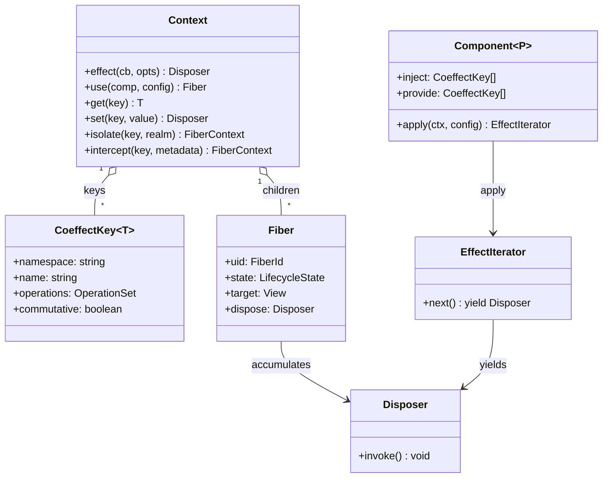
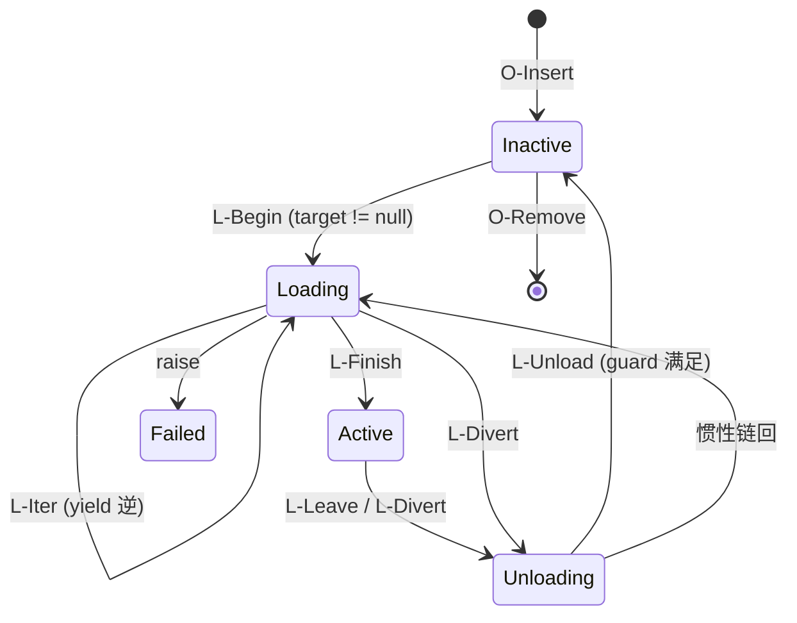

# 通用框架设计（framework）

> **目录定位**：`@zeta-agent/framework` 的**内部组件与对外 facade**。本框架由组件拼装而成；Cordis 论文复刻只是其中一个组件。对上层应用只暴露 facade API。
> **所属索引**：[总索引](../README.md)　|　**架构依据**：[architecture/framework-model.md](../architecture/framework-model.md)

## 文档清单

| 文档 | 内容 | 粒度 |
| --- | --- | --- |
| [overview.md](./overview.md) | 定位、包结构与 facade 出口、依赖边界声明 | 总览 |
| [core-semantics.md](./core-semantics.md) | 核心数据模型、ctx.effect、撤销协议、依赖注入与隔离、fiber 生命周期 | 核心语义 |
| [components.md](./components.md) | loader/patch、HMR、对象运行时、注册表 contribution | 框架组件 |
| [api-and-testing.md](./api-and-testing.md) | 测试与调试 API、与 chord/Cordis 对应、风险与开放问题、交叉引用 | API 与取舍 |

## 类图（核心类型）

## 状态机图（fiber 生命周期）

## 跨目录关系

- 上游：[architecture/framework-model.md](../architecture/framework-model.md) 定义本框架边界；[research/cordis-paper-theory.md](../research/cordis-paper-theory.md) 提供理论。
- 下游：[agent-framework](../agent-framework/README.md) 通过本框架 facade 使用能力；[agent](../agent/README.md)、[agent/tui.md](../agent/tui.md) 只调 facade。
- 事实核验：[architecture/fact-registry.md](../architecture/fact-registry.md)。
