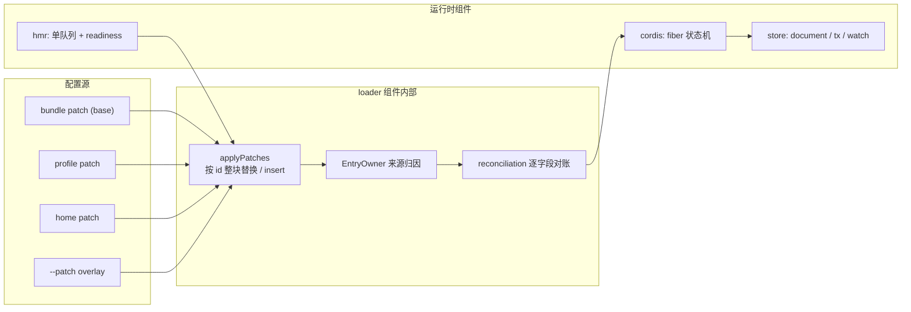
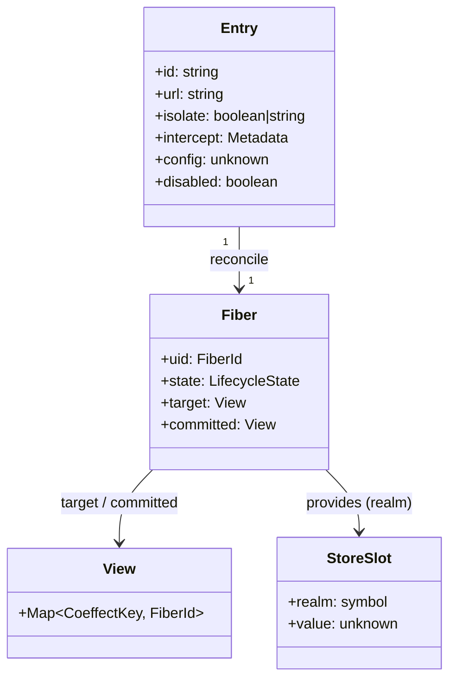
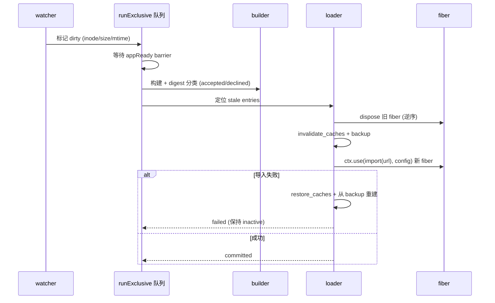

# 框架组件：loader、HMR、store 与注册表

> **文档定位**：框架组件：loader、HMR、store 与注册表（从 `04-开发框架层设计.md` 拆分/重命名而来，内容保持原样，链接已按新结构重写）。
> **所属索引**：[本目录索引](./README.md) · [总索引](../README.md)
> **来源分级**：一手来源为 [在线论文](https://arxiv.org/abs/2608.25512v1) 与 [GitHub 源码](https://github.com/earendil-works/pi)（逐文件链接见正文）；汇总见 [事实登记](../architecture/fact-registry.md)。

## 目录

- [8 组件加载器与 HMR](#8-组件加载器与-hmr)
- [9 对象运行时与跨进程边界（可选子路径）](#9-对象运行时与跨进程边界可选子路径)
- [10 注册表与 contribution](#10-注册表与-contribution)

## 8 组件加载器与 HMR

### 8.1 Entry（论文定义 81）

```ts
export interface Entry {
  readonly id: string;                 // 对账键，稳定
  readonly url: string;                // 组件模块 URL
  readonly isolate?: boolean | string; // true=局部 realm（按 id 标记）；string=全局 realm
  readonly intercept?: Metadata;       // 拦截元数据
  readonly config?: unknown;           // 绑定进 apply 的载荷
  readonly disabled?: boolean;         // administratively off
  readonly children?: Entry[];         // @zeta-agent/framework/group
}
```

entry ↔ fiber 双向绑定：字段变化 → 调整 fiber；组件自行改配置/禁用自己 → 回写 entry（chord 的插件也能自我修改应用，[02 chord 报告 §0](../research/pi-baseline.md)）。

> **P0 修订（[10 CORE-14 / ENG-1/2](../research/dsh-optimizations.md#4-工程配置与-ui-优化eng)）**：entry 不再由应用手写数组，而是**有序配置层派生**：`profile bundles → profile patch → home patch → --patch overlay`，作用于**空 entry 列表**。patch 引擎按 `id` **整块替换 config（非深合并）**或 `insert` 新行；`name` 不一致则跳过并告警；保留 `EntryOwner` 来源归因以支持 `--dump-config`。row 顺序不承载加载语义（激活由 service 可用性驱动）。字段增加 `volatile?: boolean`：volatile 变更走 `reflect.notify` 直接更新运行中的 fiber（不 remount），material 才走完整生命周期。preset 的 `config.plugins` 也是 entry list，同一 patch 机制递归应用。CLI 提供 `--profile` / `--dump-config`。

### 8.2 逐字段最小对账

| 字段变化 | 动作 |
| --- | --- |
| `id` / `url` | 重建 fiber（retire → 等去活 → remove → insert） |
| `isolate` | realm 重分配（见下） |
| `intercept` | 就地更新（读时 consult，不 reload） |
| `config` | 交给组件自己 diff，仅材料变化时 reload |
| `disabled` | true → unload；false → 重新 insert |

`@zeta-agent/framework/group` 把 `children` 作为 config，按 `id` 做 keyed diff，递归复用同一 dispatch；`@zeta-agent/framework/include` 加载外部 JSON/YAML 并嫁接子树——都是普通组件，用 `ctx.use` 实现，不进内核。

### 8.3 realm 重分配与 delimiters

问题：一个 realm symbol 可能被多个 fiber 共享，只有其中一个是 provider，如何只搬走"属于本 entry"的绑定？论文算法 7 的答案是 **delimiter**：每个键一个符号 `δk`，写在 context 上并被后代继承；entry 与 provider 的 `δk` 相同当且仅当两者在同一 isolate 作用域派生。重分配时：

1. 对变化的键 `k`，在 entry context 写新 `δk`（fresh tag）；
2. 记录 diff `(s1, s2, d1, d2)`：旧 realm、新 realm、entry tag、provider tag；
3. reload entry fiber；
4. 仅当 `d1 === d2` 且 `s1` 有绑定而 `s2` 没有时，把绑定从 `s1` 搬到 `s2`；
5. 用自定义 `affected` 测试（realm ∈ {s1,s2} 且 delimiter 分离）通知依赖方。

### 8.4 HMR 三阶段（借鉴 chord + 论文）

chord 的插件机制已经非常成熟：发现→esbuild 冷构建→`vm.Script` 求值（**无 module map / require cache**）→digest 驱动最小重求值→按 host 滚动发布→closure rule + 旧工作排空（[02 chord 报告 §3.4](../research/pi-baseline.md)）。论文的 HMR 三阶段（[01 §10.6](../research/cordis-paper-theory.md)）与之互补。我们的设计取两者之长：

**阶段 1：发现与构建（development 期）**
- 只列目录、读 `package.json`（不解析源码），字段 `zeta.plugins`（glob + `!` 排除，仿 chord/pi）。
- 每个 facet kind（如 `agent`、`tui`、`server`）一个文件，默认导出 component/facet。
- 用 esbuild 把组件打成**单文件 wrapper**（CommonJS/ESM），host 包与外部依赖保持 external；失败作为返回值 `BuiltFacet {kind:"failed", errors}`，不抛异常。
- 产物带 `digest`（输入文件哈希）；digest 相同则复用已求值对象（chord 的 `LoadedFacets.reload` 做法），插件对象不重启。

**阶段 2：分类与过期检测**
- stashed（内容已变文件）与 externals（不可热替换）作种子，取不动点：import 了 accepted 模块 → accepted；所有 import 都 declined → declined；循环未决 → declined（论文算法 8）。
- 对每个 entry 求依赖树（declined 为边界），与 accepted 相交即为 stale（论文算法 9）。

**阶段 3：事务式重载**
- `backup = invalidateCaches(accepted)`；逐个 `entry.fiber.dispose()` → `ctx.use(import(url), config)` 换新 fiber。
- 任一失败：恢复缓存，从 backup 重建所有 stale entry，**绝不半重载**（论文算法 10）。
- **不依赖 Bun 模块缓存驱逐**：采用"构建产物独立 URL + digest + 每次全新求值"的方式（chord 的 `vm` 思路），因为 Bun/ESM 没有稳定的公开 eviction API（论文脚注 6 对 Node 的说明）。在需要隔离的场景用 `vm` 或 worker；这是推断，需实测（见 §13）。

**与 chord 的差异**：chord 按 host kind 逐 host 滚动并保留"旧工作跑旧代码"；我们的最小版只在单进程内换 fiber，跨进程/滚动发布留到 [§9](#9-对象运行时与跨进程边界可选子路径) 的升级路径。


## 9 对象运行时与跨进程边界（可选子路径）

chord 把"跨进程对象"做成一等公民（[02 chord 报告 §4-5](../research/pi-baseline.md)）。我们在 `@zeta-agent/framework/objects` 提供**兼容思想的最小实现**，不作为内核依赖：

| chord 概念 | zeta 草案 | 最小版取舍 |
| --- | --- | --- |
| `local/remote` contract + version + fingerprint | `defineContract({name, version, params, members, accepts})` | 保留版本与 `accepts` 映射 |
| `createHost`, facet, `host.serve/get/reload` | `createHost`, `defineFacet`, `host.load/get/reload` | 复用 §7 fiber 状态机 |
| reference（live、release 保持存活） | `Reference<T>` + `release()` | 保留引用计数 |
| document `defineState` + `Tx` + watch | `defineDocument` + `tx.draft/put/...` | 第一版只做 JSON 文档与事务 |
| store（提交队列、group commit、outbox） | `openStore` + `defineTable` | 提供内存后端，SQLite 后端可选 |
| delta tracker（精确 op 批、顺序应用） | `track/prepare/adopt/applyImmutable` | 第一版只做进程内 |
| link（memory/ipc/ws）+ codec | `Link` + `memoryLinkPair` | IPC/WS 作为可选子路径 |
| registry contribution + compose | 见 §10 | 内核必需 |
| jobs / derive / native watch | 延后 | 需要时再加（YAGNI） |

**关键决策**：**不是 CRDT**——单一权威 + 有序副本 + 精确 delta 批（与 chord 一致，[02 chord 报告 §4](../research/pi-baseline.md)）。冲突通过"权威接受/拒绝 + 版本指纹 + 声明依赖 park"处理。这让 §7 的 fiber 生命周期覆用到对象重载：换插件代码时，对象要么 restarted / retried / ended / parked，旧调用跑旧代码、新调用等新代码。

> 升级路径：若后续需要 worker/web/tui 跨进程，直接引入 chord 风格的 `host.route(hostKind)` + `rollout` 机制；内核接口已通过 link 抽象留出位置。


## 10 注册表与 contribution

借鉴 chord：插件间**只通过契约与注册表交流**（[02 chord 报告 §3.5](../research/pi-baseline.md)）。

```ts
export function defineRegistry<C, V>(name: string, opts: { version: number; compose: (table: Table<C,V>, report) => V }): Registry<C,V>;

interface FacetHost {
  serve<C>(key: CoeffectKey<C>, provider: Provider<C>): void; // 唯一 provider
  references<C>(key: CoeffectKey<C>): Watchable<View<C>>;     // 只读活引用
}
interface FacetSelf {
  contribute<C>(registry: Registry<C, unknown>, value: Contribution<C>): void;
}
```

规则：

- 每个注册表只有一个 provider，由 `host.serve` 声明；贡献方 `self.contribute` 每注册表至多一个贡献。
- `compose(table, report)` 必须**纯同步、总有回退值**；表按插件名排序（与加载顺序无关）；冲突用 `report` 上报。
- 贡献可以是普通值或 watchable；watchable 变化时重新 compose。
- 使用点必须防御性捕获贡献代码异常（chord 设计规则），否则一个坏插件拖垮宿主。
- 版本通过 `accepts[version].value` 映射；版本不匹配 → fiber `FAILED { waiting }`，不喂错数据。

**与 fiber 的关系**：注册表本身就是一种 coeffect key（`@zeta-agent/registry:<name>`），provider 是一个 fiber，contribution 是 `ctx.set`；所以注册表机制**没有第二套生命周期**——完全落在 §4/§7。这正是"万物皆插件"的闭环。


## UML 视图

### 图 1：配置分层与加载组件（组件图）



### 图 2：Entry 与 Fiber 的对象关系（对象图）



### 图 3：HMR 事务式重载（时序图）



## 文档关系

| 关系 | 文档 |
| --- | --- |
| 所属目录索引 | [./README.md](./README.md) |
| 全局索引 | [总索引](../README.md) |
| 事实来源 | [事实登记与交叉验证矩阵](../architecture/fact-registry.md) |
