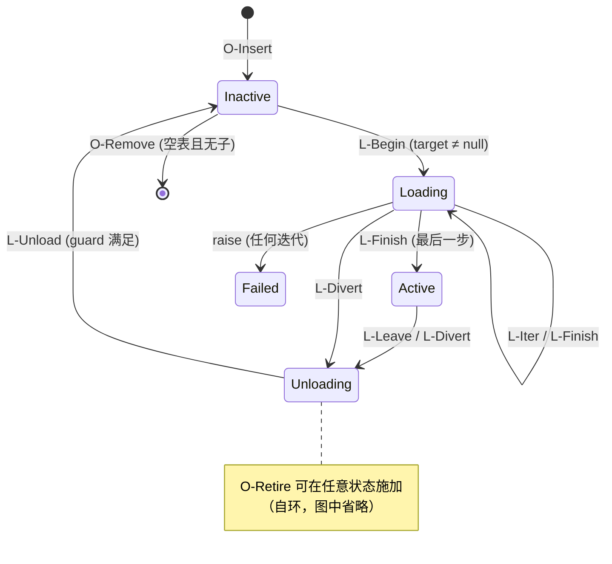
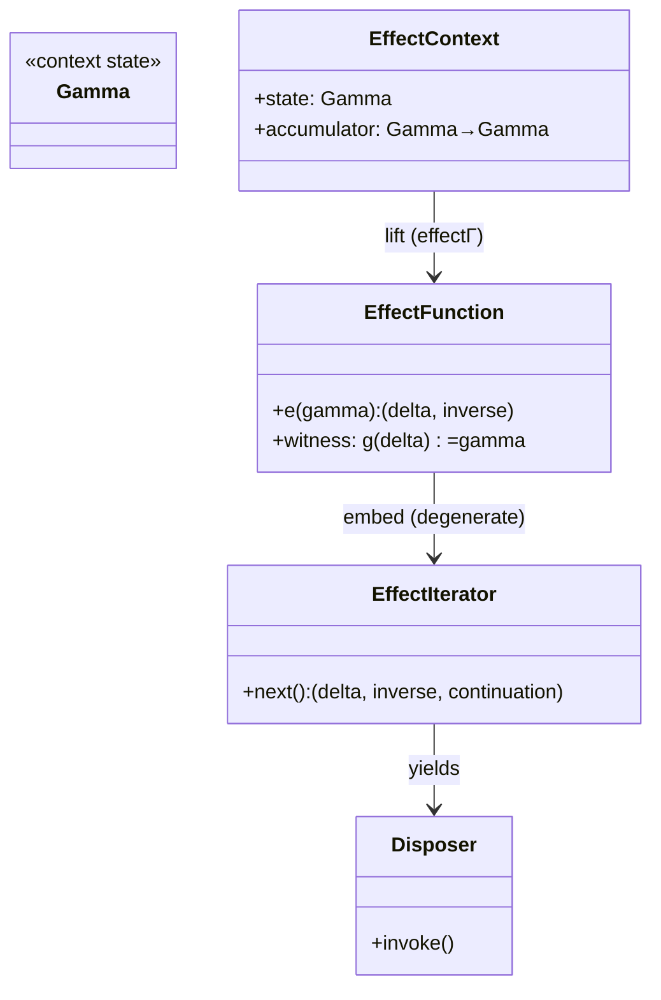
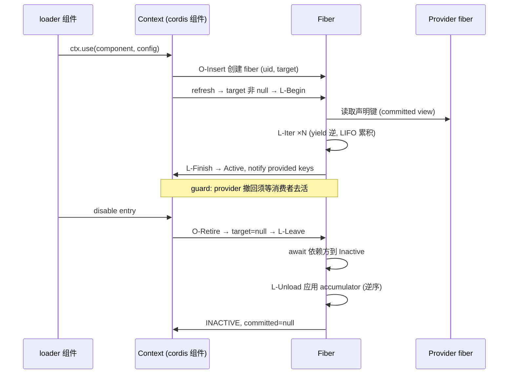

# 核心语义：effect、coeffect 与 fiber

> **文档定位**：核心语义：effect、coeffect 与 fiber（从 `04-开发框架层设计.md` 拆分/重命名而来，内容保持原样，链接已按新结构重写）。
> **所属索引**：[本目录索引](./README.md) · [总索引](../README.md)
> **来源分级**：一手来源为 [在线论文](https://arxiv.org/abs/2608.25512v1) 与 [GitHub 源码](https://github.com/earendil-works/pi)（逐文件链接见正文）；汇总见 [事实登记](../architecture/fact-registry.md)。

## 目录

- [3 核心数据模型](#3-核心数据模型)
- [4 核心原语 ctx.effect](#4-核心原语-ctxeffect)
- [5 撤销协议与 LIFO 累积器](#5-撤销协议与-lifo-累积器)
- [6 依赖注入与隔离](#6-依赖注入与隔离)
- [7 生命周期状态机](#7-生命周期状态机)

## 3 核心数据模型

### 3.1 键与 coeffect 声明

```ts
export interface CoeffectKey<T> {
  readonly namespace: string;
  readonly name: string;
  readonly symbol: symbol;          // 运行时唯一身份
  readonly operations?: OperationSet<T>; // 键上公开的操作（用于观察等价 ≃k）
  readonly commutative?: boolean;   // 同键操作可交换的见证（由 provider 保证）
}
export const defineKey = <T>(namespace: string, name: string, opts?: KeyOptions<T>): CoeffectKey<T>;
// 例：export const ToolsKey = defineKey<ToolRegistry>("@zeta-agent/tools", "registry", { commutative: true });
```

`namespace + name` 防止 key collision（[03 §6.2](../architecture/framework-model.md)）；`operations` 是论文定义 29 的 `A k`，`commutative` 是定义 46 的见证——**声明为 true 是 provider 的义务**，运行时不校验。

### 3.2 组件与 fiber

```ts
export interface Component<P = unknown, D extends CoeffectKey<any>[] = any, R extends CoeffectKey<any>[] = any> {
  readonly name: string;
  readonly version?: string;
  readonly inject: D;               // 需要的键（规格 d）
  readonly provide: R;              // 可提供的键（p）
  apply(ctx: FiberContext, config: P): EffectIterator | Promise<EffectIterator>;
  accepts?: Record<string, (value: unknown) => unknown>; // 版本映射，借鉴 chord
}

export type LifecycleState =
  | { kind: "INACTIVE" }
  | { kind: "FAILED"; error: unknown }                 // §4.4 failure 扩展
  | { kind: "LOADING"; iter: EffectIterator; dispose: Disposer; committed: View }
  | { kind: "ACTIVE"; dispose: Disposer; committed: View }
  | { kind: "UNLOADING"; dispose: Disposer; committed: View };

export interface Fiber<P = unknown> {
  readonly uid: FiberId;                 // 原子名，新鲜不复用
  readonly component: Component<P>;
  readonly parent: Fiber | null;
  readonly ctx: FiberContext;            // derived realization：子上下文
  state: LifecycleState;
  target: View | null;                   // ⊥ 用 null 表示
  inertia: TaskHandle | null;            // 在途转换
  children: Set<FiberId>;
}
```

`View = Map<CoeffectKey<any>, FiberId>`：记录每个声明键由哪个 fiber 提供——**存 uid 不存值**（[03 P4](../architecture/framework-model.md#2-从论文推导出的十条工程原则)）。

### 3.3 Context

```ts
export interface Context {
  readonly fiber: Fiber;
  readonly registry: Registry;
  readonly [@@store]: Map<symbol, unknown>;      // σ，symbol 键 = realm
  readonly [@@isolate]: Map<CoeffectKey<any>, symbol>; // ρ
  readonly [@@intercept]: Map<CoeffectKey<any>, Metadata>; // ι
  readonly dispose: Disposer;                    // 累积器（本层）
  effect(callback: EffectCallback): Disposer;    // 唯一变更入口
  use<P>(component: Component<P>, config: P): Fiber;
  get<T>(key: CoeffectKey<T>): T;                // σ(ρ(k))，不失败则返回值
  set<T>(key: CoeffectKey<T>, value: T): Disposer; // 受跟踪的 set
  isolate<T>(key: CoeffectKey<T>, realm?: symbol): FiberContext; // derived
  intercept<T>(key: CoeffectKey<T>, metadata: Metadata): FiberContext; // derived
  provide<T>(key: CoeffectKey<T>, value: T): Disposer; // ctx.set 的语义化别名
  [key: symbol]: unknown;                        // Proxy 属性访问（按 committed view 解析）
}
```

`ctx[key]` 解析算法（论文算法 6，[01 §10.4](../research/cordis-paper-theory.md)）：沿 fiber 链向上，找到第一个 committed view 绑定该键的 fiber → 返回；遇到声明但未提交的 fiber → 抛 `INACTIVE_ACCESS`；到根仍未声明 → 抛 `UNDECLARED_ACCESS`。`ctx.get(key)` 是不失败的 store 查询；`ctx[key]` 强制规格检查。


## 4 核心原语 ctx.effect

### 4.1 类型

```ts
export type EffectIterator = AsyncGenerator<Disposer | void, void, void>;
export type EffectCallback = (ctx: FiberContext) => EffectIterator | Disposer;
export type Disposer = () => void | Promise<void>;
export const composeDispose = (...ds: Disposer[]): Disposer;  // 前插组合 ⇒ LIFO
```

采用 async generator 是论文的 `Maybe(ℑ)` 续延在 TS 中的自然对应（[01 §4.3](../research/cordis-paper-theory.md)）：`yield dispose` = 一个 effect 步骤；`return` = 终止；`for await` 的每次迭代之间就是可中断边界。

### 4.2 算法

与论文算法 1 同构，但用 async generator：

```ts
async function execute(callback: EffectCallback, guard: () => boolean): Promise<Disposer> {
  const iter = toIterator(callback(ctx));           // 普通 Disposer 嵌入为单步 generator
  let inverse: Disposer = NOOP;
  while (guard()) {
    const { value, done } = await iter.next();
    if (value) inverse = composeDispose(value, inverse); // 新逆在前 ⇒ LIFO
    if (done) break;
  }
  return inverse;
}

function effect(ctx: Context, callback: EffectCallback): Disposer {
  let armed = true;
  const task = execute(callback, () => armed);
  const dispose: Disposer = async () => {
    if (!armed) return;              // 一次性
    armed = false;                   // 同时中断在途迭代
    const recover = await task;
    await recover();
  };
  ctx.dispose = composeDispose(dispose, ctx.dispose); // 提升为父级 effect
  return dispose;
}
```

**三条不可妥协的细节**：

> **P0 修订（[10 CORE-2](../research/dsh-optimizations.md#3-核心运行时优化core)）**：除"LIFO + 一次性"外，**exact disposer 身份是 load-bearing**——复合 generator effect 必须直接 `yield` 底层注册返回的那个 disposer，不能 `yield` 包装函数。包装会让注销变成并发兄弟，在最后一个 turn 仍在 drain 时就触发 teardown。`assertNoResidue` 需断言 teardown 位于正确的嵌套 yield 位置，而非仅"调用过一次"。

1. `armed` 防止二次撤销（在不产生该 effect 的状态上施加逆，违反 witness 前提）；
2. `guard` 在每次迭代前检查，既是中断也是"可取消"的实现（对应 agent 的 AbortSignal，见 [05 §6](../agent-framework/runtime.md#6-取消与中断)）；
3. 逆前插到 `ctx.dispose`，实现递归上下文 `∂²Γ`——子组件的撤销也是父组件的一个 effect。

**不验证的内容**：逆是否真的撤销（witness）；同键操作是否真的可交换（commutativity witness）。这两条都是 provider 作者义务，由测试与代码审查保证（[01 §10.1](../research/cordis-paper-theory.md)）。

### 4.3 与 chord 的统一

chord 的 `host.serve` / `self.contribute` / `host.references`（[02 chord 报告 §3.1](../research/pi-baseline.md)）在 `zeta-agent` 中全部归约为 `ctx.effect`：

| chord 概念 | zeta 归约 |
| --- | --- |
| `host.serve(Type, factory)` | `ctx.provide(Key, impl)` → `ctx.set` → `ctx.effect` |
| `self.contribute(Registry, value)` | `ctx.provide(registryKey, value)` + `compose` 作为 value 的操作 |
| `host.references(Type)` | `ctx[key]` / watchable view（committed view 的只读投影） |
| facet `setup` 只声明 | `component.apply` 只在加载时执行 effect；声明部分同步、无副作用 |

chord 的 "facet 在 load 之后不可能失败" 原则（setup 只做声明）我们保留：**`apply` 中任何可能失败的资源操作都必须通过 `ctx.effect` 的 yield 步骤完成，失败走 §7 的 FAILED 路径**，不会留下半加载状态。


## 5 撤销协议与 LIFO 累积器

### 5.1 规则

- 每个 effect 步骤 `yield` 一个逆；逆只负责撤销**该步骤在自己施加点产生的影响**。
- 撤销顺序严格 LIFO：`inverse = value ∘ inverse`。
- 嵌套：`ctx.use` 实例化子 fiber 时，父 fiber 得到的逆是"把子 fiber 的 target 设为 null 并 unload"——**子 fiber 的所有 effect 随父 fiber 一起撤销**（论文定义 52，[01 §8.2](../research/cordis-paper-theory.md)）。
- 一次性：多次调用 `dispose()` 只有第一次生效。
- 可观测性：`ctx.registry` + `ctx[@@store]` 提供测试断言入口；逆调用计数可通过 `onDispose` hook 观察。

### 5.2 获取 vs 发射（论文 §12.1，[01 §12.1](../research/cordis-paper-theory.md)）

| 类别 | 例子 | 处理 |
| --- | --- | --- |
| 获取（acquisition） | 注册监听、开连接、建会话、占端口、加路由 | 记录在内，逆自动撤销 |
| 发射（emission） | 发消息、写外部文件、调外部 API | 视为 `idΓ`，**不自动撤销**；需 withhold 或 compensation |

`ctx.effect` 的文档必须明确：开发者只能把"获取"放进 yield 的逆里；把"发射"的补偿放进去属于应用级补偿策略，需显式标记 `compensate: true` 并自行保证观察等价。


## 6 依赖注入与隔离

### 6.1 基本操作

```ts
function get(ctx, key) { return ctx[@@store][ctx[@@isolate].get(key) ?? key.symbol]; }

function set(ctx, key, value) {
  return ctx.effect(function* () {
    const realm = ctx[@@isolate].get(key) ?? key.symbol;
    ctx[@@store].set(realm, value);
    notify(ctx, [key]);
    yield () => { ctx[@@store].delete(realm); notify(ctx, [key]); };
  });
}
```

`set` 是 `𝔈*Σ`（[01 §5.1](../research/cordis-paper-theory.md)），自动获得跟踪与恢复；`notify` 对每个活 fiber 检查：键是否在其 `inject` 中、realm 是否一致 → `refresh(fiber)`（论文算法 3，[01 §10.2](../research/cordis-paper-theory.md)）。`refresh` 幂等使 neutral 变更无害。

### 6.2 隔离与拦截

- `ctx.isolate(key, realm?)`：派生一个子 context，只覆盖 `@@isolate[key]`，父表不变；逆为 identity（丢弃派生 context 即可）。`realm` 省略时生成新 symbol。用于**多 agent 会话 / 多租户 / 测试沙箱**：同一工具键在不同会话解析到不同实现。
- `ctx.intercept(key, metadata)`：派生 context，把 metadata 按 key 的 monoid 合并到 `@@intercept`（right-biased，context 优先）。provider 在依赖被调用时 consult 元数据决定是否允许（如只读数据库、路径白名单）。**不改变依赖是否满足，因此不触发 reload**（[01 §5.3](../research/cordis-paper-theory.md)）。
- 两者都是 derived realization（论文定义 23），没有需要跟踪的 effect；恢复=丢弃派生 context。

### 6.3 committed view 与读取

fiber 通过 `ctx[key]` 读依赖时，读的是**自己 committed view 指向的 provider 的绑定**，而不是裸 store（[01 §10.4](../research/cordis-paper-theory.md)）。这保证：

- 加载期间（含自己的 teardown）读到的依赖集合不变（Thm 71）；
- 未声明的访问在运行期被拒绝，形成 capability 式门禁（[01 §12.3](../research/cordis-paper-theory.md)）。


## 7 生命周期状态机

### 7.1 状态图



### 7.2 实现算法（论文算法 4-5 的 TS 化）

```ts
function use<P>(ctx: Context, component: Component<P>, config: P): Fiber {
  const fiber = new Fiber({ parent: ctx.fiber, component });
  fiber.ctx = ctx.withFiber(fiber);                     // derived context
  ctx.effect(function* () {
    refresh(fiber);                                     // O-Insert
    yield () => { fiber.target = null; unload(fiber); }; // O-Retire
  });
  return fiber;
}

function targetOf(fiber: Fiber): View | null {
  const view = new Map();
  for (const key of fiber.component.inject) {
    const provider = activeProviderOf(key, fiber.ctx);   // 只看 ACTIVE fiber 的表
    if (!provider) return null;                          // γ ⊭ d
    view.set(key, provider.uid);
  }
  return view;
}

function refresh(fiber: Fiber): void {
  const target = targetOf(fiber);
  if (viewsEqual(target, fiber.target)) return;
  fiber.target = target;
  if (fiber.inertia) return;                            // 惯性：转换中不打断
  if (target === null) {
    fiber.state = { kind: "UNLOADING", ... };           // L-Leave：先停止提供
    fiber.inertia = schedule(() => unload(fiber));
  } else {
    fiber.state = { kind: "LOADING", ... };
    fiber.inertia = schedule(() => reload(fiber));
  }
}

async function reload(fiber: Fiber): Promise<void> {
  const target0 = fiber.target;
  fiber.state.committed = resolve(fiber.component.inject); // 提交视图
  const iter = await fiber.component.apply(fiber.ctx, config);
  const dispose = await execute(iter, () => viewsEqual(fiber.target, target0));
  fiber.state.dispose = composeDispose(dispose, fiber.state.dispose);
  if (viewsEqual(fiber.target, target0)) {
    fiber.state = { kind: "ACTIVE", dispose, committed: fiber.state.committed };
    notify(fiber.ctx, providedKeys(fiber));
    fiber.inertia = null;
  } else {
    fiber.state = { kind: "UNLOADING", ... };             // 惯性链入 unload
    fiber.inertia = schedule(() => unload(fiber));
  }
}

async function unload(fiber: Fiber): Promise<void> {
  await Promise.all([...notify(fiber.ctx, providedKeys(fiber))].map(f => f.awaitIdle())); // guard
  await fiber.state.dispose();                           // LIFO
  fiber.state = { kind: "INACTIVE" };
  fiber.state.committed = null;
  if (fiber.target !== null) {                           // 惯性链回 reload
    fiber.state = { kind: "LOADING", ... };
    fiber.inertia = schedule(() => reload(fiber));
  } else fiber.inertia = null;
}
```

### 7.3 必须保持的语义（对应元理论）

| 语义 | 实现位置 | 论文保证 |
| --- | --- | --- |
| 只在依赖齐备时开始加载 | `targetOf` 返回 null 时不 L-Begin | Thm 70 |
| 撤回延迟到消费者去活之后 | `unload` 先 `await` 所有 notified fiber 到 INACTIVE | Thm 70 |
| 转换期间读到同一份依赖 | `reload` 提交 view，`unload` 最后才丢弃 | Thm 71 |
| 逆序撤销 | `composeDispose` 前插 | Thm 68 / Thm 16 |
| 系统必然静止 | guard 只等待已不满足的依赖方；依赖图按需遍历 | Thm 73 |
| 最终状态只取决于配置 | loader 对账 + 重试/失败规则 | Thm 80 |

### 7.4 失败与取消

- **失败**（论文 §4.4）：迭代抛错 → 进入 `FAILED`，把已累积的逆跑完（什么都没安装），错误留在 fiber 上；**不重试、不传播给父、兄弟不受影响**。`FAILED` 的 fiber 保持 quiet，target 即使非 null 也不会自动重启；配置 revision 才重试。
- **取消**：`ctx.effect` 的 guard 可接入 `AbortSignal`；agent 的 abort 通过取消在途迭代实现（[05 §6](../agent-framework/runtime.md#6-取消与中断)）。取消与失败不同：取消后 `state` 回 INACTIVE 且不写错误。
- **异步惯性**：TS 的 Promise 是 eager，`schedule()` 直接返回 Promise；宿主是惰性时（如 Rust future）需显式 spawn。我们使用 Bun/TS，取 eager 语义。


## UML 视图

### 图 1：effect context 类型关系（类图）



### 图 2：组件加载与卸载（时序图）



### 图 3：绑定变化传播（活动图）

```mermaid
flowchart TD
    S[ctx.set(key,value) 受跟踪 effect] --> N[notify 受影响 fiber]
    N --> Q{key 在 inject 且 realm 一致?}
    Q -->|否| END[忽略 / neutral]
    Q -->|是| R[refresh: 重算 target = provider uid]
    R --> C{target == committed?}
    C -->|是| END
    C -->|否| T{fiber.inertia 在途?}
    T -->|是| DEFER[记录 target, 转换完成后检查]
    T -->|否| D[target 非 null?]
    D -->|是| RELOAD[LOADING → reload]
    D -->|否| UNLOAD[UNLOADING → unload + guard]
```

## 文档关系

| 关系 | 文档 |
| --- | --- |
| 所属目录索引 | [./README.md](./README.md) |
| 全局索引 | [总索引](../README.md) |
| 事实来源 | [事实登记与交叉验证矩阵](../architecture/fact-registry.md) |
