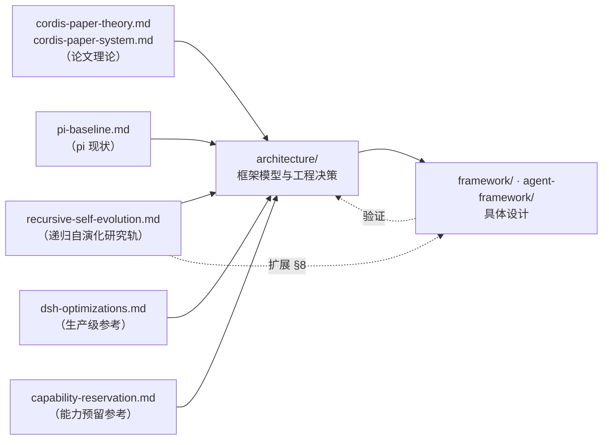
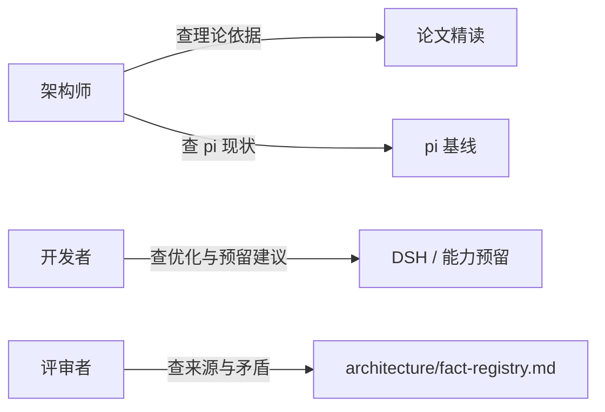

# 调研与事实源（research）

> **目录定位**：收集一切**一手事实**——论文原文、pi 源码基线、三个外部参照项目的调研结论、能力预留分析。本目录只回答"事实是什么"，不做架构决策。
> **所属索引**：[总索引](../README.md)　|　**决策输出**：[architecture](../architecture/README.md)

## 文档清单

| 文档 | 内容 | 粒度 |
| --- | --- | --- |
| [cordis-paper-theory.md](./cordis-paper-theory.md) | Cordis 论文 §1-7：问题域、effect/coeffect 理论、context paradigm、独立性 | 理论机制 |
| [cordis-paper-system.md](./cordis-paper-system.md) | Cordis 论文 §8-16：演算、元理论、实现算法 1-10、案例、讨论、相关工作 | 系统与元理论 |
| [pi-baseline.md](./pi-baseline.md) | pi 仓库一手源码基线：chord / agent-core / coding-agent / tui / 生态包 | 现状事实 |
| [dsh-optimizations.md](./dsh-optimizations.md) | deepseek-harness + superagent 调研，47 条优化建议（CORE/ENG/SUP） | 优化建议 |
| [capability-reservation.md](./capability-reservation.md) | AgentScope / CrewAI / LangGraph 调研，47 条预留建议（AS/CR/LG） | 预留建议 |
| [recursive-self-evolution.md](./recursive-self-evolution.md) | DREAM-RSI / Harness² 递归自演化调研，SE-D/SE-H 共 28 条建议 | 自演化研究轨 |

## UML 概览：本目录如何喂养架构

## 用例图（本目录服务谁）

## 跨目录关系

- 本目录的**事实**由 [architecture/fact-registry.md](../architecture/fact-registry.md) 逐条登记与分级。
- 本目录的**建议**由 [architecture/framework-model.md](../architecture/framework-model.md) 与 [architecture/engineering.md](../architecture/engineering.md) 取舍后落到 [framework](../framework/README.md) / [agent-framework](../agent-framework/README.md)。
- 所有"复刻而非引入"的依赖边界见 [总索引](../README.md)。
