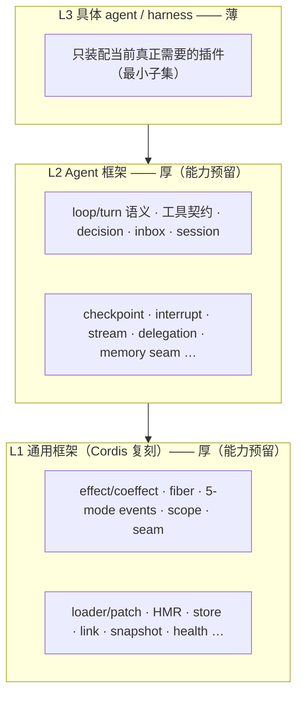

# 能力预留设计

> **文档定位**：能力预留设计（从 `11-能力预留设计.md` 拆分/重命名而来，内容保持原样，链接已按新结构重写）。
> **所属索引**：[本目录索引](./README.md) · [总索引](../README.md)
> **来源分级**：一手来源为 [在线论文](https://arxiv.org/abs/2608.25512v1) 与 [GitHub 源码](https://github.com/earendil-works/pi)（逐文件链接见正文）；汇总见 [事实登记](../architecture/fact-registry.md)。

## 目录

- [1 设计哲学：薄 harness，厚框架](#1-设计哲学薄-harness厚框架)
- [2 能力预留的判定标准](#2-能力预留的判定标准)
- [3 现有扩展点盘点](#3-现有扩展点盘点)
- [4 三项目调研结论](#4-三项目调研结论)
- [5 优化建议总表](#5-优化建议总表)
- [6 落地批次与验收](#6-落地批次与验收)
- [7 交叉引用与验证](#7-交叉引用与验证)

## 1 设计哲学：薄 harness，厚框架

### 1.1 核心命题

**当前交付的是一个极简 harness**（对齐 pi coding agent 的"minimal, extensible agent harness"定位）：单 agent、本地工具、交互式 TUI、无多 agent 编排、无图工作流、无长期记忆、无人在回路审批流。

**但框架层不能按当前用例裁剪**。原因是插件系统的存在改变了经济账：

- 没有插件系统时，预留未使用的能力是过度设计（YAGNI）；
- 有了"万物皆插件"的插件系统后，预留能力只是**多提供一组可被挂载的原语和契约**，其成本是接口定义与实现，收益是**未来无需改框架即可拼装新形态**。

因此形成分层策略：

**框架负责"能拼装什么"，harness 负责"实际拼了什么"。**

> 概念对齐：本文的 L1 = 通用框架 `@zeta-agent/framework`，L2 = Agent 框架 `@zeta-agent/agent-framework`。**两个框架各自内部都由许多组件拼装而成**（Cordis 只是通用框架内部的一个组件），框架对应用只暴露 facade API。因此"能力预留"指的是**框架内部组件与 facade 上的契约预留**，而不是让应用去接触组件。详见 [framework-model/engineering §4](../architecture/framework-model.md#4-两个框架-应用形态组件拼装模型)。

### 1.2 与 YAGNI 的关系

我们仍然遵守"不过度设计"，但把 YAGNI 的适用范围限定在**实现**而非**契约**：

| 层面 | 策略 | 理由 |
| --- | --- | --- |
| 契约 / 接口 / 扩展点 | **主动预留** | 改契约会破坏所有已装插件；提前定义成本低于未来迁移 |
| 具体实现 / 默认插件 | **按需实现** | 当前用不上的能力只留 seam 与默认 no-op 实现 |
| 装配清单 | **极简** | harness 只挂载需要的插件，避免运行期复杂度 |

这是"接口先行、实现后置"：**预留的是 seam 的两侧角色（Service Definition + Consumer 契约），默认 Provider 可以是 `unsupported` / `noop`，等需要时再装真正的 Provider 插件。**

### 1.3 与已有设计原则的关系

- 与 [03 P1-P10](../architecture/framework-model.md#2-从论文推导出的十条工程原则) 一致：P9（core 不依赖 provider/持久化/UI）正是能力预留的基础设施。
- 与 [10](./dsh-optimizations.md) 的 seam 三段式（CORE-13）一致：能力预留以 seam 为单位登记，而非零散 hook。
- 与 [cordis-paper §6.1](./cordis-paper-theory.md) 一致：`Σ` 可编码任何共享可变状态，所以 store/memory/checkpoint 等都是 coeffect key，不需要新增机制。

## 2 能力预留的判定标准

一个候选能力是否应预留，按以下四条判定（全部满足才进框架层）：

1. **形态可抽象**：能定义为 Service Definition（接口）+ Consumer 契约，而不是绑定某个具体实现。
2. **正交于现有语义**：不与 `ctx.effect` / fiber 生命周期 / turn 状态机冲突；能作为插件挂载或作为 coeffect key 注入。
3. **未来拼装需要**：存在明确的未来场景（多 agent、恢复、审批、长期记忆等），且该场景下**无法在插件层绕过**——即需要框架在关键路径上留出中断点/钩子。
4. **当前成本可控**：默认实现可以是 no-op / unsupported，不增加 harness 的运行开销与认知负担。

满足 1-2 但不满足 3 的，归入 L1 通用框架（纯原语）；满足 3 的，归入 L2 Agent 框架（需要在 agent 关键路径上预留钩子）；只满足 1-2 且更偏业务语义的，归入 L3 插件清单（按需实现）。

> 具体归类在 [§5 建议总表](#5-优化建议总表) 中逐条给出。

## 3 现有扩展点盘点

### 3.1 L1 通用框架已预留

| 能力 | 现有机制 | 文档 |
| --- | --- | --- |
| 唯一变更入口 / 撤销 | `ctx.effect` + exact disposer + LIFO | [framework §4](../framework/core-semantics.md#4-核心原语-ctxeffect) |
| 依赖声明 / 隔离 / 拦截 | `CoeffectKey` + `ctx.get/set/isolate/intercept` | [framework §6](../framework/core-semantics.md#6-依赖注入与隔离) |
| 事件 | 5 种派发模式 + `@mode` 校验 | [10 CORE-1](./dsh-optimizations.md#3-核心运行时优化core) |
| 生命周期 / 热替换 | fiber 状态机 + guard + HMR | [framework §7/§8](../framework/overview.md) |
| 服务登记 | seam 三段式 + 注册表 contribution | [10 CORE-13](./dsh-optimizations.md#3-核心运行时优化core) |
| 配置与分发 | profile/bundle/patch + `--dump-config` | [framework §8](../framework/components.md#8-组件加载器与-hmr) |
| 范围路由 | `Scoped<T>` + scope-filtered 事件 | [10 CORE-4](./dsh-optimizations.md#3-核心运行时优化core) |
| 可观测 | effect label + getEffects + HealthBoard | [10 CORE-16](./dsh-optimizations.md#3-核心运行时优化core) |
| 跨进程 | object / store / link 可选子路径 | [framework §9](../framework/components.md#9-对象运行时与跨进程边界可选子路径) |

### 3.2 L2 Agent 框架已预留

| 能力 | 现有机制 | 文档 |
| --- | --- | --- |
| 拦截 / 策略 | decision union + 单调 guard | [10 CORE-5/6](./dsh-optimizations.md#3-核心运行时优化core) |
| 输入队列 | inbox 双队列 + `agent.inject()` | [10 CORE-8](./dsh-optimizations.md#3-核心运行时优化core) |
| 所有权 | Agent vs AgentHandle + whenIdle | [10 CORE-9](./dsh-optimizations.md#3-核心运行时优化core) |
| 工具 | schemas allowlist + 强制 output + 条件并行 | [10 CORE-7/10](./dsh-optimizations.md#3-核心运行时优化core) |
| 会话 | surface append/replace + message projection | [10 CORE-11](./dsh-optimizations.md#3-核心运行时优化core) |
| 流式 | `agent/assistant-stream` start/chunk/end | [pi-baseline §4](./pi-baseline.md#4-earendil-workspi-agent-core极简-agent-运行时) |
| 扩展安装 | `AgentPlugin` 管线 + legacy 兼容 | [agent-framework §4](../agent-framework/runtime.md#4-agentplugin-管线替代-monkey-patch) |

### 3.3 尚未预留（本次调研要回答）

- 图/工作流编排（节点、条件边、子图、并行合并）；
- checkpoint / 恢复 / 时间旅行；
- 中断与人在回路（interrupt / resume）；
- 多 agent 角色、委托、群聊、共享状态；
- 记忆（短期/长期/实体）与知识/RAG；
- 任务/output schema / guardrail / 结构化输出；
- 评估/追踪/测试支持。

## 4 三项目调研结论

### 4.1 AgentScope 2.0（来源 S14）

> 一手来源：[agentscope-ai/agentscope](https://github.com/agentscope-ai/agentscope)。**版本校正**：仓库是 2.0，1.x 的 `ReActAgent`/`AgentBase`/`MemoryBase`/`MsgHub` 已不存在；2.0 只有统一 `Agent` 类 + middleware + `AgentState`。

**最值得借鉴的一点**：AgentScope 的价值不在多 agent 编排的复杂度，而在**把决策、事件、权限、记忆、执行环境都收敛成带显式类型的小接口，并让核心保持无状态依赖**——这与我们的 P9、`ctx.effect` 单一入口、插件即 fiber 的方向同构。

**建议清单（融入层 / 目标节 / API 草案要点 / 来源 / 未来场景）**：

| ID | 层 | 目标节 | 建议要点 | 来源 | 未来拼装场景 |
| --- | --- | --- | --- | --- | --- |
| AS-1 | L2 | 05 §5.2 | `AgentDecision = reasoning|acting|exit` 三态 union + **纯决策函数** `nextAction(state, finalMsg)`（无 IO），runLoop 只做 match | [agent/_utils.py:26-44](https://github.com/agentscope-ai/agentscope/blob/main/agent/_utils.py#L26-L44)、[agent/_agent.py:3657,1175](https://github.com/agentscope-ai/agentscope/blob/main/agent/_agent.py#L3657) | 可恢复/可回放 agent：决策可快照、可测试、可由不同调度器接管 |
| AS-2 | L1 | 03 §4 | **节点协议同构**：`NodeProtocol.replyStream(inputs): AsyncGenerator<AgentEvent|AgentMessage>`；Agent / Team / Goal / SOP 都实现它，可无限嵌套 | [pipeline/_base.py:15](https://github.com/agentscope-ai/agentscope/blob/main/pipeline/_base.py#L15)（故意用 `def` 返回 async generator 支持鸭子类型） | 多 agent 编排的最小前提：pipeline of pipelines |
| AS-3 | L2 | 05 §10 | `reduceEventIntoMessage(msg, event, replyId)`：按 block id 追加/更新、结束事件盖 finishedReason、replyId 不匹配跳过 | [message/_base.py:247-549](https://github.com/agentscope-ai/agentscope/blob/main/message/_base.py#L247-L549) | print/json 模式、事件回放、SSE 重连重建 transcript |
| AS-4 | L1/L2 | 05 §3.1 | 流式事件统一为**块级 start/delta/end 三段式** + 一次性 `HintBlockEvent`；事件基类带 `id/createdAt/metadata/replyId` | [event/_event.py:25-66,159-310](https://github.com/agentscope-ai/agentscope/blob/main/event/_event.py#L25-L66) | 多模态、语音截断（end 覆盖最终文本）、团队消息 |
| AS-5 | L2 | 05 §4/§7 | `MiddlewareBase` 七 hook + `isImplemented()` **零配置发现** + next_handler 洋葱链；与我们 priority/order 显式声明合并 | [middleware/_base.py:13-303](https://github.com/agentscope-ai/agentscope/blob/main/middleware/_base.py#L13-L303) | 生态插件多时只需实现关心的 hook，不写注册样板 |
| AS-6 | L2 | 05 §8、06 §6 | `onActing` **只包纯 I/O、不写 agent state** 的边界契约；state 注入工具需标注并发风险 | [middleware/_base.py:124-165](https://github.com/agentscope-ai/agentscope/blob/main/middleware/_base.py#L124-L165) | 长任务转后台 + 结果唤醒时避免中间件与主循环竞争 state |
| AS-7 | L2 | 05 §6、06 §5、03 §9 | **HITL park/resume 一等协议**：`RequireUserConfirm/RequireExternalExecution` ↔ `UserConfirmResult/ExternalExecutionResult/UserInterrupt`，按 replyId 路由；等待判据 = tool_call ↔ tool_result 配对；park 状态可序列化 | [event/_event.py:442-531](https://github.com/agentscope-ai/agentscope/blob/main/event/_event.py#L442-L531)、[agent/_agent.py:1870-2060](https://github.com/agentscope-ai/agentscope/blob/main/agent/_agent.py#L1870-L2060)、[state/_state.py:346-413](https://github.com/agentscope-ai/agentscope/blob/main/state/_state.py#L346-L413) | 审批、外部执行、多租户 RPC：可暂停/持久化/跨进程恢复 |
| AS-8 | L1/L2 | 03 §4.1、05 §11 | **长期记忆 provider 接口**：`onSystemPrompt/recall/record/key` + 每 provider 独立 `middleContext[providerKey]`；默认文件实现，可选 Mem0/ReMe | `middleware/_longterm_memory/...`、[state/_state.py:294](https://github.com/agentscope-ai/agentscope/blob/main/state/_state.py#L294) | 有记忆系统时加后端不改 L2 |
| AS-9 | L1 | 05 §11、03 §4.1 | **Offloader 端口**：`offloadDataBlock/offloadContext/offloadToolResult` → 可移植 URI（`workspace:///`） | [workspace/_offload_protocol.py:8-59](https://github.com/agentscope-ai/agentscope/blob/main/workspace/_offload_protocol.py#L8-L59)、[_base.py:1052-1239](https://github.com/agentscope-ai/agentscope/blob/main/_base.py#L1052-L1239) | 可恢复/可审计的上下文压缩：被压缩内容外置留引用 |
| AS-10 | L2 | 05 §8、§3.3 | **工具组 + 元工具**：保留 `basic` 组，非 basic 组自动注入 `ResetTools`，激活状态进 `toolContext.activatedGroups`；与我们 `exposure` 字段合并 | [tool/_tool_group.py:10-110](https://github.com/agentscope-ai/agentscope/blob/main/tool/_tool_group.py#L10-L110)、[_toolkit.py:66-134,473-554](https://github.com/agentscope-ai/agentscope/blob/main/_toolkit.py#L66-L134) | 几十个 MCP/Skill 时按需暴露 schema，避免撑爆 context |
| AS-11 | L2 | 05 §9（P0 CORE-6 对齐） | 权限决策类型 `PermissionBehavior{ALLOW,DENY,ASK,PASSTHROUGH}` + `bypassImmune`（危险操作任何 allow 都不能翻转）；`PermissionMode` 5 档 | [permission/_types.py:18-102](https://github.com/agentscope-ai/agentscope/blob/main/permission/_types.py#L18-L102)、[_decision.py:11-68](https://github.com/agentscope-ai/agentscope/blob/main/_decision.py#L11-L68) | 多插件权限链防提权（直接印证我们的单调 guard） |
| AS-12 | L1 | 05 §9、03 §4.1/§6.1 | **Workspace + Backend 双层执行环境**：`execShell/readFile/writeFile` 三原语；`SandboxedWorkspaceBase` 只留 provision/teardown/bootstrap 三个钩子；危险解压在 backend 侧做 | [tool/_builtin/_backend.py:138-247,741](https://github.com/agentscope-ai/agentscope/blob/main/tool/_builtin/_backend.py#L138-L247)、[workspace/_base.py:261-623](https://github.com/agentscope-ai/agentscope/blob/main/workspace/_base.py#L261-L623)、[_sandboxed_base.py:38-90](https://github.com/agentscope-ai/agentscope/blob/main/_sandboxed_base.py#L38-L90) | 不可信代码切 Docker/E2B/K8s 而不改工具 |
| AS-13 | — | 08 阶段 3-5、06 §8 | **仅参考**：SOP 定义/运行态分离（`SOP` + `SOPStepBase` + `SOPRunState`） | [sop/_schema.py:65-163](https://github.com/agentscope-ai/agentscope/blob/main/sop/_schema.py#L65-L163) | 未来工作流/可审计多步任务，当前不融入（避免 YAGNI） |
| AS-14 | — | 03 §4.4 | **仅参考**：服务层多租户实体 + 渠道适配 + `CustomEvent` | [app/storage/_base.py:9-31](https://github.com/agentscope-ai/agentscope/blob/main/app/storage/_base.py#L9-L31)、`app/channel` | 未来团队/多租户/IM 接入的 L4 蓝本 |

### 4.2 CrewAI（来源 S15）

> 一手来源：[crewAIInc/crewAI](https://github.com/crewAIInc/crewAI)，主包 `lib/crewai/src/crewai/`。**版本事实**：这是近期重构过的大规模实现（Flow 已拆为 dsl/runtime/flow_definition，Memory 已统一为 `unified_memory.Memory`），旧版 short/long/entity 记忆类已不存在。

**最关键的洞察**：CrewAI 的"多 agent"本质是 **角色 + 委托工具 + 单一任务循环**——`hierarchical` 与 `sequential` 共用同一个 `_execute_tasks`，差别只在任务指派对象（manager vs task.agent）。因此**我们 L2 不需要为多 agent 重写 loop，只需预留身份 / 委托 / 编排策略三个口子**。这与我们"薄 harness 厚框架"完全一致。

**建议清单**：

| ID | 层 | 目标节 | 建议要点 | 来源 | 未来拼装场景 |
| --- | --- | --- | --- | --- | --- |
| CR-1 | L1 | 04 §10、03 §6.1b | **typed Seam 注册表**：`defineSeam<T>(ns,name)` + `ctx.provide(seam,impl): Disposer`（重复 claim 抛错）+ `setSeamFactory`；显式实例优先 | [memory/storage/factory.py:33](https://github.com/crewAIInc/crewAI/blob/main/memory/storage/factory.py#L33)、[rag/factory.py:26](https://github.com/crewAIInc/crewAI/blob/main/rag/factory.py#L26) | 换 memory/knowledge/flow 后端时避免散落 N 个 setter（复用我们已有的 seam 草案） |
| CR-2 | L1 | 04 §6、05 §4 | **通用拦截点 + 作用域 hook**：`defineInterceptionPoint` + `dispatch(point,ctx)`；全局 + scoped hook；`AbortEffect` 中止、其余 fail-open | [hooks/dispatch.py:40-130](https://github.com/crewAIInc/crewAI/blob/main/hooks/dispatch.py#L40-L130) | 审批/审计/权限/跨 agent 策略需要有序可撤销拦截，避免 monkey-patch |
| CR-3 | L1/L2 | 05 §10、04 五模式事件 | **事件信封因果链**：`Envelope{eventId,parentEventId,previousEventId,triggeredByEventId,emissionSequence}` + AsyncLocalStorage scope 栈 | [events/base_events.py:66-87](https://github.com/crewAIInc/crewAI/blob/main/events/base_events.py#L66-L87)、[event_context.py:261-368](https://github.com/crewAIInc/crewAI/blob/main/event_context.py#L261-L368) | 多 agent 委托/嵌套 Flow 的 trace 还原"谁触发谁" |
| CR-4 | L1/L2 | 05 §3.1/§10 | **handler 依赖图决定派发顺序**（FastAPI Depends 式）：`onEvent(name,{dependsOn,mode},fn)`，无依赖并行、有依赖拓扑串行 | [events/depends.py:43](https://github.com/crewAIInc/crewAI/blob/main/events/depends.py#L43)、`handler_graph.py` | 几十个 observer 时显式依赖比隐式 priority 可靠 |
| CR-5 | L2 | 05 §3、06 §11 | **极薄 WorkUnit**：`{id,input,outputSchema?,contextRefs?}`，不含 agent 分配/重试；runLoop 每轮接收一个 | [task.py:131-329](https://github.com/crewAIInc/crewAI/blob/main/task.py#L131-L329)、[task_output.py:15](https://github.com/crewAIInc/crewAI/blob/main/task_output.py#L15) | 顺序/层级编排需要"声明输入输出与依赖"的载体，否则只能塞字符串 |
| CR-6 | L2 | 05 §5、06 §11 | **context 双语义**：`contextRefs:"all"|WorkUnitId[]|"none"`（对应 NOT_SPECIFIED/list/None） | [crew.py:1896-1904](https://github.com/crewAIInc/crewAI/blob/main/crew.py#L1896-L1904)、[task.py:178-181](https://github.com/crewAIInc/crewAI/blob/main/task.py#L178-L181) | sequential 拼装时最自然的上下文传播，显式 list 可建 DAG |
| CR-7 | L2 | 05 §3.1/§4/§8 | **Guardrail 有序 waterfall + 重试预算**：`addGuardrail(fn,{priority,maxRetries})`，失败 feedback 回灌 | [guardrail_types.py:12](https://github.com/crewAIInc/crewAI/blob/main/guardrail_types.py#L12)、`task.py:331-387/1425/1545` | coding agent 的结构化输出/patch 自修正 |
| CR-8 | L2 | 05 §3.4、06 §2 | **角色描述符 + 委托工具工厂**：`defineRole({role,goal,backstory,canDelegate})` + `createDelegationTools(peers)`（按 role 归一化匹配） | [base_agent.py:255-280](https://github.com/crewAIInc/crewAI/blob/main/base_agent.py#L255-L280)、[agent_tools/agent_tools.py:16](https://github.com/crewAIInc/crewAI/blob/main/agent_tools/agent_tools.py#L16)、[delegate_work_tool.py:16](https://github.com/crewAIInc/crewAI/blob/main/delegate_work_tool.py#L16) | 多 agent 身份 + "把活转给谁"的原语 |
| CR-9 | L2/L3 | 03 §4、06 §11 | **可插拔编排策略**：`OrchestrationStrategy{run(units,ctx)}`，实现 sequential/hierarchical；**manager 只持委托工具**（强制校验） | [process.py:4](https://github.com/crewAIInc/crewAI/blob/main/process.py#L4)、`crew.py:736-755/1537-1576/1673-1707` | "manager 只分派不碰业务工具"防上下文污染与安全扩散 |
| CR-10 | L2 | 05 §8/§9 | **结构化工具失败 + 四级策略级联**：`failure{reason,code,retryable,details}` + `ToolFailurePolicy=ignore|warn|raise`（tool→unit→agent→crew） | [tools/tool_failure.py:35-130](https://github.com/crewAIInc/crewAI/blob/main/tools/tool_failure.py#L35-L130)、[cache_handler.py:38-44](https://github.com/crewAIInc/crewAI/blob/main/cache_handler.py#L38-L44) | 多 agent 依赖工具结果做委托决策，需机器可读失败信号 |
| CR-11 | L2/L3 | 06 §3、04 §5 | **工具预算 + opt-in 缓存（fail-closed）**：`maxUsageCount` 原子 `_claimUsage`、`cachePolicy` 默认不缓存、不可解析一律 never | `base_tool.py:98-110/329-351`、[cache_handler.py:10-60](https://github.com/crewAIInc/crewAI/blob/main/cache_handler.py#L10-L60) | 多 agent 共享工具与额度时的成本治理 |
| CR-12 | L2/L3 | 04 §6、06 §5 | **Memory 作为 coeffect provider + 能力视图**：`scope(path)→ctx.isolate`、`slice(scopes,readOnly)→ctx.intercept`；复用已有语义而非新造 API | [unified_memory.py:686-931](https://github.com/crewAIInc/crewAI/blob/main/unified_memory.py#L686-L931)、`memory_scope.py:39/229` | 多 agent "同店不同 scope""只读切片"能力隔离 |
| CR-13 | L1/L2 | 04 §9、03 §6.2 | **RAG/embedder provider 注册表 + 声明式 spec**（判别联合），含维度变化版本治理 | [rag/factory.py:21-77](https://github.com/crewAIInc/crewAI/blob/main/rag/factory.py#L21-L77)、[rag/embeddings/types.py:34-82](https://github.com/crewAIInc/crewAI/blob/main/rag/embeddings/types.py#L34-L82) | 知识库 provider 演进（维度变化、隐私本地化） |
| CR-14 | L2/L3 | 04 §7、05 §5 | **声明式 WorkflowDefinition + 条件/事件/racing 执行器**，每个 step 编译成 fiber（复用 L1 状态机） | [flow/flow_definition.py:81-233](https://github.com/crewAIInc/crewAI/blob/main/flow/flow_definition.py#L81-L233)、[flow/runtime/__init__.py:444](https://github.com/crewAIInc/crewAI/blob/main/flow/runtime/__init__.py#L444) | "研究→写代码→评审→修复"多步编排需可序列化可持久化的图 |
| CR-15 | L2/L3 | 06 §5、03 §9 | **InputProvider seam + CheckpointStore + pause/resume(feedback)** | [flow/input_provider.py:93](https://github.com/crewAIInc/crewAI/blob/main/flow/input_provider.py#L93)、[flow/persistence/base.py:18](https://github.com/crewAIInc/crewAI/blob/main/flow/persistence/base.py#L18) | 审批/澄清的暂停恢复；print/rpc 模式 provider 不同 |
| CR-16 | L2/L3 | 05 §11、06 §6 | **Checkpoint + 可序列化 hook 引用（可信门控）**：只许 `"mod.fn"`，反序列化需显式 trust 开关，hook 带 digest | [types/callback.py:1-72](https://github.com/crewAIInc/crewAI/blob/main/types/callback.py#L1-L72)、[base_tool.py:49-95](https://github.com/crewAIInc/crewAI/blob/main/base_tool.py#L49-L95) | 长事务恢复时防代码注入（安全边界） |
| CR-17 | — | 03 §9、05 §12 | **仅参考**：遥测作为插件、默认禁用、no-op fast path、字段级脱敏 | [telemetry/telemetry.py:1-130](https://github.com/crewAIInc/crewAI/blob/main/telemetry/telemetry.py#L1-L130) | 极简 harness 绝不内置上报 |

**不要照搬**：`AgentMeta` 在事件 emit 时触发 re-validation 的隐式副作用（违反 P1）；进程级全局 factory（多租户/测试隔离差）；`HallucinationGuardrail` 是 no-op；A2A 与平台强耦合。

### 4.3 LangGraph（来源 S16）

> 一手来源：[langchain-ai/langgraph](https://github.com/langchain-ai/langgraph)（HEAD `84ced60`，2026-11-18）。**战略定位事实**：[AGENTS.md:27-58](https://github.com/langchain-ai/langgraph/blob/main/AGENTS.md#L27-L58) 明确"LangGraph is a runtime"——低层专注 graph execution / checkpointing / streaming / interrupt-resume，agent 构建属于上一层；`prebuilt` 为 maintenance-only（`create_react_agent` 已弃用）。

**最值得借鉴的结构性事实**：`create_react_agent` 只是 **StateGraph + 两个节点 + 条件边 + Send**，所有状态、中断、流式、持久化都来自 `Pregel` 执行引擎与 `checkpoint` 层，agent 层不重复实现。这与我们"L1 厚原语、L2 薄接口"完全一致。**优先级建议：先落 L1 原语（LG-1..5），L2 只留薄接口（LG-8..11）。**

**建议清单**：

| ID | 层 | 目标节 | 建议要点 | 来源 | 未来拼装场景 |
| --- | --- | --- | --- | --- | --- |
| LG-1 | L1 | 04 §9、§3 | **Channel/Reducer 状态槽**：`defineChannel({key,init,update,snapshot,restore})` + `LastValueChannel`/`ReducerChannel`/`BarrierChannel`；update 纯函数且顺序确定 | [channels/base.py:19-120](https://github.com/langchain-ai/langgraph/blob/main/channels/base.py#L19-L120)、[binop.py:66-159](https://github.com/langchain-ai/langgraph/blob/main/binop.py#L66-L159) | 子图/并行工具时需要确定性合并与可快照恢复的槽 |
| LG-2 | L1 | 04 §9、08 A4 | **带单调 ID 的 Snapshot + SnapshotStore**（UUIDv6/逻辑时钟，`get/put/list/fork`） | [checkpoint/base/__init__.py:39-147](https://github.com/langchain-ai/langgraph/blob/main/checkpoint/base/__init__.py#L39-L147)、[base/id.py:79](https://github.com/langchain-ai/langgraph/blob/main/base/id.py#L79) | time travel / 崩溃恢复 / fork 调试 |
| LG-3 | L1 | 04 §4/§5.2 | **ctx.effect durable step 选项**：`{stepKey, durability:'none'|sync|async|exit, onReplay}` | [types.py:99-105](https://github.com/langchain-ai/langgraph/blob/main/types.py#L99-L105)、[pregel/_loop.py:1275-1369](https://github.com/langchain-ai/langgraph/blob/main/pregel/_loop.py#L1275-L1369) | 插件加载/会话写入 durable 时判断"该步骤是否已提交" |
| LG-4 | L1 | 04 §6.2、03 §6.2 | **层次化命名空间 scope**：`ctx.childScope(name)` / `scopePath()` / `checkpointMap` | [_internal/_constants.py:59-96](https://github.com/langchain-ai/langgraph/blob/main/_internal/_constants.py#L59-L96)、[pregel/main.py:1154-1212](https://github.com/langchain-ai/langgraph/blob/main/pregel/main.py#L1154-L1212) | 多 agent/子图/租户在同一上下文树寻址与回溯 |
| LG-5 | L1 | 03 §6.1b、04 §10 | **单一写入者 + 确定性写序**：`writeSortKey=(taskPath,taskId,idx)` + 纯函数 `applyWrites` | [checkpoint/base/__init__.py:185-196](https://github.com/langchain-ai/langgraph/blob/main/checkpoint/base/__init__.py#L185-L196)、[pregel/_algo.py:234-266](https://github.com/langchain-ai/langgraph/blob/main/pregel/_algo.py#L234-L266) | 并发 fiber 写同键时保证 Thm 80 汇合性 |
| LG-6 | L1 | 04 §2(events.ts)、05 §10 | **事件/流 Transformer 扩展点**：`registerEventTransformer({init,process,finalize,scope,beforeBuiltins})` | [stream/_types.py:44-143](https://github.com/langchain-ai/langgraph/blob/main/stream/_types.py#L44-L143)、`stream/transformers.py` | TUI 未来多种投影，避免改事件总线核心 |
| LG-7 | L1 | 03 §4.1、04 §9 | **BaseStore 作为 coeffect key**：`get/search/put/delete/listNamespaces(ns)`，经 `ctx.provide(StoreKey, impl)` | [store/base/__init__.py:708-1144](https://github.com/langchain-ai/langgraph/blob/main/store/base/__init__.py#L708-L1144)、[config.py:32-123](https://github.com/langchain-ai/langgraph/blob/main/config.py#L32-L123) | 跨会话记忆/skills 不破坏单一写入者 |
| LG-8 | L2 | 05 §2/§3.4/§12 | **注入式 AgentRuntime + ExecutionInfo**（context/store/streamWriter/executionInfo/control），hook 与 tool 统一签名 | [runtime.py:26-104,124-238](https://github.com/langchain-ai/langgraph/blob/main/runtime.py#L26-L104)、[prebuilt/tool_node.py:1697](https://github.com/langchain-ai/langgraph/blob/main/prebuilt/tool_node.py#L1697) | 多租户/审批/遥测时避免退回全局变量 |
| LG-9 | L2 | 05 §5/§11/§13 | **turn 作为可恢复检查点**：`beginTurn(cp)`/`resume(cp,answer)`，与 `replay:'never'|'safe'` 对齐 | [types.py:913-1058](https://github.com/langchain-ai/langgraph/blob/main/types.py#L913-L1058)、[pregel/_checkpoint.py:268-341](https://github.com/langchain-ai/langgraph/blob/main/pregel/_checkpoint.py#L268-L341) | 接 durable 插件无需改 runLoop 顺序（不变量不漂移） |
| LG-10 | L2 | 05 §6/§9、06 §6 | **类型化中断/恢复控制流**：`AgentInterrupt{id,value,responseSchema}` + `ResumeCommand`；**deny 单调不可翻回 vs interrupt 可协商** 类型分离 | [types.py:913-1058](https://github.com/langchain-ai/langgraph/blob/main/types.py#L913-L1058)、[errors.py:104-120](https://github.com/langchain-ai/langgraph/blob/main/errors.py#L104-L120)、[prebuilt/tool_node.py:968-1000](https://github.com/langchain-ai/langgraph/blob/main/prebuilt/tool_node.py#L968-L1000) | 命令审批刚需；防止链式 hook 把拒绝翻成允许 |
| LG-11 | L2 | 05 §3.1/§10、03 §9 | **结构化流式块 + getStreamWriter**：`AgentStreamPart{message|tool-update|custom,ns?}` | [types.py:132-151,274-377](https://github.com/langchain-ai/langgraph/blob/main/types.py#L132-L151)、[config.py:126-196](https://github.com/langchain-ai/langgraph/blob/main/config.py#L126-L196) | token 级渲染/进度/调试流不改所有 observable |
| LG-12 | L2 | 05 §8/§4.2、06 §6 | **工具结果携带 Command 式控制指令**：`command?:{update,goto,resume,graph}`，goto 只声明不立即执行 | [types.py:842-892](https://github.com/langchain-ai/langgraph/blob/main/types.py#L842-L892)、[state.py:1753-1779](https://github.com/langchain-ai/langgraph/blob/main/state.py#L1753-L1779) | 工具写会话状态/触发子任务/请求审批 |
| LG-13 | L2 | 05 §3.4、03 §4.2 | **子 Agent/子图节点协议**：`AgentNode{name,defer,invoke}`，Agent 自身实现它；恢复用 childScope + parent checkpointMap | [graph/_node.py:22-103](https://github.com/langchain-ai/langgraph/blob/main/graph/_node.py#L22-L103)、[types.py:748-836](https://github.com/langchain-ai/langgraph/blob/main/types.py#L748-L836) | 规划-执行/多 agent 时拼 supervisor 不改 loop 内核 |
| LG-14 | L2 | 05 §4/§7 | hook 链增加 `beforeBuiltins` 顺序位（与 priority 兼容） | [stream/_types.py:94-109](https://github.com/langchain-ai/langgraph/blob/main/stream/_types.py#L94-L109)、[chat_agent_executor.py:874-897](https://github.com/langchain-ai/langgraph/blob/main/chat_agent_executor.py#L874-L897) | PII 脱敏/提示词注入需在内置 hook 前改写 |
| LG-15 | L2 | 05 §8/§13、04 O-6 | **节点级策略元数据**：`{retry,timeout,cache,trace,onError}` 作为 registerTool options | [types.py:428-577](https://github.com/langchain-ai/langgraph/blob/main/types.py#L428-L577)、[graph/state.py:667-682](https://github.com/langchain-ai/langgraph/blob/main/graph/state.py#L667-L682) | 生产化时的重试/超时/缓存是节点元数据而非全局配置 |
| LG-16 | — | 03 §9 | **仅参考**：RPC/SDK 线协议字段 `Thread/ThreadState/RunCreate/Command/Send` | [sdk-py/schema.py:189-940](https://github.com/langchain-ai/langgraph/blob/main/sdk-py/schema.py#L189-L940) | 未来 RPC 实现零成本对接生态客户端 |

**恢复语义硬约束**：LangGraph 的 `interrupt()` 恢复时**节点从头重放全部逻辑**（[types.py:928](https://github.com/agentscope-ai/agentscope/blob/main/types.py#L928)），因此副作用必须按 id 幂等/去重——这正是我们 `AgentTool.replay:'never'|'safe'` 的对应钩子，应在 LG-9 中显式承接。

## 5 优化建议总表

三项目合计 **47 条建议**（AgentScope 14 + CrewAI 17 + LangGraph 16），按"预留层次"归并如下：

| 预留簇 | 涉及建议 | 融入层 | 一句话 |
| --- | --- | --- | --- |
| **决策与节点同构** | AS-1/2、CR-5/6、LG-13 | L1/L2 | 纯决策函数 + union；Agent 与编排器同构；WorkUnit 作工作载体 |
| **事件、因果与流** | AS-3/4、CR-3/4、LG-6/11 | L1/L2 | 事件信封因果链、handler 依赖图、块级流式、Transformer 扩展点 |
| **中断与人在回路** | AS-7、CR-15、LG-9/10、SUP-12 | L2 | HITL park/resume 一等协议；deny 单调 vs interrupt 可协商类型分离 |
| **持久化与恢复** | AS-8/9、CR-12/16、LG-1/2/3/7 | L1 | Channel/Reducer、Snapshot、durable step、Store coeffect、Offloader |
| **编排与多 agent** | CR-8/9/14、LG-13（AS-13 仅参考） | L2 | 身份/委托/编排策略三个口子；WorkflowDefinition + 子图节点 |
| **工具治理** | AS-6/10、CR-7/10/11、LG-12/15 | L2 | onActing 纯 IO 边界、工具组、guardrail、结构化失败、预算与节点策略 |
| **权限与安全** | AS-11/12、CR-2、LG-10 | L1/L2 | 单调 guard + bypassImmune；Backend 三原语；通用拦截点 |
| **仅参考（L3/L4）** | AS-13/14、CR-17、LG-16 | — | SOP、服务层实体、遥测插件、RPC 线协议 |

**优先级判断**（综合三项目的共识）：

- **P0（先落 L1 原语）**：LG-1/2/3/4/5、AS-2/4、CR-1/2 —— 这些是其他一切能力的地基，且不与当前极简 harness 冲突。
- **P1（L2 薄接口）**：AS-1/3/5/6/7、CR-5/6/7/8/9/10/15、LG-8/9/10/11/12 —— 在关键路径上留钩子，当前用 no-op 默认实现。
- **P2（插件层按需实现）**：记忆后端、RAG、工具组、编排策略、SOP、遥测、RPC —— 只留 seam，不写实现。

## 6 落地批次与验收

| 批次 | 内容 | 验收 |
| --- | --- | --- |
| **C0** | P0 L1 原语：Channel/Snapshot/durable step/scopePath/writeSortKey + 事件信封与 Transformer 注册点 | 04 新增对应类型草案；汇合性测试扩展为"并发写 + 快照恢复后状态一致" |
| **C1** | P1 L2 薄接口：Decision union / WorkUnit / HITL interrupt / AgentRuntime / stream part / NodeOptions | 05 不变量清单新增"决策可回放、interrupt 不被错误处理吞、deny 不可翻 allow"三组测试 |
| **C2** | seam 与插件层：Memory/Store/RAG/Orchestration/Backend 的 Seam 定义 + no-op 默认 Provider | seam catalog 校验每个 seam 至少 1 provider；框架单测不依赖任何具体 harness |
| **C3** | 仅参考项进入 docs 草案（RPC 线协议、SOP 形态），不实现 | 文档交叉引用完整 |

**核心验收原则**：框架层的任何新增能力都不得让当前极简 harness 变复杂——以"框架单测可独立运行、harness 装配清单不增长"为硬性判据。每条建议将标注：融入层次（L1/L2/L3/仅参考）、目标文档节、API 草案、来源路径、未来拼装场景。

## 7 交叉引用与验证

| 本文结论 | 依据 | 验证 |
| --- | --- | --- |
| 薄 harness 厚框架 | 用户目标 + [03 P9](../architecture/framework-model.md#2-从论文推导出的十条工程原则) | 框架单测不依赖具体 harness |
| 能力预留判定标准 | [cordis-paper §6.1](./cordis-paper-theory.md)、[10 CORE-13](./dsh-optimizations.md#3-核心运行时优化core) | seam catalog 校验 |
| 现有扩展点盘点 | [04](../framework/overview.md)、[05](../agent-framework/overview.md)、[10](./dsh-optimizations.md) | 各文档交叉引用表 |
| AgentScope 调研（S14） | `agentscope/src/agentscope/` 一手源码 | AS-1..14 的 API 草案与来源 |
| CrewAI 调研（S15） | `crewAI/lib/crewai/src/crewai/` 一手源码 | CR-1..17 的 API 草案与来源 |
| LangGraph 调研（S16） | `langgraph/libs/` 一手源码（HEAD `84ced60`） | LG-1..16 的 API 草案与来源 |
| 47 条建议分层 | [§5 总表](#5-优化建议总表) | [§6 批次 C0-C3](#6-落地批次与验收) |

**返回索引**：[00](../README.md)

## 文档关系

| 关系 | 文档 |
| --- | --- |
| 所属目录索引 | [./README.md](./README.md) |
| 全局索引 | [总索引](../README.md) |
| 事实来源 | [事实登记与交叉验证矩阵](../architecture/fact-registry.md) |
