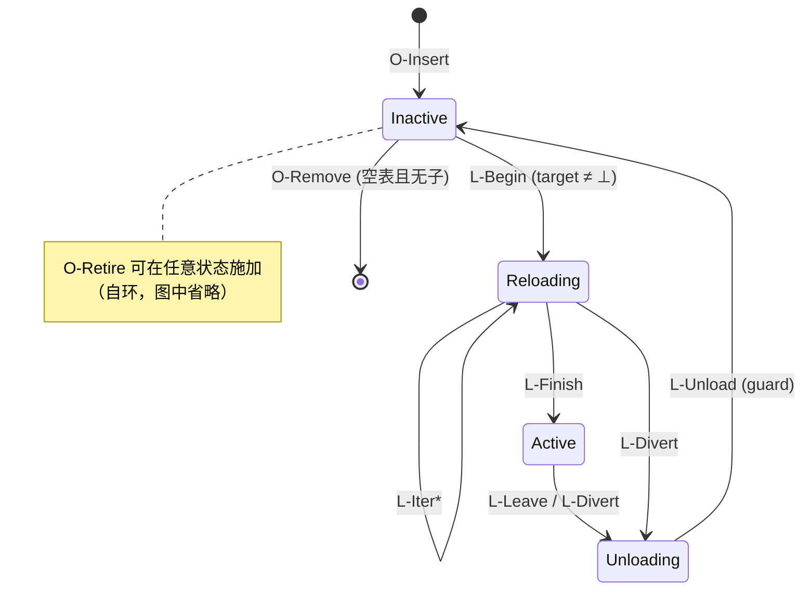
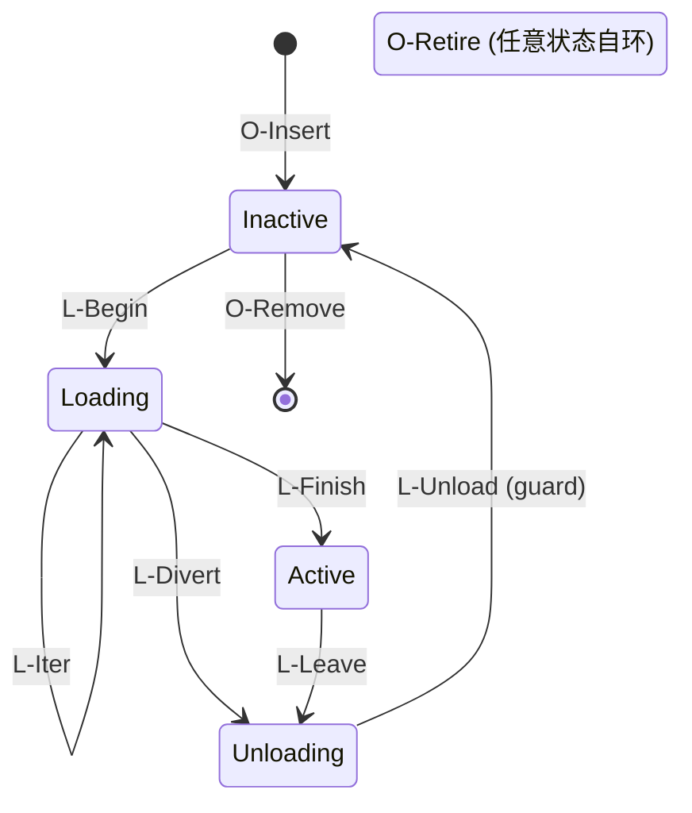
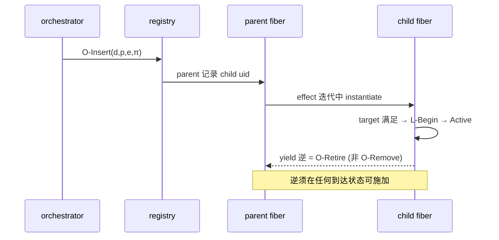

# Cordis 论文精读：演算、实现与讨论

> **文档定位**：Cordis 论文精读：演算、实现与讨论（从 `01-Cordis论文精读.md` 拆分/重命名而来，内容保持原样，链接已按新结构重写）。
> **所属索引**：[本目录索引](./README.md) · [总索引](../README.md)
> **来源分级**：一手来源为 [在线论文](https://arxiv.org/abs/2608.25512v1) 与 [GitHub 源码](https://github.com/earendil-works/pi)（逐文件链接见正文）；汇总见 [事实登记](../architecture/fact-registry.md)。

## 目录

- [8 动态组合演算：组件与 fiber](#8-动态组合演算组件与-fiber)
- [9 元理论：五条承重保证](#9-元理论五条承重保证)
- [10 实现：Cordis 三层架构与十一个算法](#10-实现cordis-三层架构与十一个算法)
- [11 案例研究：Koishi](#11-案例研究koishi)
- [12 讨论：边界、复用、权限、语言与循环依赖](#12-讨论边界复用权限语言与循环依赖)
- [13 相关工作定位](#13-相关工作定位)
- [14 与本项目目标的关系](#14-与本项目目标的关系)
- [15 证据强度与不确定性](#15-证据强度与不确定性)
- [16 交叉引用与验证](#16-交叉引用与验证)

## 8 动态组合演算：组件与 fiber

### 8.1 组件与 fiber（PDF p.31-33）

- **定义 48（component）**：`ℭΓ ≜ (d:𝔇Γ) × (p:𝓟Γ) × ℑ(d∪p)Γ`，三元组 `(d,p,e)`：
  - `d`：需要的依赖（inject specification）
  - `p`：可提供的键（provision）
  - `e`：在 `d∪p` 上带见证的 effect iterator——定义组件活跃时的 effect 及撤销它们的逆。
- **定义 49（fiber）**：组件的一次实例化，元组 `⟨d,p,e,π,σ,τ,θ⟩`：
  - `π`：父 fiber（或 `root`）
  - `σ`：fiber 自己的 coeffect 表，激活前为空，由 effect 写入
  - `τ`：retirement flag（`⊥` 新鲜，`⊤` 已被编排器退休）
  - `θ`：生命周期状态 `Inactive | Reloading(i,g,ω) | Active(g,ω) | Unloading(g,ω)`；`i` 剩余迭代器，`g` 累积器，`ω: d→𝔑` **committed view**（记录提交时每个依赖由哪个 fiber 提供）。
  - `installed(n,γ) ≜ θn ≠ Inactive`（式 44）。
- **定义 50（registry）**：状态 `γ` 持有 `Fγ: 𝔑 ⇀ 𝔉Γ`，parent 指针构成以 `root` 为根的树；fiber 名是原子（只判等，不计算/检查结构），对应动态创建局部名的纪律 [40]。
- **派生 coeffect context（式 46）**：`σγ = ⋃{σm | m ∈ dom(Fγ), θm = Active(−,−)}`——**只聚合 Active fiber 的表**；provision 不相交（O-Insert 拒绝第二个声明同键的 fiber），故每个键恰好一个 provider。
- **定义 51**：`σSγ` 是所有 fiber（不限 Active）在键集 `S` 上的绑定；观察等价与见证在此读取。

### 8.2 九条规则（PDF p.34-38，Table 1 见 p.40）

**编排规则（orchestration，`γ ⇒ δ`）——外部输入**：

| 规则 | 前提 | 效果 |
| --- | --- | --- |
| **O-Insert** | `n` 不在 registry；父存在；`(d,p,e)∈ℭΓ`；∀m. `p∩p_m=∅` | 插入 `⟨d,p,e,π,⌀,⊥,Inactive⟩`。最后的"单源"前提保证每个键只有一个 provider |
| **O-Retire** | `n ∈ dom(Fγ)` | 只写 `τn ← ⊤`，与生命周期状态无关（它是请求，不是动作） |
| **O-Remove** | `τn=⊤ ∧ θn=Inactive ∧ σn=⌀ ∧ ∀m. πm≠n` | 从 registry 删除 `n`；先子后父，且只删空表项 |

**生命周期规则（lifecycle，`γ ⟶ δ`）——系统自主**：

- **Definition 52（instantiation）**：迭代可以实例化组件——在父 fiber 上做 O-Insert（`π=n`），返回的逆是 O-Retire。**插件加载插件**的机制；逆选择 Retire 而非 Remove，因为 O-Remove 有前提，逆必须"在任何到达的状态都能施加"。
- **Definition 53（target view）**：`target_n(γ)` 在 `τn ∨ ¬(γ⊨d_n)` 时为 `⊥`，否则 `k ↦ provider_k(γ)`。记录 **provider 的 uid 而非值**：uid 新鲜不复用，替换 provider 不会被误认为旧的，即使值相同。
- **L-Begin**：`θn=Inactive ∧ ω=target_n(γ)≠⊥` → `Reloading(e_n, idΓ, ω)`。
- **L-Iter**：`θn=Reloading(i,g,ω) ∧ target_n(γ)=ω ∧ i(γ)=(δ,h,Just(i′))` → `δ`，`θn=Reloading(i′, g∘h, ω)`。逆按 `g∘h` 前插 → LIFO。
- **L-Finish**：同上但 `o=Nothing` → `Active(g∘h, ω)`。
- **Definition 54（relied）**：`relied_n(γ) ≜ ∃m≠n,k∈d_m. installed_m(γ) ∧ ω_m(k)=n`——是否有其他已安装 fiber 的 committed view 指向 `n`。
- **L-Divert**：在 Reloading 中 target 改变时转入 `Unloading(g∘h,ω)`，可在迭代边界中止当前迭代（aborting）或让它落地（landing，异步宿主只能选后者，见 §4.4 的 inertia）。
- **L-Leave**：`Active(g,ω) ∧ target_n(γ)≠ω` → `Unloading(g,ω)`；**先停止提供 coeffect，再安排逆**。
- **L-Unload**：`Unloading(g,ω) ∧ ¬relied_n(γ) ∧ g(γ)=δ` → `δ`，`Inactive`。**演算中唯一施加累积器的规则**；`¬relied` 是 **guard**，保证消费者先卸载、提供者后撤回。

**confinement（定义 55-56）**：effect function 只能 ① 写自己 `σn` 和 `σm|d_n`（声明键的值在 provider 表里）、② 读自己 `σn` 与声明键；不得读写控制字段、不得读写未声明的表。实例化是唯一例外。定义 56 给出 stage 沿 coeffect 投影的 lift；引理 57 证明其自动满足 confinement 与 witness。

### 8.3 生命周期状态机（Figure 1，p.34）



**guard 不会死锁的理由**（p.37）：一旦 L-Leave / L-Divert 把 `n` 标记，`σγ` 只聚合 Active fiber，`n` 的表立即退出 `σγ`，于是没有 target view 还能指向 `n`，所有 committed 到 `n` 的消费者都在退出途中。这是一个**按需遍历 provider 图**的协议，不需要预先拓扑分析。


## 9 元理论：五条承重保证

> 以下定理是论文的核心承重论断；每条都来自 PDF 正文（页码），并在 [09 事实登记与交叉验证矩阵](../architecture/fact-registry.md) 登记为"作者自述、数学证明随论文给出、未经本项目独立复核"。

| 编号 | 名称 | 页码 | 工程含义 |
| --- | --- | --- | --- |
| **Thm 64** | Preservation | 43 | 九条规则保持 registry 良构（parent 树、provision 不相交、表归属等） |
| **Thm 68** | Recovery exactness | 44 | 一个 fiber 的 episode 中，即使交错其他 fiber 的步骤，其 effect 仍被精确恢复到 `≃`（在它自己的声明键上） |
| **Cor 69** | Terminal recovery | 44 | 离开的 fiber 对状态的贡献归零——重建一个 entry 不会残留旧 fiber 的任何东西 |
| **Thm 70** | Ordering | 47 | fiber 只在依赖被提供时开始 transition；provider 的撤回延迟到所有消费者去活之后（guard）；组件在整个加载期（含自己的 teardown）都能读到同一份绑定 |
| **Thm 71** | Resolution coherence | 49 | 没有任何 transition 跨越它的 coeffect 的两次不同解析 |
| **Thm 73** | Progress | 49 | 若 precedence 关系 `≺` 无环且迭代器有限，系统必然 quiesce（静止）——不会永远卡在转换中 |
| **Thm 80** | Confluence | 51 | 汇合性：到达静止后，状态只取决于**最终配置**，与中间加载/替换/撤销的顺序无关；存在唯一正规形 |

**定理 80 的工程价值**（p.55）：编排器"添加组件 → 移除 → 换 provider → 撤销替换"保证到达与一开始就写下最终组合相同的状态；组件作者只需推理静止状态。注意**限制**：它说的是状态，不是过程中产生的 emissions（跨越系统边界的输出）——见 §12.1。

**四个扩展（§4.4，p.55-57）保持上述定理不变**：

1. **Asynchrony / inertia**：异步宿主的迭代与逆产出 future，L-Divert 只能取"landing"分支；fiber 在迭代落地后才从 `Unloading` 去活。所有定理量化所有步骤序列，故覆盖 inertial 序列。
2. **Failure**：迭代器可抛错 `Γ → Either(Ξ, Γ×(Γ→Γ)×Maybe(ℑ))`；raise 走 aborting L-Divert 路线进入 Unloading，到达 Inactive 且**什么都没安装**；错误作为 outcome 留在 fiber 上，**不重试、不传播给父、不影响兄弟**。实现中的 `FAILED` 状态承载它。
3. **Isolation**：把键空间从 `K` 扩到 `K×R`，realm 固定时 relaxed calculus 就是原演算在更大键集上的读取；`isolate` 在运行时改 realm 属于配置 revision。
4. **Configuration**：配置在 `e` 内部；声明式 revision（改配置/换 realm/禁用再启用）是若干规则的复合；启用用**新建 fiber** 而不是把 `τ` 写回 ⊥（因为被父的累积器 retire 的 fiber 必须保持 retired）。


## 10 实现：Cordis 三层架构与十一个算法

### 10.0 三层与理论↔实现映射（PDF p.57-58，Table 2）

Cordis 是**元框架（meta-framework）**：不像 Web 路由/ORM/UI 那样规定场景，只提供通用动态组合语义。三层：

1. **core library**：直接实现 effect / coeffect 系统；
2. **component loader**：配置对账（reconciliation）+ HMR；
3. **application frameworks**（如 Koishi）：在前两层上构建领域功能。

| 理论 | 实现 |
| --- | --- |
| `Γ∞` | `ctx`，一等上下文 |
| `𝔈Γ`, `ℑΓ` | 返回/产出逆的 effect callback |
| `effectΓ(e)` | `ctx.effect(callback)` |
| `Σ, Σiso, Σinter` | `ctx[@@store]`, `ctx[@@isolate]`, `ctx[@@intercept]` |
| `get(k), set(k,v)` | `ctx.get(key)`, `ctx.set(key,value)` |
| `isolate(k,r)`, `intercept(k,ν)` | `ctx.isolate(key,realm)`, `ctx.intercept(key,metadata)` |
| fiber `⟨d,p,e,π,σ,τ,θ⟩` | `fiber`，含 `uid`, `inject`, `provide`, `apply`, `parent.fiber.uid`, `ctx`, `state`, `dispose`, `committed` |
| `dom(Fγ)` | `ctx.registry` |
| `θ` | `fiber.state`（`LOADING`=Reloading，`FAILED` 承载错误 outcome） |
| `recover` / `g` | `fiber.dispose` |
| `ω` | `fiber.committed` |
| `provider_k(γ)` | provider fiber 处于 ACTIVE 的 Impl |
| `target(γ,n)` | `fiber.target`，由 `refresh` 重算；⊥=INACTIVE |
| `Future` / inertia | `fiber.inertia` |
| O-Insert / O-Retire | `ctx.use` 及其 callback 的逆（算法 4） |
| L-Begin/L-Iter/L-Finish | `execute` 的迭代循环（算法 1） |
| L-Divert | 迭代边界的 guard 失败，或 reload 链入 unload |
| L-Leave | `refresh` 把 fiber 标 UNLOADING（算法 5 第 10 行） |
| L-Unload | `unload` 及其惯性链接（算法 5） |
| guard | `unload` 等待被通知的依赖方（算法 5 第 25 行） |
| failure | fiber 上记录错误，target 置 ⊥ |

### 10.1 算法 1：`ctx.effect` / `execute`

```ts
async function execute(callback, guard) {
  const iter = callback();
  let inverse = () => {};              // id
  while (guard()) {
    const { value, done } = await iter.next();
    if (value) inverse = value.compose(inverse);   // 前插 ⇒ LIFO
    if (done) break;
  }
  return inverse;
}
function effect(ctx, callback) {
  let armed = true;
  const task = execute(callback, () => armed);
  async function dispose() {
    if (!armed) return;                 // 至多触发一次
    armed = false;                      // 同时停止在途迭代
    const recover = await task;
    recover();
  }
  ctx.dispose = dispose.compose(ctx.dispose);  // 子 effect 的逆提升为父 effect
  return dispose;
}
```

要点：① 所有上下文变更唯一入口；② `guard` 既是迭代边界中断，也是一次性撤销开关（防止在不产生该 effect 的状态上施加逆）；③ 撤销前插到父 `ctx.dispose`，实现 `∂²Γ` 的递归结构；④ **不验证 witness**——逆是否真的撤销是该组件作者的义务；coeffect 的交换性见证同样不验证（p.59）。

### 10.2 算法 2 / 3：coeffect 操作与通知

```ts
function get(ctx, key) {
  const realm = ctx[@@isolate][key];       // ρ(k)
  return ctx[@@store][realm];              // σ(ρ(k))
}
function set(ctx, key, value) {
  return ctx.effect(function* () {
    const realm = ctx[@@isolate][key];
    ctx[@@store][realm] = value;           // σ[ρ(k) ↦ v]
    notify(ctx, [key]);
    yield () => {                          // 逆
      delete ctx[@@store][realm];          // σ ∖ ρ(k)
      notify(ctx, [key]);
    };
  });
}
function notify(ctx, keys) {
  const affected = new Set();
  for (const fiber of allFibers)
    for (const key of keys)
      if (fiber.inject.has(key) &&
          fiber.ctx[@@isolate][key] === ctx[@@isolate][key]) {
        refresh(fiber); affected.add(fiber); break;
      }
  return affected;                         // 调用方可 await
}
```

`ctx.set` 因 `set ∈ 𝔈*Σ` 而自动获得跟踪与恢复；`notify` 是定义 22 的实现：变更键出现在一个活 fiber 的 `inject` 且 realm 一致 → `refresh` 重算 target；`refresh` 幂等使 neutral 变更无害。

### 10.3 算法 4 / 5：组件实例化与生命周期

```ts
function use(ctx, component, config) {
  function callback() {
    refresh(fiber);                       // O-Insert
    return () => { fiber.target = null; unload(fiber); };  // O-Retire
  }
  const fiber = new Fiber({ parent: ctx, inject: component.inject });
  fiber.ctx = ctx.withFiber(fiber);       // derived realization
  fiber.apply = () => component.apply(fiber.ctx, config);  // 绑定 config
  ctx.effect(callback);                   // 实例化是父的一个普通受跟踪 effect
  return fiber;
}

function refresh(fiber) {
  const target = targetOf(fiber);         // Definition 53 的 digest
  if (eqTarget(target, fiber.target)) return;
  fiber.target = target;
  if (fiber.inertia) return;              // 惯性：转换中不打断
  if (target !== null) {
    fiber.state = LOADING;
    fiber.inertia = createTask(reload(fiber));
  } else {
    fiber.state = UNLOADING;              // L-Leave：先停止提供
    fiber.inertia = createTask(unload(fiber));
  }
}
async function reload(fiber) {
  const target0 = fiber.target;
  fiber.committed = resolve(fiber.inject);          // 提交视图
  const recover = await execute(fiber.apply, () => eqTarget(fiber.target, target0));
  fiber.dispose = recover.compose(fiber.dispose);
  if (eqTarget(fiber.target, target0)) {
    fiber.state = ACTIVE;
    notify(fiber.ctx, provided(fiber));
    fiber.inertia = null;
  } else {
    fiber.state = UNLOADING;              // 惯性链入 unload
    fiber.inertia = createTask(unload(fiber));
  }
}
async function unload(fiber) {
  await Promise.all([...notify(fiber.ctx, provided(fiber))].map(f => f.await())); // guard：排空依赖方
  await fiber.dispose();                  // LIFO 恢复
  fiber.dispose = id;
  fiber.committed = null;
  if (fiber.target === null) { fiber.state = INACTIVE; fiber.inertia = null; }
  else { fiber.state = LOADING; fiber.inertia = createTask(reload(fiber)); }
}
```

关键工程细节：

- **target 用 provider 的 uid 而非值**：uid 新鲜不复用，所以"替换了 provider 但值相同"也会被检测为变化并触发 reload；provider 就地覆盖自己的绑定则**不观测**（想传播替换必须撤回再重装）。
- **两层检查**：transition 层在 reload/unload 完成时检查 target（惯性链接）；iteration 层在每个迭代边界检查 target（部分回滚）。
- **三行承载 Thm 70**：reload 第 14 行提交视图、unload 在所有逆跑完后才丢弃（teardown 也能读依赖）；`refresh` 第 10 行在任务创建**之前**标 UNLOADING（L-Leave）；`unload` 第 25 行等待被通知的依赖方到 INACTIVE（guard）。等待放在整个恢复之前，而不是某个逆内部。
- **guard 按绑定而非按 fiber**：只挡住 committed view 指向它的 fiber；realm 不同不算。

### 10.4 算法 6：Proxy 中介的属性访问

```ts
function resolve(ctx, key) {
  let fiber = ctx.fiber;
  while (true) {
    if (key in fiber.committed) return fiber.committed[key];
    if (fiber.inject.has(key)) throw INACTIVE_ACCESS;  // 声明但未加载
    if (fiber === root) throw UNDECLARED_ACCESS;       // 未声明
    fiber = fiber.parent.fiber;
  }
}
```

`ctx.get(key)` 是不失败的 store 查询；Proxy `ctx[key]` 则沿 fiber 链按 committed view 解析并**在使用的点强制 coeffect 规格 `d`**。这是 capability 式访问控制的基石（§12.3），也是"静态声明可在编译期检查"的钩子（§12.4）。

### 10.5 算法 7：配置对账与 realm 重分配

- **Entry 字段**（定义 81）：`id`（对账键）、`url`（组件模块）、`isolate`（隔离注解）、`intercept`（拦截注解）、`config`（绑定进 apply 的载荷）、`disabled`（ administratively off）。
- entry ↔ fiber 双向绑定：字段变化 → 调整 fiber；组件自行改配置/禁用自己 → 回写 entry。
- **按字段最小侵入对账**：`id/url` 变了 → 重建；`isolate` 变了 → 重分配 realm（算法 7）；`intercept` 变了 → 就地更新（读时 consult，无需 reload）；`config` 变了 → 交给组件自己 diff；`disabled` → unload/reload。
- `@cordisjs/group` 把子 entry 列表作为 config，按 `id` 做 keyed diff，递归复用同一套 dispatch；`@cordisjs/include` 加载外部 YAML/JSON 并嫁接子树——**都是普通组件**，建立在 instantiation 原语上。
- **delimiters（定界符）**：每个键一个符号 `δk`，写在上下文上并被后代继承；用于判断某绑定是否"属于"该 entry（entry 与 provider 的 `δk` 相同），从而只搬走属于它的绑定，并在 realm 重分配后正确通知依赖方。

### 10.6 算法 8-10：HMR 三阶段

`@cordisjs/hmr` 把可撤销效应模式应用到模块级；因为 fiber 已界定组件的全部 effect/coeffect，**HMR 不需要开发者标注 accept 边界**（对比 Webpack [48] / Vite [49]）。

1. **模块分类**：输入 stashed（内容已变的文件 URL）与 externals（不可热替换、触发整体重启）；从 stashed 的 imports 作种子，取不动点：某模块的某个 import 被 accepted → 它 accepted；所有 imports 都 declined → 它 declined；循环里未决的模块默认 declined。
2. **过期 entry 检测**：`get_dependencies(root, declined)` 沿 imports 传递（把 declined 当边界）；entry 的依赖树与 accepted 相交即为 stale，并把该树折入 accepted。
3. **事务式重载**：`backup = invalidate_caches(accepted)`（Node 上要同时清 ESM 与 CJS 缓存，脚注 3）；逐个 `entry.fiber.dispose()` 并 `ctx.use(import(url), config)` 换上新 fiber；**任一失败则恢复缓存并从 backup 重建所有 entry**，绝不进入半重载状态。

> 工程转译：这套三阶段算法是 Cordis component loader 的一部分，因此由我们在 **L1 通用框架内复刻**，是运行时核心能力而非开发期工具（同时服务于 agent 自演化）。见 [08 运行时 HMR](../delivery/roadmap.md#5-运行时-hmr-与测试) 与 [04 组件加载器](../framework/components.md#8-组件加载器与-hmr)。


## 11 案例研究：Koishi

- Koishi 是基于 Cordis 的开源聊天机器人框架，四年积累 **4000+ 社区插件**（IM adapter、数据库驱动、管理控制台、终端功能），论文称其为生产环境验证（p.69）。
- **表达力与通用性**：服务端每个功能都是插件，Koishi 只贡献聊天机器人领域词汇；其 Web 控制台是**第二个独立的 Cordis 应用**，插件组合的是浏览器与 UI 的原语而非服务端原语。论文据此主张 (1) 原语足以承载完整生产系统，(2) 模型只固定组合方式、不预设领域或运行时。
- **时间可组合性无认知负担**：编排器从控制台禁用插件即就地撤销；开发期 HMR 保存时重应用编辑过的插件，同时保留别处的缓存与活连接；作者无需写 uninstall 路径。
- **空间可组合性跨开放生态**：IM adapter 提供平台访问、数据库驱动提供持久化、功能插件声明并访问它们——**真实的依赖拓扑**（与 VSCode 生态形成对比）。重新配置 provider（换存储后端、重连 adapter）只重激活解析结果变化的依赖方；依赖不可用的插件保持 inactive 而不报错。插件与依赖通常由不同作者编写，只靠 coeffect 协调。
- **有效性威胁（作者自述，p.70）**：单一生态、单一宿主语言；无法区分范式本身的优点与 TypeScript 实现/Koishi 领域的优点；观察性而非对照实验。结论是**存在性与采用性结果，不是定量的**。

> 注：Koishi 当前用 Cordis v3；论文呈现的是 v4（精炼 effect/coeffect 语义、重新设计 loader），核心组合模型两者共享（脚注 4）。Koishi 用词 "plugin" 对应论文形式化的 "component"（脚注 5）。我们在文档中统一使用"组件/fiber"，在面向用户的 API 上保留"plugin"作为别称。


## 12 讨论：边界、复用、权限、语言与循环依赖

### 12.1 系统边界（p.70-71）

- 内的位置：系统能**独占修改**且能恢复到修改前的状态 → 操作被 Γ 跟踪、可撤销；外的位置：任一能力不满足 → 操作视为 `idΓ`，不跟踪不撤销。
- **获取 / 发射两阶段**：`open` 获取描述符（记录在内，可 `close` 撤回）、`write` 推送字节（跨越边界，视为 `idΓ`）。记录同时是数据离开的通道。
- 若必须恢复 emission：要么 **withhold**（等产生它的状态确定持久化再发，即 rollback-recovery 的 output commit 问题 [50]），要么 **compensation**（删除创建的文件、退款，按应用提供的更粗等价恢复；可像逆一样 LIFO 组合，但 Thm 65 的交换性是针对 `≃` 证明的，换更粗等价要重证）。

> **设计约束**：agent 的工具调用里，"注册监听器/开连接/建会话"是获取，可以自动撤销；"发消息/执行副作用命令/写外部文件"是发射，不能承诺自动撤销，必须走 withhold 或补偿。见 [06 Agent实现层](../agent/plugin-system.md#6-工具副作用的边界分类)。

### 12.2 服务复用（p.71-72）

coeffect 对应 OSGi 的 service [52]：键背后的接口 = service，provider = 实现者，consumer = 注入者。一个 service 多实现有两种形式：

- **排他绑定**：一次只绑一个，切换要卸载旧 provider 再加载新 provider，会扰动所有消费者；
- **service broker**：一个中心 service 作为接口入口，provider 和 consumer 都注入它，broker 分发请求 → 多 provider 共存，更新后端 provider 不动 broker，消费者无 reload。broker 支持**负载均衡、滚动更新、跨进程调用**（跨进程需要异步契约，因为延迟与中途失败）。

> 对应到 agent：模型 provider（OpenAI/Anthropic/…）最适合做成 broker 式 service——切换后端不应让所有工具/agent 重新加载。见 [05 Agent开发框架层](../agent-framework/state-and-events.md#12-模型服务作为-broker)。

### 12.3 访问控制与沙箱（p.72-73）

- **能力式访问控制**：proxy 属性访问只允许声明过的依赖，未声明访问报错；`inject` 声明 = capability request，context proxy = capability mediator；声明是静态的，编排器可在加载前审查批准全部 capability。
- **拦截做细粒度策略**：访问控制的元数据可由上下文携带或组件声明；provider 在依赖被调用时 consult 元数据决定是否允许。例如文件系统依赖携带允许读写的路径元数据；拦截在上下文而非双方代码里，编排器可在不改 provider 的情况下给社区组件只读数据库权限。**拦截不改变依赖是否满足，因此可在运行时安装/重配/移除而不触发 reload**。
- **沙箱**：语言级控制不足以对抗恶意代码，需要 SFI [59]、独立语言运行时、沙箱进程或容器 [60]；不可信组件在自己的沙箱 context 中运行，经 bridge 访问宿主依赖（与 §12.2 跨进程调用同构）。

### 12.4 语言独立性与选择（p.73-74）

- 时间可组合性最低要求：**闭包**（逆要能作为值捕获）；模块引入/撤回：托管运行时用可编程 module registry（Node 的 `require.cache`；ESM 无公开 eviction API），原生代码用 dlopen/dlclose [61]，WASM 视 embedder 而定。
- 空间可组合性最低要求：声明依赖 + 运行时注入；类型层用 typeclass（Haskell）/ trait（Rust）/ TypeScript **module augmentation** 让 provider 扩展 context 类型；运行时用 Proxy（JS）/ descriptor 协议（Python）透明拦截，否则退化为反射（丧失类型安全）；宏/装饰器可同时提供类型声明与访问器。

### 12.5 循环依赖与组件粒度（p.74）

- coeffect 模型里依赖环 = 相关组件永久 inactive（满足谓词永不为真）；与死锁不同，它**可从声明静态预测**，加载时可报告。
- 消环办法：拆细。例：server（提供网络接口）与 access controller（强制授权）双向交互 → 拆成 `server-core`、`access-control-core`、`request-mediation`、`policy-management` 四个组件，两个 core 互不依赖。一般地 n 个互相交互的组件可能产生**平方级**的集成组件，但组件轻量，不影响正确性/性能；代价是配置、命名与认知负担。缓解：打包、约定式接线、脚手架生成。

### 12.6 依赖类型与版本（p.75-76）

- 形式模型仅按**键身份**建立链接（nominal linking）；独立开发时会 **interface drift**（provider 改接口、consumer 仍声明同键，coeffect 满足但运行时值不符）与 **key collision**（不同提供者用同名键表示无关接口）。
- 三种方案：① **key namespacing**（`K×P`，最直接的消碰撞，但把包注册表嵌入模型）；② **peer dependencies**（Cordis 目前采用：组件依赖语义上是 peer dep，npm 可在安装期查版本；缺点：依赖 semver 纪律、包管理器通常只解析单版本）；③ **structural compatibility**（`k∈dom(σ)` 换成结构兼容谓词，类似结构子类型；记录类型容易，行为契约复杂，含参数多态时不可判定）。统一模型仍是开放问题。

### 12.7 与语言/操作系统的协同设计（p.76-77）

语言协同：让上下文隐式（消除"组件误触别的组件 context"的泄漏）、让 effect 迭代器编译成单个状态机（而不是每步分配闭包）、把 coeffect 规格纳入类型系统（编译期报环、按 row type 做结构兼容）。OS 协同：把组件声明的 coeffect 作为它全部可达范围的边界（像 WASM 从 embedder 拿 imports），提供资源即 coeffect（内存、fd 的获取记账由内核一次完成），用事务写/COW/不可变存储让部分 emission 可逆。


## 13 相关工作定位

- **Effect/coeffect 系统**：ZIO `ZIO[R,E,A]`、Effect-TS `Effect<A,E,R>`、fp-ts [84-86] 需把程序写进 effect 类型且需求由 handler 解释、撤回服务后其效果留存；Effekt [87,88] 把 effect 类型重解释为 capability 但静态、词法；Heunen 等 [89] 的 dagger/inverse arrows 是可逆语义的最近工作但要求全局可逆、双边逆；Granule [90] 等 graded 类型是静态注解。**Cordis 的正交贡献是把两者提升到运行时**。
- **编程范式**：State monad 显式线程 vs 命令式隐式变更；Cordis 取"可追溯 + 人体工学"的中间态，作为**覆盖层（overlay）**。COP [94-96] 的 layer 不跟踪也不撤销副作用；AOP [97-100] 的 pointcut 是"无感知且量化"的，Cordis 的横切被限制在组件声明的表面，可审计、随生命周期撤销。
- **时间可组合性**：DSU（Kramer & Magee 的 quiescence [53]、tranquility [54]、Kitsune [103] 等）用手写状态迁移函数；插件生命周期回调/OSGi/Eclipse/IntelliJ/VSCode 的清理靠作者纪律；React `useEffect` [108] 结构上配对 cleanup 但不能在条件/循环里调用、不接受 async 或迭代器；STM/可逆计算/RAII/线性类型把撤销限制在静态固定作用域；Nooks [79]/shadow drivers [80]/Akeso [119] 通过接口拦截记录获取，是最接近的系统级先例但平台固定了可回收资源种类。
- **空间可组合性**：DI 框架（Spring/Guice/Angular/Inversify）与 UI context（Vue provide/inject、React Context）在初始化时接线，provider 被替换不重解析；OSGi Declarative Services / iPOJO [121,122]、R-OSGi [55] 按服务可用性激活/去活，最近但未解决手写清理回调与同步 teardown；FRP/signals [123-127] 在值粒度传播且无 Cordis 的异步生命周期语义。**Cordis 在组件粒度补上异步生命周期与量化的依赖解析。**


## 14 与本项目目标的关系

用户的目标：用"万物皆插件"重构 pi，按 `bun/ts + turborepo + opentui(solidjs)` 技术栈，依次实现 ① 类 `@earendil-works/chord` 的开发框架 → ② 类 `@earendil-works/pi-agent-core` 的 agent 开发框架 → ③ agent → ④ OpenTUI TUI。论文与这个目标的对应关系：

| 论文概念 | 在本项目中的落点 | 详文档 |
| --- | --- | --- |
| Cordis 三层（core / loader / app framework） | **复刻为通用框架的内部组件**：(1)+(2) → `components/cordis` + `components/loader` + `components/hmr` 等；(3) 的 agent 特化 → Agent 框架。两个框架对应用只暴露 facade | [03 §4](../architecture/framework-model.md#4-两个框架-应用形态组件拼装模型)、[04](../framework/overview.md) |
| component `(d,p,e)` + revertible effect | ② agent 框架的 tool/provider/hook 统一为 fiber | [05](../agent-framework/overview.md) |
| reactive coeffect + target/committed view | agent 的依赖解析、模型 provider 热切换、能力门禁 | [05](../agent-framework/state-and-events.md#12-模型服务作为-broker) |
| effect iterator + guard + inertia | agent loop 的可取消/可回滚执行 | [05](../agent-framework/runtime.md#5-agent-loop-作为-effect-iterator) |
| self-evolving agent harness（论文未来方向） | ③ agent 自修改自身组件而不重启 | [06](../agent/plugin-system.md#8-自演化与安全管理) |
| 派生 context + 层次化组合 | ④ TUI 的 Solid signal 与 fiber 的桥接；插件 UI 槽位 | [07](../agent/tui.md) |
| HMR 三阶段 | 开发期插件/agent 组件热重载 | [08](../delivery/roadmap.md#5-运行时-hmr-与测试) |
| Thm 80 汇合性 | 迁移验收的黄金判据：最终配置决定最终状态 | [08](../delivery/roadmap.md#4-验收标准) |

**pi 现状基线**由 [02 pi 项目现状剖析](./pi-baseline.md) 提供；**技术栈与工程化**由 [03 总体架构与技术栈](../architecture/framework-model.md) 提供；所有跨文档事实的可回溯登记见 [09 事实登记与交叉验证矩阵](../architecture/fact-registry.md)。


## 15 证据强度与不确定性

| 论断 | 来源类型 | 置信 | 备注 |
| --- | --- | --- | --- |
| 两个可组合性维度的定义、effect/coeffect 形式化、定理陈述 | 论文原文（预印本） | 高 | 逐条来自 PDF；数学证明随文给出但本项目未独立复核 |
| `ctx.effect` / 算法 1-10 的实现描述 | 作者自述（一手实现说明） | 中高 | 描述的是 Cordis v4；Koishi 实际用 v3；现已由 S12 `vendor/cordis/src/*` 源码交叉验证（该源码仅作只读复刻蓝本，**不是我们的依赖**） |
| VSCode 前 100 扩展的 87 / 7 统计 | 论文脚注引 Marketplace | 中 | 数据日期 2026-06-09；本项目未独立重采 |
| Koishi 4000+ 插件、生产验证 | 作者自述 | 中 | 作者自承观察性、单生态、无对照 |
| "自演化 agent harness 是首要未来方向" | 论文结论 | 高（作为作者意图） | 这是动机而非已验证结论 |

**未验证/推断**：本项目中将 effect iterator 映射为 async generator、将 coeffect 映射为 typed key + Proxy 的具体 API 设计，是**作者的工程推断**，不是论文原文；在 [09](../architecture/fact-registry.md) 中标记为推断。论文对 `FAILED`、delimiters 等实现细节只有算法级描述，没有完整类型定义——本项目的 API 草案属于**设计补全**。


## 16 交叉引用与验证

| 本文结论 | 下游文档 | 验证方式 |
| --- | --- | --- |
| §2.3 自演化 harness 需要动态可组合性 | [06 Agent实现层](../agent/plugin-system.md#8-自演化与安全管理) | 检查 agent 是否具备运行时组件替换与回滚 |
| §4.3 iterator/yield = 可恢复执行 | [05 Agent开发框架层](../agent-framework/runtime.md#5-agent-loop-作为-effect-iterator) | 检查 agent loop 的取消/回滚路径 |
| §7.2 同键操作必须可交换 | [05 Agent开发框架层](../agent-framework/tools-and-policies.md#7-顺序敏感部分中间件与提示词) | 审查工具注册/中间件链的交换性声明 |
| §9 Thm 70 提供者撤回延迟 | [04 开发框架层](../framework/core-semantics.md#7-生命周期状态机) | 对照 `unload` 的 guard 实现 |
| §9 Thm 80 汇合性 | [08 迁移路线与验收](../delivery/roadmap.md#4-验收标准) | 作为端到端验收判据 |
| §10.5 entry 字段 | [04 开发框架层](../framework/components.md#8-组件加载器与-hmr) | 逐字段核对配置模型 |
| §10.6 HMR 三阶段 | [08 迁移路线与验收](../delivery/roadmap.md#5-运行时-hmr-与测试) | 实现对照与故障注入测试 |
| §12.1 获取 vs 发射 | [06 Agent实现层](../agent/plugin-system.md#6-工具副作用的边界分类) | 工具分类表是否覆盖 |
| §12.2 service broker | [05 Agent开发框架层](../agent-framework/state-and-events.md#12-模型服务作为-broker) | 模型后端热切换不触发消费者 reload |
| §12.3 capability + interception | [05 Agent开发框架层](../agent-framework/tools-and-policies.md#9-权限与沙箱-hook) | 工具权限元数据与 gate |
| §12.5 循环依赖 | [03 总体架构](../architecture/framework-model.md#6-依赖约束与分层) | 分层 DAG 是否无环 |
| §12.6 版本/命名空间 | [03 总体架构](../architecture/engineering.md#7-包包名与版本策略) | 键命名空间方案 |

**返回索引**：[00 索引与交叉验证](../README.md)


## UML 视图

### 图 1：九条规则驱动的状态机（状态机图）



### 图 2：组件实例化的时序（时序图）



## 文档关系

| 关系 | 文档 |
| --- | --- |
| 所属目录索引 | [./README.md](./README.md) |
| 全局索引 | [总索引](../README.md) |
| 事实来源 | [事实登记与交叉验证矩阵](../architecture/fact-registry.md) |
