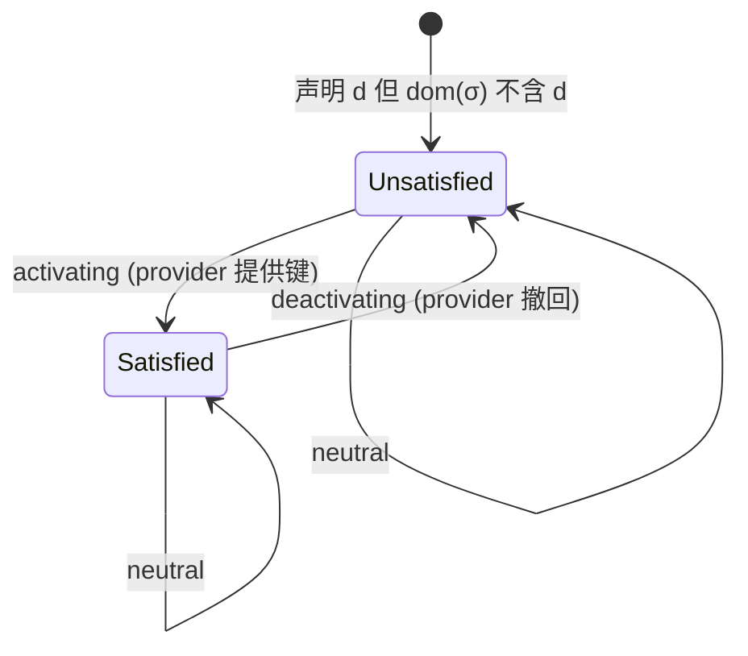

# Cordis 论文精读：理论与机制

> **文档定位**：Cordis 论文精读：理论与机制（从 `01-Cordis论文精读.md` 拆分/重命名而来，内容保持原样，链接已按新结构重写）。
> **所属索引**：[本目录索引](./README.md) · [总索引](../README.md)
> **来源分级**：一手来源为 [在线论文](https://arxiv.org/abs/2608.25512v1) 与 [GitHub 源码](https://github.com/earendil-works/pi)（逐文件链接见正文）；汇总见 [事实登记](../architecture/fact-registry.md)。

## 目录

- [1 一句话结论](#1-一句话结论)
- [2 问题域：为什么"万物皆插件"需要形式化](#2-问题域为什么万物皆插件需要形式化)
- [3 理论支柱：effect / coeffect](#3-理论支柱effect-coeffect)
- [4 可撤销效应（Revertible Effects）](#4-可撤销效应revertible-effects)
- [5 响应式共效应（Reactive Coeffects）](#5-响应式共效应reactive-coeffects)
- [6 上下文范式（Context Paradigm）](#6-上下文范式context-paradigm)
- [7 独立性：从局部到全局](#7-独立性从局部到全局)

## 1 一句话结论

Cordis 把"插件"重新定义为一个**组件（component）**：它声明自己**需要什么**（coeffect specification `d`）、**提供什么**（provision `p`），以及**加载时做什么、卸载时怎么撤**（带逆的 effect iterator `e`）。运行时用**统一的上下文 Γ∞** 承载一切交互，并自动完成两件事：① 把每个上下文变换配上逆函数、按 LIFO 组合，卸载组件时精确回滚（**时间可组合性**）；② 把每次上下文变化按组件的依赖声明分类为 *activating / deactivating / neutral*，自动激活或去活组件（**空间可组合性**）。论文进一步证明，满足独立性条件的组件可以任意交错加载/卸载，最终静止状态只取决于最终配置，与操作顺序无关（汇合性）。实现上，Cordis 把 provision、instantiation、coeffect 操作**全部**归约为唯一原语 `ctx.effect`，这正是"万物皆插件"的操作定义。[PDF p.1, p.31, p.57-64]

> 对本项目最直接的一句话：**pi 的"extension / tool / provider / 命令 / UI 片段"都应成为同一个 `ctx.effect` 原语之上的 fiber，而不是各自一套注册机制**。设计落地见 [03 总体架构](../architecture/framework-model.md)、[04 开发框架层](../framework/overview.md)。


## 2 问题域：为什么"万物皆插件"需要形式化

### 2.1 两个正交维度（PDF p.4）

| 维度 | 含义 | 静态对应物 | 动态难点 |
| --- | --- | --- | --- |
| **时间可组合性** | 移除组件时，它对共享环境的所有修改必须完整、安全地逆转 | 词法作用域（RAII、bracket 模式） | 长生命周期、有状态、无词法边界的副作用 |
| **空间可组合性** | 组件能声明、发现、解析彼此依赖，且依赖变化时被结构化、可验证地协调 | 模块导入解析 | 依赖在运行中出现、消失、改变身份 |

### 2.2 激励案例一：插件系统（PDF p.4-5）

论文以 VSCode 为代表，给出可核查数据（数据取自 2026-06-09 的 Visual Studio Code Marketplace，论文脚注 1）：

- 安装量前 100 的扩展中，**87 个包含可执行代码**，禁用/卸载需要重启 extension host；
- `deactivate` 只是宿主进程终止时的优雅关闭回调，**不支持在线移除**，且把"创建"与"销毁"分离，违反局部性关注点（locality of concern），使完整清理难以验证；
- 前 100 中仅 **7 个**声明了 `extensionDependencies`；扩展通过宿主固定扩展点（命令、视图、语言特性）贡献功能，彼此不直接依赖；
- `vscode.extensions.getExtension(...).exports` 返回 `any`，没有结构化契约。

→ 结论：插件系统的两个局限（无法在线卸载、无法安全相互依赖）是通用现象，不只是 VSCode。

### 2.3 激励案例二：自演化 agent harness（PDF p.5）

论文明确指出，现代 AI agent 依赖运行时 harness，组合工具套件、执行环境、权限与沙箱、会话状态与持久化、上下文与记忆、子 agent 与多 agent 工作流、用户与自动化接口；**未来的 harness 会在持续服务请求的同时生成并部署对自身组件的修改**（p.5）。若没有时间可组合性，每次自修改都要重启并丢弃进程内累积状态；若没有空间可组合性，每个模块只能临时适配依赖变化，甚至静默破坏依赖方或引入仅在重载时暴露的循环依赖。

> **这是本项目的直接理论合法性来源**：我们要重构的 pi 正是一个 agent harness；论文结论章（p.82-83）把"self-evolving agent harnesses"列为未来验证的首要方向。详见 [§14](#14-与本项目目标的关系)。

### 2.4 粗粒度替代方案及其代价（PDF p.5-6）

操作系统在**进程**粒度提供时间可组合性，容器编排在**服务**粒度提供空间可组合性。代价：每次重启丢弃缓存、连接、部分计算（重建耗时数秒到数分钟 [15]），为可用性需要冗余副本；容器编排无法表达共享地址空间内组件的依赖，且把本可本地函数调用的交互变成网络调用。**粒度错配**要求在与组件同层管理 effect 与依赖。


## 3 理论支柱：effect / coeffect

### 3.1 Effect（PDF p.7）

- 类型判断 `Γ ⊢ t : T effect`，用 effect algebra 的元素标注结果类型，刻画计算可能产生的副作用（Lucassen & Gifford [22]）。
- **Monadic effects**：Moggi [16] 用 monad `(T, η, μ)` 范畴化建模，Wadler [23] 在 Haskell 推广；经典实例 Maybe / State / IO。
- **Algebraic effects**：Plotkin & Power [17,24] 让 effect signature Σ 声明操作（如 state 的 `get: () → S`, `put: S → ()`），程序自由调用操作而不绑定实现；Plotkin & Pretnar [25] 的 effect handler 接收参数 `v` 与**定界续延** `κ`，可调用 0/1/多次，统一表达异常、协程、非确定性。Koka [27,28]、Eff [29]、OCaml 5 [30] 均已采用。

### 3.2 Coeffect（PDF p.7-8）

- 对偶地富化上下文：`Γ coeffect ⊢ t : T`，描述计算**需要从环境获得什么**（资源、权限、依赖服务）。effect 描述程序对世界的影响，coeffect 描述世界对程序的约束。
- **Comonadic coeffects**：Uustalu & Vene [32] 提出对称（半）幺半 comonad 作为 monad 的对偶；Petricek 等 [18] 把 coeffect 作为上下文依赖的统一静态分析。comonad `(D, ε, δ)`：`ε: D(A) → A` 抽取当前值，`δ: D(A) → D(D(A))` 复制上下文。Environment comonad `D(X)=E×X`，Stream comonad `D(X)=ℕ→X`。
- **Graded coeffects**：用预序半环 `S=(S,≤,+,×,0,1)` 量化使用次数（0/1/n/∞），`×` 顺序组合、`+` 并行组合，支持资源跟踪、敏感度分析、信息流控制 [33-37]。

### 3.3 与动态可组合性的关系（PDF p.8）

时间可组合性 ↔ 有状态 effect 必须可逆；空间可组合性 ↔ 依赖必须声明并按环境供给解析。经典 effect/coeffect 系统是**静态工具**：effect 在词法固定作用域内由编译期 handler  discharge，coeffect 注释在执行前确定的上下文上验证。动态组合要求这些保证对运行时到来/离开的组件、持续演化的上下文成立。论文的核心转向：**不是给静态类型系统加更多注释，而是把 effect/coeffect 的概念结构具体化（reify）为运行时可直接操作的实体**。

> 工程转译：TS 里没有原生 algebraic effects / coeffects，只能用对象、闭包、Proxy、generator 实现；这正是 Cordis 选择 TypeScript 时的做法，见 [§10](#10-实现cordis-三层架构与十一个算法) 与 [04 开发框架层](../framework/core-semantics.md#4-核心原语-ctxeffect)。


## 4 可撤销效应（Revertible Effects）

### 4.1 从副作用到上下文变换（PDF p.9）

把不纯函数 `f: X ⇝ Y` 变为纯形式 `f: Γ×X → Γ×Y`；固定输入 `x`，`γ ↦ pr₁(f(γ,x))` 捕获副作用。effect 生活在变换 monoid `(Γ→Γ, ∘)` 中。逆只要求**单边**：`g ∘ f`（绝不要求 `f ∘ g`）。

- **定义 1（扭曲复合）**：`(f₁,g₁) ∘ (f₂,g₂) ≜ (f₁∘f₂, g₂∘g₁)`（式 4），使 `(Γ→Γ)×(Γ→Γ)` 成为幺半群 `𝔗Γ`。
- **定义 2（effect context）**：`∂Γ ≜ Γ × (Γ→Γ)`，元素 `(γ, φ)`；`γ` 当前状态，`φ` **累积器**——已执行 effect 的逆的复合，用于把上下文恢复到初态；初始 `(γ₀, idΓ)`。迭代得到塔 `Γ, ∂Γ, ∂²Γ, …`。
- **定义 3（track）**：`trackΓ(f,g): (γ,φ) ↦ (f(γ), φ∘g)`（式 6）。
- **定理 4**：`pr₁∘trackΓ(f,g) = f∘pr₁`——跟踪不改变正向行为。
- **定理 5**：`trackΓ` 是从 `𝔗Γ` 到 `∂Γ→∂Γ` 的幺半群同态——逐个跟踪等价于一次性跟踪扭曲复合。
- **定义 6（recover）**：`recoverΓ(γ,φ) = (φ(γ), idΓ)`（式 9）。
- **定理 7**：若 `g(f(γ))=γ`，则 `recoverΓ(trackΓ(f,g)(γ,φ)) = recoverΓ(γ,φ)`（式 10）。`φ(γ)=γ₀` 称为状态的**可靠性不变量（soundness invariant）**。
- **定理 16**：若 `e₁…eₙ ∈ 𝔈*Γ` 顺序施加、按逆序回滚，则每次回滚精确恢复该次施加前的状态，且所有中间状态满足可靠性不变量。这就是 **LIFO 恢复**的形式依据。

### 4.2 从固定逆到按状态生成逆（PDF p.12-15）

`track/recover` 的两个局限：① `g` 在看到状态前就固定，要求一个统一逆在所有状态成立；② `recover` 是全有或全无，不能有选择地撤销其中一个 effect。

- **定义 8（effect function）**：`𝔈Γ ≜ Γ → Γ × (Γ→Γ)`；带见证的 `𝔈*Γ` 额外要求 `(γ:Γ)→(δ:Γ)→(g:Γ→Γ)→((δ,g)=e(γ) → g(δ)=γ)`（式 12）。**逆在施加点按需返回**，可逐状态不同；见证条件只在该状态成立，由组件作者承担，运行时**不验证**（p.59 明确）。
- **定义 9（effect composition）**：`f ⋄ g = γ ↦ let (δ,s)=g(γ) in let (ε,t)=f(δ) in (ε, s∘t)`（式 13）。
- **定理 10**：`(𝔈Γ, ⋄)` 是幺半群，单位 `ηΓ = γ ↦ (γ, idΓ)`；`(f,g) ↦ γ ↦ (f(γ),g)` 是同态。
- **定理 11**：`𝔈*Γ` 是子幺半群，见证在复合下保持。
- **定义 12（effect 提升）**：`effectΓ(e): (γ,φ) ↦ let (δ,g)=e(γ) in ((δ, φ∘g), trackΓ(g, pr₁∘e))`（式 14）——把 `𝔈Γ` 提升为 `𝔈∂Γ`，使撤销本身也是一个 effect（这是"undo 可回滚"的关键）。
- **定理 13**：`effectΓ(f) ⋄ effectΓ(g) = effectΓ(f⋄g)`（复合保持）。
- **定理 15**：提升后的逆 `g′(Δ) = (γ, φ∘g∘f)`（式 16）；仅当 `g∘f = idΓ` 时累积器也精确恢复，但任何情况下都保持可靠性不变量 `φ(g(f(γ)))=φ(γ)`。

### 4.3 Effect iterator（PDF p.15-16）

组件加载不是单个 effect 而是一串，卸载要撤销整串。

- **定义 17**：`ℑΓ ≜ μℑ. Γ → Γ × (Γ→Γ) × Maybe(ℑ)`；每次迭代产出 `(δ, g, o)`，`o = Nothing` 终止、`Just(i′)` 给出后续迭代。带见证 `ℑ*Γ` 同样只约束单次迭代的 `g(δ)=γ`。
- **定义 18（effect 迭代器提升）**：`effectiterΓ` 递归定义（式 18），每层把逆 `g` 按施加顺序复合到 `φ`，得到 `φ∘g₁∘…∘g_k`，施加时按 LIFO 回滚。
- 迭代器是**具体化的定界续延**，直接对应主流语言的 `yield` / generator。
- **局部时间可组合性判据**：组件施加的任意 effect 序列，其累积器恢复起始上下文；逆序回滚把每个逆交到它自己产生的状态。见论文 §3.1.3 总结（p.16）。

> 工程转译：`ctx.effect(callback)` 的 callback 是一个 async generator，`yield` 出 dispose 函数；`execute()` 把每次 yield 的 dispose 前插到 `inverse` 链上，形成 LIFO。对应 [§10.1 算法 1](#101-算法-1ctxeffect-execute) 与 [04 开发框架层](../framework/core-semantics.md#5-撤销协议与-lifo-累积器)。


## 5 响应式共效应（Reactive Coeffects）

### 5.1 Coeffect context（PDF p.17）

- **定义 19**：`Σ ≜ (k:K) ⇀ V k`，从依赖键到类型化值的有限偏函数（type family `V: K→Type` 保证键与值类型对应）。操作：`σ(k)`、`σ[k↦v]`、`σ∖k`、`k∈dom(σ)`。
- **定义 20**：`get(k): σ ↦ σ(k)`（需 `k∈dom(σ)`）；`set(k,v): σ ↦ (σ[k↦v], λσ′. σ′∖k)`（需 `k∉dom(σ)`）。**`set(k,v)` 的类型就是 `𝔈*Σ`**，因此 coeffect 操作本身就是可撤销 effect——这是两个理论支柱的"协同点"（p.17）。

### 5.2 规格与通知（PDF p.18）

- 满足谓词 `σ ⊨ d ≜ ∀k∈d. k∈dom(σ)`（式 22），因 `dom(σ)` 有限而可判定。
- **定义 21**：coeffect specification `𝔇Σ ≜ Set(K)`，组件声明它从环境要求的依赖集合。
- **定义 22（notify）**：
  - `activating`：`σ ⊭ d ∧ σ′ ⊨ d`
  - `deactivating`：`σ ⊨ d ∧ σ′ ⊭ d`
  - `neutral`：其他
  
  activating 触发组件 effect 的执行（按 §4 跟踪），deactivating 触发累积器恢复。**局部空间可组合性判据**：组件只在满足规格的状态激活，因此绝不读不存在的绑定；每次上下文变化都被分类，满足度丢失在发生处被检测并驱动去活。

### 5.3 隔离与拦截（PDF p.19-21）

- **定义 23（两种 realization）**：in-place 实现改动上下文并返回非平凡逆；derived 实现保持输入不变、返回一个派生上下文、逆为 identity，恢复即丢弃派生上下文。隔离与拦截**天然是 derived realization**——它们改变键的解析方式而不改共享表，因此没有 effect 需要跟踪。
- **定义 24（隔离 realm）**：`Σiso ≜ (K⇀R) × ((r:R)⇀V r)`，即 `(ρ, σ)`；`ρ` 把逻辑键映射到 realm，`σ` 把 realm 映射到值；未被隔离的键解析到自身 realm（`R ⊇ K`）。**运行时 ad-hoc 多态**：同一个键在不同上下文解析到不同值；多租户、测试环境、组件沙箱都用它。
- **定义 25**：`get(k): (ρ,σ) ↦ σ(ρ(k))`；`set(k,v)` 写 `σ[ρ(k)↦v]` 并给出逆；`isolate(k,r): (ρ,σ) ↦ (ρ[k↦r], σ)`（式 26）。`set` 仍是 `𝔈*Σiso`，`isolate` 不需要逆。
- **定义 26-27（拦截）**：`Σinter ≜ ((k:K)→M k) × ((k:K)⇀(M k→V k))`，`𝔇inter ≜ (k:K)⇀M k`；每个键带元数据 monoid `(M k, ⊕k, εk)`。访问时求值 `σ(k)(d(k) ⊕k ι(k))`，即**组件声明的元数据与上下文携带元数据合并后传给 provider 函数**；合并是 right-biased，`ι(k)` 优先，使外层上下文能在不改组件的前提下约束它对 coeffect 的使用（用于 §12.3 的访问控制）。`intercept(k,ν)` 把 `ν` 合并到继承的元数据，是 derived realization，可在运行时安装/重配/移除而**不触发任何 reload**。

> 工程转译：`@@store` / `@@isolate` / `@@intercept` 三个 symbol 键槽；`ctx.get/set/isolate/intercept`；Proxy 属性访问在 fiber 链上按 committed view 解析并强制声明检查。见 [§10.2](#102-算法-2-3coeffect-操作与通知) 与 [04 开发框架层](../framework/core-semantics.md#6-依赖注入与隔离)。


## 6 上下文范式（Context Paradigm）

### 6.1 统一上下文（PDF p.21-23）

- **定义 28**：`Γ∞ ≜ μΓ. Γ × (Γ→Γ) × Σ`（式 29），三个投影：递归的当前状态、撤销本层 effect 的累积器、携带依赖信息的 coeffect context。这样 `∂`-塔被统一成一个自相似类型；`Σ` 的结构化集成让依赖操作（`set/get`）作用于 `Σ`，累积器持有它们的逆。**因为 `V` 不受约束，任何需要跨组件共享的可变状态都可以编码为依赖——`Σ` 涵盖所有共享可变状态**，不只是组件间依赖。
- **定义 29**：一个键上的 coeffect 是 `(V k, A k)`：`V k` 是值类型，`A k` 是该值提供给持有它的组件的操作集合；操作 `a: X a → V k ⇀ V k × (V k ⇀ V k) × B a`（式 30），前两个分量是 `V k` 上的见证 effect function，第三个是 outcome。操作通过 lift `aΣ(x)(σ)` 作用于 coeffect context（式 31），只读写该键。
- **定义 30（context-mediated iterators）**：`ℑ𝒜Σ(S,P)`（`P⊆S⊆K`）是 Σ 上迭代器的最小集合，含单位与两种 stage：**operation stage**（执行某个键上的 coeffect 操作并按 outcome 选择续延）和 **provision stage**（在 `k∈P` 安装绑定，逆是 restriction）。属于这个类就是"每个交互都经上下文中介"的形式内容。
- **层次化组合**（p.22-23）：递归结构支持树形控制结构；父上下文聚合所有子层 effect。**加载组件 = 执行它的 effects（plug in）；卸载组件 = 撤销它的 effects（unplug，不影响其他运行组件）**；不同层组件可独立加载/卸载。

### 6.2 观察等价（PDF p.23-25）

物理状态无法按原样恢复（`free` 不恢复堆布局；生成式名字被丢弃后下次创建仍是新的名字），所以 §3 的等号要**在观察等价 ≃ 下读取**。

- **定义 31**：对携带操作集 `𝒜` 的值 `V`，test 是有限词，字母是各 `a(x)` 的正向映射与产出的逆；`v ≈𝒜 v′` 当所有 test 在两处都定义或都不定义且 outcome 相同。键上的等价 `≃k ≜ ≈𝒜k`（式 33）。
- **引理 32**：`≃k` 是等价且被所有操作保持，且是**最粗的**这样的关系。
- **定义 33**：`σ ≃S σ′` 当在 `S` 上绑定相同键且值分别 `≃k`；`γ ≃S γ′` 当 coeffect 投影满足之（式 34）。**未被任何键绑定的部分被遗忘**——这正是让定理 7 能在 `≃` 下成立的理由。
- **定义 34-37**：关系沿函数、积、Maybe 扩展；递归类型按共归纳读取；`𝔈SΓ`、`ℑSΓ` 是在 `≃S` 下带见证的版本。键集 `S` 就是组件声明进入的地方：组件被约束在它命名的键上。
- **引理 38**：§3.1 所有状态等式把 `=` 换成 `≃` 后仍成立。
- **工程意义**：恢复是"观察等价"的恢复，不是字节级快照恢复。设计中不要承诺"完美还原物理状态"，而是定义**接口可观察等价**（见 [09 事实登记与交叉验证矩阵](../architecture/fact-registry.md) 的开放问题 O-3）。


## 7 独立性：从局部到全局

### 7.1 Effect 独立性（PDF p.26-28）

运行时卸载一个组件时，逆可能在**其他组件的 effect 仍在场**的状态上执行；一个序列也可能交错多个组件的 effect。此时逆遇到的是被外部 effect 移动过的状态，必须要求交换性。

- **定义 40**：`reach(i)` 是迭代器经续延闭包后的集合；`𝔐(i)` 是由 `reach(i)` 中所有迭代器的正向映射与产出的逆生成的变换子幺半群（式 38）。
- **引理 41**：交换性在生成元上判定即可；`⋄` 不扩大变换幺半群。
- **定义 42（独立）**：`i,j` 独立当 ① ∀f∈𝔐(i),g∈𝔐(j). f∘g=g∘f；② 一方的变换不扰动另一方的产出（逆与续延）（式 39-40）。
- **定理 43**：若 `e₁…eₙ ∈ 𝔈*Γ` 两两独立，则在序列到达的状态上按**任意排列**施加这些逆，都回到 `γ₀`。

### 7.2 Coeffect 交换性与见证（PDF p.28-30）

- **定义 44**：操作 `a,a′` 独立当它们的 lift 作为 effect function 独立，且一方的变换不扰动另一方的 outcome。
- **定理 45**：**不同键上的操作天然独立**——每个生成元都是键局部的 `σ↦σ[k↦u(σ(k))]`，不同键互不相干。
- **定义 46**：一个键上的 coeffect 是**带见证的**，当它除 `(V k, A k)` 外还携带"`k` 可交换"的证明。与 effect 的逆见证平行：都在定义处提供而非使用处检查。**同键操作的交换性由提供该键的组件负责**，典型可交换案例是"表/注册表类"值（路由、事件监听：每次注册拿唯一标识符，逆删除该条目）；典型不可交换案例是**有序中间件链**（插入顺序决定请求所见）。
- **定理 47**：两个 context-mediated iterator 独立，只需 ① `P₁∩S₂ = P₂∩S₁ = ∅`（一方提供的键不被另一方操作），② 双方都操作的键是可交换的。

> **设计红线**：在 agent 框架中，**事件监听器、工具注册、路由注册**天然可交换（唯一 id + 逆删除）；**中间件链、提示词拼装顺序、工具调用优先级**天然不可交换，必须通过显式顺序声明（coeffect 依赖）来约束，不能指望运行时自动交换。见 [05 Agent开发框架层](../agent-framework/tools-and-policies.md#7-顺序敏感部分中间件与提示词)。


## UML 视图

### 图 1：track / recover 的活动流（活动图）

```mermaid
flowchart LR
    A[effect 函数 e(γ)] --> B[返回 δ 与逆 g]
    B --> C[track: φ ← φ ∘ g]
    C --> D[状态 δ, 累积器 φ]
    D --> E{继续 effect?}
    E -->|是| A
    E -->|否| F[recover: φ(γ) 恢复初态]
    F --> G[φ 重置为 id]
```

### 图 2：coeffect 分类（状态机图）



## 文档关系

| 关系 | 文档 |
| --- | --- |
| 所属目录索引 | [./README.md](./README.md) |
| 全局索引 | [总索引](../README.md) |
| 事实来源 | [事实登记与交叉验证矩阵](../architecture/fact-registry.md) |
