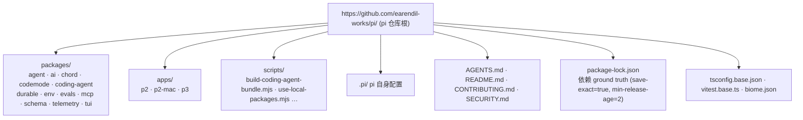

# pi 项目现状剖析

> **文档定位**：pi 项目现状剖析（从 `02-pi项目现状剖析.md` 拆分/重命名而来，内容保持原样，链接已按新结构重写）。
> **所属索引**：[本目录索引](./README.md) · [总索引](../README.md)
> **来源分级**：一手来源为 [在线论文](https://arxiv.org/abs/2608.25512v1) 与 [GitHub 源码](https://github.com/earendil-works/pi)（逐文件链接见正文）；汇总见 [事实登记](../architecture/fact-registry.md)。

## 目录

- [1 总览与重要事实校正](#1-总览与重要事实校正)
- [2 仓库结构与依赖图](#2-仓库结构与依赖图)
- [3 @earendil-works/chord：对象运行时与插件](#3-earendil-workschord对象运行时与插件)
- [4 @earendil-works/pi-agent-core：极简 agent 运行时](#4-earendil-workspi-agent-core极简-agent-运行时)
- [5 @earendil-works/pi-coding-agent：完整 CLI 与扩展系统](#5-earendil-workspi-coding-agent完整-cli-与扩展系统)
- [6 @earendil-works/pi-tui：自研差分渲染](#6-earendil-workspi-tui自研差分渲染)
- [7 生态包：ai / durable / schema / mcp / env / codemode / telemetry / evals](#7-生态包ai-durable-schema-mcp-env-codemode-telemetry-evals)
- [8 已插件化 vs 仍硬编码](#8-已插件化-vs-仍硬编码)
- [9 重构必须保留的不变量清单](#9-重构必须保留的不变量清单)
- [10 与目标栈的差异表](#10-与目标栈的差异表)
- [11 交叉引用与验证](#11-交叉引用与验证)

## 1 总览与重要事实校正

pi 的定位（README）：*minimal, extensible agent harness that you can make your own*。它是 npm workspaces monorepo，Node ≥22.19，`tsc` + esbuild bundle，bun 仅用于 `bun build --compile` 产单文件二进制。

**三个必须先说清的事实校正**（否则设计文档会建立在错误前提上）：

1. **当前没有 turborepo**：根 `package.json` 用 npm workspaces，构建是手写串行链：`telemetry → schema → chord → tui → codemode → mcp → ai → durable → env → agent → coding-agent`。目标栈里的 turborepo 是**新增**，不是现状。
2. **当前没有 solidjs / opentui 运行时依赖**：`packages/tui` 是自研命令式组件模型；全仓只有 [tui/src/stdin-buffer.ts:16](https://github.com/earendil-works/pi/blob/main/tui/src/stdin-buffer.ts#L16)、[keys.ts:6](https://github.com/earendil-works/pi/blob/main/keys.ts#L6)、[test/stdin-buffer.test.ts:4](https://github.com/earendil-works/pi/blob/main/test/stdin-buffer.test.ts#L4) 三处注释写着"Based on code from OpenTUI (MIT)"——**只借鉴算法，不是依赖**。
3. **bun 用途有限**：只在 `coding-agent/package.json` 的 `build:binary` 用 `bun build --compile`；源码遵循 erasable TypeScript / strip-only（[AGENTS.md:25](https://github.com/earendil-works/pi/blob/main/AGENTS.md#L25)）。

→ 目标栈（bun/ts + turborepo + opentui/solidjs）是**迁移目标**，不是对 pi 现状的描述。详见 [§10](#10-与目标栈的差异表)。


## 2 仓库结构与依赖图

### 2.1 顶层



### 2.2 内部依赖图（基于各 package.json）

```mermaid
flowchart LR
    TEL[telemetry] --> AI
    SCH[schema] --> AI
    SCH --> CHORD
    SCH --> DURABLE
    TEL --> CHORD
    TEL --> DURABLE
    CODE[codemode] --> DURABLE
    CODE --> CA[coding-agent]
    MCP[mcp] --> CA
    AI[ai] --> ACORE[agent-core]
    AI --> DURABLE
    AI --> CA
    CHORD --> DURABLE
    ACORE --> CA
    TUI[tui] --> CA
    DURABLE --> ENV
    CHORD --> ENV
    CA --> EV[evals (private)]
    AI --> EV
```

要点：**coding-agent 与 durable 是两条平行分支**；coding-agent 不直接依赖 durable/env/schema/chord，durable 建立在 chord+ai 之上。`mcp/schema/tui/codemode/telemetry` 是底层可复用能力包。

### 2.3 README 中的包职责表

| 包 | 描述 |
| --- | --- |
| `@earendil-works/chord` | Objects runtime across processes：contracts、documents、store、links、带热重载的 plugins、HTTP、workers、web/terminal clients |
| `@earendil-works/pi-telemetry` | 厂商中立 telemetry 契约、参考 adapter、一致性测试、类型化 schema |
| `@earendil-works/pi-ai` | 统一多 provider LLM API |
| `@earendil-works/pi-durable` | 持久化会话、任务、文档运行时 |
| `@earendil-works/pi-agent-core` | 带工具调用和状态管理的 agent runtime |
| `@earendil-works/pi-coding-agent` | 交互式 coding agent CLI |
| `@earendil-works/pi-tui` | 带差分渲染的终端 UI 库 |


## 3 @earendil-works/chord：对象运行时与插件

### 3.1 定位与包结构

[chord/package.json](https://github.com/earendil-works/pi/tree/main/packages/chord/package.json)：`1.5.2`，`type: module`，`main: dist/index.js`，`sideEffects: false`，Node ≥22.19；依赖 `pi-schema` + `pi-telemetry`；可选 peer：`esbuild`（plugins/surfaces/workers）、`react`（/react）、`ws`（/http、/tui/launcher）。

**关键设计决定**（[docs/design.md:2345-2349](https://github.com/earendil-works/pi/tree/main/packages/chord/docs/design.md:2345-2349)）：**没有 dev/prod 之分**——应用是"自我修改"的（所有者或 agent 在运行时编辑插件），因此插件的发现/构建/加载/监听/滚动发布是**核心机械**而非开发期工具；内核保持可移植（大部分无 Node 依赖），Node 专属能力在 `src/node/` 子路径。

`src/` 模块：`contracts/`、`data/`、`documents/`、`store/`、`delta/`、`state/`、`host/`、`link/`、`remote/`、`registries/`、`jobs/`、`sync/`、`surfaces/`、`web/`、`react/`、`tui/`、`node/{http,workers,plugins,app,surfaces,tui}/`、`sqlite/`、`telemetry-*/`。

### 3.2 核心概念与真实 API

| 概念 | 源码 | 关键导出 |
| --- | --- | --- |
| 契约 | `src/contracts/{declare,contract,host-kind,evolve,schema,accepts}.ts` | `local`, `remote`, `hostKind`, `evolve`, `Contract`, `Implementation<C,X>`, `str/num/int/bool/obj/arr/map/method/keyed/event`, `fingerprint`, `accepts` |
| 文档 | `src/documents/{definition,handles,transaction,slot,persistence}.ts` | `defineState`, `SingletonHandle/KeyedHandle`, `Tx`, `migrate`, `checkpointWhen`, `persist` |
| Store | `src/store/{store,table,query,backend,engine,outbox,archive}.ts` | `openStore`, `Store`, `defineTable`, `evolveTable`, `query`, `json`, `host`, `Outbox`, group commit |
| Links | `src/link/{link,binary,text,ipc,websocket,part}.ts` | `Link`, `memoryLinkPair`, `ipcLink`, `webSocketLink`, `binaryCodec`, `textCodec`, `PROTOCOL_VERSION=1`，16 KiB 压缩阈值 |
| Delta | `src/delta/` | `track`, `beginChange`, `prepare`, `adopt`, `applyImmutable`, `PendingOps`，op 元组 `["r"|"s"|"d"|"a"|"t"|"p"|"m", ...]` |
| Watch | `src/watch.ts`, `src/state/` | `Watchable`, `WatchHandle`, `NativeWatch`, `derive`, `writable`，`(call, context)` 单监听器协议 |
| HTTP | `src/node/http/` | `createHttp`, `HttpComponent`, `Http/Authenticators` 注册表，`fetch(Request)→Response`，deny-by-default |
| Workers | `src/node/workers/` | `createWorkers`, `workerMain`, `processLock`，每 host 地址 fork 进程、按需启动、空闲停止 |
| Web | `src/web/` | `startPage`, `chordFacet` 脚本注册，主题/语言走注册表 |
| TUI | `src/tui/` + `src/node/tui/` | `startTerminalRuntime`, `BridgeTerminal`, `TuiScope`, sandbox/launcher 桥 |

### 3.3 插件系统（facet 为唯一注册单元）

真实签名（`src/host/facet.ts`）：

```ts
export interface FacetHost<P extends Principal = Principal> {
  serve<C extends Contract>(Type: C, factory: Factory<C, P>, options?: ServeOptions<C>): void;
  serve<C, V>(R: Registry<C, V>, provider: RegistryProvider<C, V>): void;
  references<C extends Contract>(Type: C): Watchable<readonly Presence<C, P>[]>;
}
export interface FacetSelf {
  contribute<C>(R: Registry<C, unknown>, value: Contribution<C>): void;
}
export type Facet<P> = { readonly setup: (host, self) => void; readonly "~principal"?: ... };
export function defineFacet<P>(setup): Facet<P>;
```

host 加载/重载（[src/host/host.ts:287-325](https://github.com/earendil-works/pi/blob/main/src/host/host.ts#L287-L325)）：

```ts
load(facets: readonly PluginFacet<P>[], context: Context): Promise<LoadReport>;
reload(facets: readonly PluginFacet<P>[], context: Context, options?: ReloadOptions): Promise<ReloadReport>;
```

**规则**：facet 的 setup **只做声明**（`host.serve`/`self.contribute`/`host.references`），同步执行；因此 facet 在 `load` 之后不可能失败。真正的状态与常驻行为放在空参数 `local` 对象里。插件之间**只有两种交流方式：对象契约与注册表**（[docs/design.md:1918](https://github.com/earendil-works/pi/blob/main/docs/design.md#L1918)："Between plugins only: object types and registries. No natives across plugins except through registry entries."）。

**插件流水线**：

1. **发现**（`src/node/plugins/discover.ts`）：只列目录、读 `package.json`，不解析源码；`chord.plugins` manifest（glob + `!` 排除）；目录插件每 kind 一文件（`server.ts`/`worker.ts`/`web.tsx`/`tui.ts`），默认导出 facet；无 facet 文件的插件只提供契约。
2. **构建**（[build.ts:31-92](https://github.com/earendil-works/pi/blob/main/build.ts#L31-L92)）：esbuild 冷构建成 CommonJS wrapper，`BuiltFacet {kind:"script"|"failed", source, digest, inputs, css, assets}`；失败是返回值不是异常；禁止 `import.meta`/`__dirname`/字面量动态 import/top-level await。
3. **求值**（`evaluate.ts`）：`vm.Script` 在稳定文件名 `/chord-plugins/<plugin>/<file>?<digest>` 下求值，注入自定义 `require`（只回答 host packages、`pluginFile`、builtin/external）——**No module map, no cache**；`setFlagsFromString("--no-compilation-cache")` 关闭 V8 编译缓存；旧闭包被 GC 回收（`FinalizationRegistry` 管 sourcemap）。
4. **digest 最小重求值**（`src/surfaces/loaded.ts`）：`LoadedFacets.reload()` 逐插件比较 digest，相同则**复用同一个 facet 对象**（插件对象不重启），不同才重新 prepare。
5. **滚动发布**（[plugins.ts:263-304](https://github.com/earendil-works/pi/blob/main/plugins.ts#L263-L304)）：`step(name, host)` + `rollout(steps, built, ctx)` 逐 host 应用；失败插件/host 不阻断；最后只对成功应用且未变化的插件清 dirty。
6. **host 侧重载语义**：staging 跑新 setup、受影响对象用 recording `self` 跑新 factory；**closure rule**：新代码失败则保留旧代码，直到不动点；提交是单一 batch；每个对象 `restarted/retried/ended/parked`；**旧工作跑旧代码**（在途调用及经 ctx 引发的调用在旧 attempt 完成，新调用在新代码门口等待，超时上限 `reloadDrainTimeout` 5s）。

**watcher 只标记不应用**（`watcher.ts`）：`fs.watch` 各 root（从不监听 `node_modules`/`.git`），文件变 → `dirty`，`package.json` 变 → `install`，插件增删 → `set`，base 代码用内容哈希比对 → `base`；每个标记带单调递增 generation，构建期间的修改不会被老 rollout 误清。

**contribution 机制**（`src/registries/README.md`、[design.md:1922-1995](https://github.com/earendil-works/pi/blob/main/design.md#L1922-L1995)）：`defineRegistry<C,V>(name,{version})`；定义插件以 `host.serve(R, {compose, accepts?})` 提供唯一 provider；任意 facet 或 host-lifetime 对象用 `self.contribute(R, value)` 贡献（每注册表至多一个）；贡献可以是 watchable，变化时重新 compose；`compose` 纯同步、总有回退值，表按插件名排序（与加载顺序无关）；读者 `self.registry(R)`（未就绪则对象 park `failed {waiting}`）或 `host.registry(R, ctx)`；版本通过 `accepts[version].value` 映射；使用点必须防御性捕获异常。

**"万物皆插件"证据**（[design.md:2400-2403](https://github.com/earendil-works/pi/blob/main/design.md#L2400-L2403)）：*"Every implementation, the harness and core registry providers included, is a plugin"*；`createHttp`/`createWorkers`/`webSurface`/`tuiSurface` 本身返回 facet，与用户插件一起加载；HTTP 的路由/wrap/socket/域名/CSP 全部由插件向 `Http` 注册表贡献；主题、翻译、登录、文件、遥测都是核心插件（如 `chord.themes`、`chord.app.files`）。

### 3.4 数据模型：不是 CRDT

- **契约**：`local/remote` 有 version + fingerprint；`evolve` 做结构化演进；`accepts` 把旧版本协议映射到当前版本；映射失败 → 旧消费者 `failed {waiting}: contract_mismatch`，不喂错数据。
- **文档**：`defineState(name,{schema,version,initial,keyed?,migrate?,persist?,checkpointWhen?})`；单例/keyed 句柄；`Tx` 事务（对象在自己的 line 上串行，回调内只能 `await tx.*`）；存储版本更新/migrate 抛错/fingerprint 不同 → 对象 `broken`，不覆写数据。
- **Store**：每 host 一个 store，同时只允许一个 open host；提交队列只串行化 commit step，排队提交合并为一个后端事务（group commit）；outbox 供 sync 层使用。
- **Delta**：单一权威 + 有序副本 + 精确 op 批；多个 change 可并行 prepare，`adopt` 一个使其余 stale；慢消费者超 10,000 ops 收整根替换；安全路径拒绝 `__proto__`/`constructor`/`prototype`。**顺序由层保证，没有 CRDT 并发合并**。
- **Watch**：`watch.value` 是获取时值，`start(listener)` 装唯一异步监听器，`(call, context)` 一次一个；`failed`（暂时失败，watch 保持打开）/ `retired`；结束原因 `stopped|aborted|ended|listener_error|failed`。

### 3.5 最小示例（[chord/README.md:44-74](https://github.com/earendil-works/pi/tree/main/packages/chord/README.md:44-74)）

```ts
import { createHost, defineFacet, local, method, obj, str, constant } from "@earendil-works/chord";
import { BACKGROUND_CONTEXT } from "@earendil-works/chord/context";
const context = BACKGROUND_CONTEXT;
const Greeter = local("example.greeter", {
  version: 1, params: { language: str() },
  members: { language: str(), greet: method(obj({ name: str() }), str()) },
});
const facet = defineFacet((host) => {
  host.serve(Greeter, ({ language }) => ({
    language: constant(language),
    greet: async ({ name }) => (language === "de" ? `Hallo ${name}` : `Hello ${name}`),
  }));
});
const host = createHost({ onError: (e) => console.error(e) });
await host.load([{ name: "@example/greeter", facet }], context);
const german = await host.get(Greeter, { language: "de" }, context);
console.log(german.language.value, await german.greet({ name: "Mario" }, context));
german.release();
await host.close(context);
```

`test/examples/` 有 01~68 号示例；插件相关：35-plugins（完整热重载闭环）、36-plugin-failures、38-watch-and-rollout、49-52 plugin API/test、62-telemetry。


## 4 @earendil-works/pi-agent-core：极简 agent 运行时

### 4.1 事实速览

[packages/agent](https://github.com/earendil-works/pi/packages/agent)：`1.5.2`，**6 个源文件**（`index.ts` 5 行纯 re-export、`types.ts` 551、`agent.ts` 623、`agent-loop.ts` 952、`proxy.ts` 397、`stream-fn.ts` 20）。依赖**只有** `pi-ai` + `pi-schema`；**无持久化、无 pi-durable、无内置工具、无 provider 目录**。exports 仅 `"."` 和 `"./package.json"`（1.0.0 删除了 `./node`、`./harness/*`、`./experimental/*`）。

> 用户提到的 `AgentSession` **不在本包**，它在 [coding-agent/src/core/agent-session.ts:409](https://github.com/earendil-works/pi/blob/main/coding-agent/src/core/agent-session.ts#L409)；`Tool`/`ToolResult` 来自 pi-ai；本包只定义 `AgentTool`/`AgentToolResult`。

### 4.2 公开 API

```ts
// index.ts 全文
export * from "./agent.ts"; export * from "./agent-loop.ts";
export * from "./proxy.ts"; export { setDefaultStreamFn } from "./stream-fn.ts";
export * from "./types.ts";
```

关键类型：

- `StreamFn`（types.ts:33）：`(model, context: TranscriptContext, options?) => AssistantMessageEventStream | Promise<...>`；**不得抛错**，失败编码进流协议与最终 `stopReason: "error"|"aborted"`。
- `ToolExecutionMode = "sequential"|"parallel"`；`QueueMode = "all"|"one-at-a-time"`。
- `BeforeToolCallResult {block?, reason?, terminate?}`；`AfterToolCallResult {content?, details?, structuredContent?, isError?, usage?, terminate?}`。
- `AgentTurnDecision {action:"continue"}|{action:"end"}`；`FinishTurn`、`PrepareRequest`、`AgentLoopConfig`（全部 hook 字段）。
- `AgentState`（382-421）：`systemPrompt`, `model`, `thinkingLevel`, `tools`, `messages`（赋值时 `slice()` 拷贝）, `isStreaming`, `streamingMessage`, `pendingToolCalls: ReadonlySet<string>`, `errorMessage?`。
- `AgentTool<TParameters,TDetails>`（478）：`label`, `prepareArguments?`, `outputSchema?`, `execute(toolCallId, params, signal?, onUpdate?)`, `replay?: "never"|"safe"`, `executionMode?`；继承 pi-ai `Tool` 的 `name/description/parameters`。
- `AgentEvent`（528-551）10 个 union 变体：`agent_start`, `agent_end{messages}`, `turn_start`, `turn_end{message,toolResults}`, `message_start`, `message_update{message,assistantMessageEvent}`, `message_end`, `tool_execution_start`, `tool_execution_update`, `tool_execution_end`（三个 tool_execution 是独立事件，合计 10；源码行 528-551）。
- `CustomAgentMessages` 空接口供 declaration merging。

### 4.3 runLoop 状态机（[agent-loop.ts:172-330](https://github.com/earendil-works/pi/blob/main/agent-loop.ts#L172-L330)）

外层 `while(true)` 处理 follow-up；内层 `while(hasMoreToolCalls || pendingMessages.length>0)` 处理工具与 steering。每轮严格顺序：

1. `prepareNextTurn?.(lastCompletedTurn)` → 可替换 context/messages/model/thinkingLevel；再轮询 steering；`turn_start`。
2. `declareToolChanges` 把待发消息 `message_start/message_end` 并 push。
3. `await prepareRequest?.({context,model,thinkingLevel}, signal)`——**此处不轮询队列**。
4. `streamAssistantResponse` → AssistantMessage，push。
5. `stopReason === "error"|"aborted"` → `finishTurn` → `turn_end` → `agent_end` → **硬退出**（continue 无效）。
6. 提取 `toolCalls`；`stopReason==="length"` → `failToolCallsFromTruncatedMessage`（一律失败不执行）；否则 `executeToolCalls`。
7. 构造 `lastCompletedTurn`，`await finishTurn?.(...)`，`emit turn_end`（顺序：toolResult message_end → finishTurn → turn_end）。
8. decision `end` → `agent_end` → return（不轮询队列、不 prepareNextTurn、不清队列）。
9. decision `continue` → 再轮询 steering；若已有工具/steering 则清除 explicitContinuation。
10. 内层退出：`getFollowUpMessages()` 有值 → 设为 pending 并 continue；否则 explicitContinuation 为真 → 做**一次** context-only 请求；否则 break。
11. 统一 `emit agent_end`。

**事件屏障语义**（[agent.ts:575-622](https://github.com/earendil-works/pi/blob/main/agent.ts#L575-L622)）：`processEvents` 先归约内部状态，再按注册顺序 `await` 所有 listener；`agent_end` 只是"不再发事件"，**不是 idle**——`waitForIdle()`/`prompt()` 都等 `agent_end` 的 awaited listener 结束。持久化挂在这个屏障上。

**工具流水线**：`executeToolCalls` 按 `config.toolExecution` 或任一工具的 `executionMode==="sequential"` 决定串行/并行。单条：`prepareToolCall`（查工具 → `prepareArguments` → pi-ai `validateToolArguments` → `beforeToolCall`，block → error result）→ `executePreparedToolCall`（计时只包 `execute()`；`onUpdate` 的 promise 在 settle 后统一 await，迟到更新丢弃）→ `finalizeExecutedToolCall`（`afterToolCall` 按字段覆盖；`structuredContent` 的覆盖规则）→ `emitToolExecutionEnd` → `createToolResultMessage`。`shouldTerminateToolBatch`：**仅当整批所有 finalized result 的 `terminate===true`** 才停止；混合批次继续。`runToolCall` 公开给工具嵌套调用，**复用同一流水线但不发事件、不加消息**。

**流映射**：`transformContext` → `convertToLlm`（默认只保留 system/user/assistant/toolResult）→ `normalizeContext` → `getApiKey` → `streamFunction`。system prompt 与工具声明**不通过 state.tools/systemPrompt**，而由 transcript 前导/后续 system 消息承载（`declareToolChanges` 用 pi-ai `getToolStateChanges` 产出 toolsAdded/toolsRemoved）。

**扩展点（全部是可写公共字段/配置回调，没有正式注册表）**：`convertToLlm`、`transformContext`、`streamFn`/`setDefaultStreamFn`、`getApiKey`/`identity`/`transport`/`thinkingBudgets`/`maxRetryDelayMs`/`sessionId`、`onPayload/onResponse/onProviderStreamEvent`、`beforeToolCall`/`afterToolCall`、`finishTurn`、`prepareRequest`、`prepareNextTurn*`、`steer/followUp` + QueueMode、`subscribe`、`abort/waitForIdle/reset`、`CustomAgentMessages`、`AgentTool` 各字段、`AgentEventSink`/`runAgentLoop`、`runToolCall`。

**上层用法暴露的架构问题**：`coding-agent/src/core/agent-session.ts` 大量使用"保存 previous hook → 安装新 hook → 内部调用 previous"的链式 monkey-patch（:851、:950、:962、:1864）——这是重构为插件管线的首要目标。

### 4.4 测试揭示的设计意图（节选）

| 测试 | 意图 |
| --- | --- |
| `tool_execution_end` 按完成顺序、toolResult/turn_end.toolResults 按 assistant 源码顺序（721-813） | **事件顺序与 transcript 顺序解耦**，必须保持 |
| `durationMs` 只计 `execute()`，不含 hooks（455-507） | 计时边界明确 |
| `stopReason:"length"` 时截断消息里的 toolCall 一律不执行（509-579） | 安全优先 |
| `beforeToolCall` 改 args 后不再校验（581-640） | hook 是可信策略层 |
| `error/aborted` 的 continue 无效（1285-1337） | 硬退出不可推翻 |
| `action:"end"` 不清队列、不 prepareNextTurn（1340-1394） | stop 语义 |
| `{action:"continue"}` 是"保证一次请求"而非"无条件多一次"（1396-1430） | 续跑语义 |
| provider 错误不向调用方抛，而是完整事件序列 + `stopReason:"error"`（331-360） | 错误即消息 |
| `agent_end` listener 里的 await 会阻塞 `prompt`/`waitForIdle`（362-433） | 持久化屏障 |
| 迟到的工具 `onUpdate` 被丢弃（473+） | settle 后不可变 |

### 4.5 1.0.0 的架构决定

CHANGELOG:59：删除 `AgentHarness`、sessions/session storage、durable runtime、pico3、harness tools、compaction、skills；"Use `@earendil-works/pi-durable` for durable sessions."。`AgentTool.replay?: "never"|"safe"` 是留给上层的语义钩子（"durable intent exists but outcome unknown"），本包不实现。


## 5 @earendil-works/pi-coding-agent：完整 CLI 与扩展系统

### 5.1 启动链（`src/main.ts`）

```
cli.ts → setupCli() → main()
  → runAuthCommand / handlePackageCommand / handleConfigCommand / mcp 子命令
  → parseArgs()
  → createSessionManager()（JSONL 会话树）
  → createRuntime → createAgentSessionServices()
      → ModelRuntime.create + SettingsManager.create + DefaultResourceLoader
      → resourceLoader.reload() → packageManager.resolve() / discoverAndLoadExtensions()
  → buildSessionOptions → createAgentSessionFromServices → createAgentSession()
  → createAgentSessionRuntime()
  → 按 AppMode 分派：runRpcMode / InteractiveMode.run() / runPrintMode()
```

`builtInExtensions = [llama.cpp, codemode, tool-search, mcp]`（[src/extensions/index.ts:7](https://github.com/earendil-works/pi/blob/main/src/extensions/index.ts#L7)），全部 `builtin: true`，后三者 `replaceable: true`；`omitReplacedExtensions()` 按工具/命令/flag 名冲突让第三方整包替换。

### 5.2 ExtensionAPI（[src/core/extensions/types.ts:1638-1967](https://github.com/earendil-works/pi/blob/main/src/core/extensions/types.ts#L1638-L1967)）

`ExtensionFactory = (pi: ExtensionAPI) => void | Promise<void>`。注册方法：

| 方法 | 作用 |
| --- | --- |
| `on(event, handler)` | 订阅 40+ 生命周期事件 |
| `registerTool(ToolDefinition)` | LLM 工具；含 `exposure: direct|model-only|codemode|deferred|hidden`、`namespace`、`defaultActive`、`prepareLoadout`、`renderCall/renderResult` |
| `registerCommand` / `registerShortcut` / `registerFlag` | 命令 / 快捷键 / CLI flag |
| `registerMessageRenderer` / `registerEntryRenderer` / `registerMarkdownTransformer` / `registerToolRenderer` | 渲染拦截 |
| `sendMessage` / `sendUserMessage` / `appendEntry` | 会话写入 |
| `setSessionName` / `setLabel` / `exec` | 元数据、shell |
| `getActiveTools` / `setActiveTools` / `getCommands` | 工具集控制 |
| `setModel` / `setThinkingLevel` | 模型控制 |
| `registerProvider` / `registerNativeProvider` / `unregisterProvider` | **provider 即插件** |
| `registerMcpServer` / `unregisterMcpServer` | **MCP 服务器即插件数据** |
| `registerVirtualModel` / `unregisterVirtualModel` | 虚拟路由模型 |
| `events: EventBus` | 扩展间共享事件总线 |

**发现与加载**（`src/core/extensions/loader.ts`）：`.ts/.js` 文件、子目录 `index.ts/js`、`package.json` 的 `pi.extensions` manifest（一层深度）；路径为项目 `.pi/extensions/`、用户 `~/.pi/agent/extensions/`、显式配置；加载器是 **jiti**（源码 `jiti-loader.ts`、编译 `jiti-static-loader.ts`、二进制 `virtual-modules.ts`）；`getAliases()` 把 `@earendil-works/pi-ai` 映射到 `pi-ai-extension-view.ts` 保证共享类/注册表；`initializeExtension(factory)` → `await factory(api)` → `commit()`，失败 `discard()`；provider/virtualModel/mcp 注册在 pre-bind 入队，由 `runner.bindCore()` flush。`/reload` 走 `session_shutdown → 重建 ExtensionRunner → session_start(reason:"reload") → resources_discover(reason:"reload")`。

**事件生命周期**（[docs/extensions.md:311-407](https://github.com/earendil-works/pi/blob/main/docs/extensions.md#L311-L407)）：启动 `project_trust → session_start → resources_discover`；每轮 `input → skill/template 展开 → before_agent_start → agent_start`；每请求 `context → context_with_system → before_provider_headers → before_provider_request → after_provider_response → provider_stream_event + message_*`；每工具 `tool_execution_start → tool_call（可阻断/改参）→ tool_execution_update → tool_result（可改结果）→ tool_execution_end`；收尾 `turn_end → agent_end → agent_before_settle → agent_settled`；另有 compaction/tree/model_select/user_bash/mcp_servers_change 等。

**资源可插拔**：`skills`（SKILL.md）、`prompt templates`（Markdown + frontmatter）、`themes`（JSON + schema）、`agents files` 都经 `DefaultResourceLoader`；扩展可通过 `resources_discover` 事件追加路径（`extendResources()`）——但**不能替换解析器**（硬编码点）。

**Pi packages**（`docs/packages.md`、`src/core/package-manager.ts`）：npm/git/local 包统一分发 `extensions/skills/prompts/themes`；`pi` manifest 声明显式 glob；`PI_OFFLINE` 离线模式；settings 的 `packages/autoload/defaultTools` 过滤。

**沙箱真相**：不是 OS 沙箱。① codemode 的 QuickJS/WASM JS 沙箱；② bun 二进制环境还原。**扩展在 pi 进程内运行，拥有同等 OS 权限**（[docs/extensions.md:7](https://github.com/earendil-works/pi/blob/main/docs/extensions.md#L7)）。

### 5.3 组装 agent-core 的方式（关键调用）

`core/sdk.ts:191 createAgentSession()`：`setDefaultStreamFn(streamSimple)`；`new Agent({ initialState, streamFn: modelRuntime.streamSimple, transformContext: runner.emitContext, onPayload/onResponse/onProviderStreamEvent, beforeToolCall/afterToolCall, finishTurn, prepareRequest, prepareNextTurnWithContext, ... })`；`new AgentSession({...})`；`_bindExtensionCore(runner)`；`_refreshToolRegistry()` 把基础工具 `read/bash/edit/write`（`core/tools/index.ts`）与 `runner.getAllRegisteredTools()` 合并、`wrapRegisteredTools()` 挂 `tool_call/tool_result` 中间件，再 `agent.state.tools = ...`；`buildSystemPrompt()` 输入 `getAgentsFiles()/getSkills()` + 工具 snippets + `before_agent_start`。


## 6 @earendil-works/pi-tui：自研差分渲染

[packages/tui](https://github.com/earendil-works/pi/packages/tui)，无 React/Solid 运行时依赖。`src/index.ts`（196 行）导出 `TUI/TuiBase/Container/Component`、`TuiMainScreen/TuiAltScreen`、`ProcessTerminal`、`Text/Editor/Markdown/SelectList/ScrollView/VStack/HStack/Box/Input/Loader/Image`、`KeybindingsManager`、`colors`（OKLCH/OKHSL）、`StdinBuffer`、`ProgramStatus`（OSC 7501）、终端图像协议（Kitty/iTerm2）。

组件模型（[src/tui.ts:124-155](https://github.com/earendil-works/pi/blob/main/src/tui.ts#L124-L155)）：

```ts
interface Component {
  render(width: number): string[];
  handleInput?(data: string): void;
  handleMouse?(event): TuiMouseEventResult | undefined;
  invalidate(): void;
}
interface TUI extends Component {
  addChild/requestRender/showOverlay/start/stop/...;
}
```

差分渲染（`src/tui-main-screen.ts:250 doRender()`）：`render(width)` 得 `newLines`，overlay 在比较前合成；与 `previousLines` 求 `firstChanged/lastChanged`；首次/宽度/高度变化/clearOnShrink 才全量重绘；否则只输出变化区间；`\x1b[?2026h/l` 同步输出。布局缓存 `renderCached()` 按组件+宽度缓存。

**与插件的桥接**：`ExtensionUIContext.setWidget/setFooter/setHeader/custom/setEditorComponent` 直接接收 `(tui: TUI, theme: Theme) => Component`——TUI 本身是 UI 插件的宿主接口；各 mode（interactive/print/rpc/json）各自实现同一 `ExtensionUIContext`。


## 7 生态包：ai / durable / schema / mcp / env / codemode / telemetry / evals

| 包 | 职责与关键 API |
| --- | --- |
| **pi-ai** | 核心无副作用（`src/index.ts` 注释）：无生成目录、无 provider factory、无 api-registry、无 OAuth。类型：`Api/Provider/Model`、`Message`、`AssistantMessageEvent`（start/text_*/thinking_*/toolcall_*/done/error）、`TranscriptContext`（brand）、`ProviderStreams.stream/streamSimple`。`Provider` 抽象（[src/models.ts:158-255](https://github.com/earendil-works/pi/blob/main/src/models.ts#L158-L255)）：`id/name/auth/getModels()/stream()/streamSimple()/…`；`createProvider()`；`builtinProviders()` 约 44 个 factory；`lazyStream/lazyApi` 按需 import。扩展点 `onPayload/onResponse/onProviderStreamEvent/transformHeaders`。 |
| **pi-durable** | 建立在 pi-ai + chord 之上。`Harness`（storage + 原子提交线）、`Conversation`（不可变 entry）、`Commit`、`Document`、`Task`（每步 checkpoint）、`Submission`、`Registry`。**第二套更彻底的插件 DSL**（[src/harness/define.ts:15-65](https://github.com/earendil-works/pi/blob/main/src/harness/define.ts#L15-L65)）：`defineExtension/defineTool/hook/hookTask/section/wrapSection/wrapTool`；`Extension{name,namespace?,tools?,sections?,hooks?,wraps?,tasks?}`；`Registry.install(CodingTools/Coding)`，同名 tool 后者覆盖前者。**registry 本身不持久化，会话只存扩展名**。storage 多后端：`jsonl/sqlite/node/cloudflare/indexeddb/store`。 |
| **pi-schema** | 无 eval 的 JSON Schema 校验（draft 2020-12/7），编译成闭包；`compile()`, `Validator`, builders `obj/str/num/opt/oneOf`, `Static`, `equal`。被 ai/agent/durable/chord 依赖。 |
| **pi-mcp** | 独立 MCP 客户端（stdio/streamable HTTP/pipe），`McpClient`, `McpServerConfig`, `mcpNamespace/createMcpToolName`, `StdioTransport/StreamableHttpTransport/PipeTransport`；无内部 workspace 依赖。 |
| **pi-env** | durable 的远程执行：Rust daemon over SSH；`Connection`, `RemoteExecutionEnv`, `connectSsh/deployDaemon/acceptHostKey`；`protocol.md`。 |
| **pi-codemode** | QuickJS/WASM 沙箱内 JS，唯一能力是调用注入的 tools；`CodemodeSandbox`, `renderDeclarations`, `parseCodemodeSource`；`quickjs-wasi` 依赖。 |
| **pi-telemetry** | 厂商中立契约：`TelemetryContext/Span/Store`, `defineTelemetrySchema`, `createTypedSpanStarter`, `InMemoryTelemetryContext`, `NOOP_*`，`./render`/`./testing` 子路径。 |
| **pi-evals** | private，行为评测（vitest-evals）：`cli.ts/docker.ts/plan.ts/report.ts/harness.ts`；`evals/*.docs.eval.ts`。 |


## 8 已插件化 vs 仍硬编码

### 已插件化（可直接作为事实依据）

1. **Extensions 全景**：tools / commands / shortcuts / flags / 事件 hooks / provider / MCP server / virtual model / 消息与工具渲染 / Markdown 变换 / 自定义 TUI 组件 / 持久化 entry，全部有 `ExtensionAPI` 注册方法。
2. **内置功能以扩展形态存在**：mcp / codemode / tool-search / llama.cpp 四个 builtin 是 ExtensionFactory，`replaceable` + `omitReplacedExtensions()` 支持整包替换。
3. **Providers 插件化**：`createProvider()` + `registerProvider()` + 生成式 catalog + `lazyApi`。
4. **Pi packages**：npm/git/local 统一分发四类资源 + manifest + 信任门控。
5. **资源发现可扩展**：`resources_discover` 可追加 skill/prompt/theme 路径。
6. **Durable 的独立插件系统**：`Extension{tools,sections,hooks,wraps,tasks}` + Registry——最接近"一切皆插件"的现成范式。
7. **TUI 面向插件**：`Component/TUI/Overlay` 稳定，扩展可完全替换 editor/footer/header。
8. **Telemetry**：adapter 注入 + `NOOP_*` 默认实现。

### 仍硬编码 / 可重构为插件（按成本从低到高）

| 硬编码点 | 位置 | 说明 |
| --- | --- | --- |
| 内置工具 `read/bash/edit/write` | `core/tools/index.ts`、[sdk.ts:28-40](https://github.com/earendil-works/pi/blob/main/sdk.ts#L28-L40)、[agent-session.ts:3820](https://github.com/earendil-works/pi/blob/main/agent-session.ts#L3820) | 编译期 import + 字符串名数组，未走 ExtensionFactory |
| 内置扩展清单 | [src/extensions/index.ts:7-14](https://github.com/earendil-works/pi/blob/main/src/extensions/index.ts#L7-L14) | 顺序/可替换性硬编码，可改 manifest 驱动 |
| 模式 AppMode | `modes/index.ts`、[main.ts:1013-1063](https://github.com/earendil-works/pi/blob/main/main.ts#L1013-L1063) | 联合类型 + if/else 分派，可插件化为 mode provider |
| CLI 子命令 | `main.ts` auth/package/config/mcp 前置 | 未走 `registerCommand` |
| 信任门控 | `core/project-trust.ts`、`trust-manager.ts` | 主流程固定，虽有 `project_trust` 事件 |
| 压缩策略 | `core/compaction/` | 有 `session_before_compact` hook，默认算法写死 |
| 资源加载器 | `skills.ts`/`prompt-templates.ts`/`theme.ts` | `resources_discover` 只能加路径不能换解析器 |
| 会话存储 | `SessionManager` JSONL 固定 | 与 durable 多后端形成对比 |
| 校验器 | 直接用 typebox | 无"校验器插件"抽象 |
| **两套扩展系统分裂** | coding-agent `ExtensionAPI` vs durable `Extension/Registry` | **最大架构决策点**：统一还是桥接 |
| 工程栈 | npm workspaces + esbuild + 自研 TUI | 与目标栈不一致 |


## 9 重构必须保留的不变量清单

以下清单来自 agent-core 测试与实现，是 [framework-model/engineering §12](../architecture/engineering.md#12-验收标准) 验收项 5 的具体内容；插件化后必须逐条等价验证：

1. assistant `message_end` 是工具 preflight 前的屏障。
2. 事件完成顺序与 transcript 顺序解耦。
3. `error`/`aborted` 硬退出，`finishTurn` 的 continue 不能推翻。
4. `{action:"end"}` 不轮询队列、不 prepareNextTurn、不清队列。
5. `{action:"continue"}` 是"保证一次请求"，已有自然请求时不叠加。
6. hook 的 no-throw 契约：`convertToLlm`/`transformContext`/`getSteeringMessages`/`getFollowUpMessages`/`getApiKey` 必须返回安全回退值。
7. `streamFn` 不得抛错，失败编码在流里。
8. 迟到工具 `onUpdate` 必须丢弃；`durationMs` 只计 `execute()`。
9. core 不得引入持久化/provider 依赖。
10. 工具 pack 的 `terminate` 只在整批全为 true 时停止。
11. `runToolCall` 嵌套调用必须走同一 hooks 流水线但不发事件/不加消息。
12. system 消息是 prompt/工具声明的单一事实源，可执行 tools 与 transcript 声明通过 delta 对齐。


## 10 与目标栈的差异表

| 维度 | pi 现状 | 目标（用户规划） | 差异类型 |
| --- | --- | --- | --- |
| 包管理 | npm workspaces + package-lock | Bun workspaces + bun.lock | 替换 |
| 任务编排 | 手写串行 build 链 | Turborepo + turbo.json | 新增 |
| 运行时 | Node ≥22.19；bun 仅构建二进制 | Bun 为主运行时 | 替换 |
| TUI | 自研 `@earendil-works/pi-tui`（命令式 + 差分渲染） | OpenTUI 与 SolidJS（Zig native + 响应式） | 替换 |
| 插件加载 | jiti（源码/编译/二进制三态）+ alias + virtual modules | 需重新设计（建议 esbuild/vm + digest，见 [framework §8](../framework/components.md#8-组件加载器与-hmr)） | 重新设计 |
| 扩展系统 | 两套：coding-agent ExtensionAPI + durable Extension/Registry | 统一为 fiber 插件（[05](../agent-framework/overview.md)） | 统一 |
| 持久化 | coding-agent JSONL SessionManager + durable 多后端 | session 作为 coeffect provider（[06](../agent/plugin-system.md)） | 重新定位 |


## 11 交叉引用与验证

| 本文事实 | 下游文档 | 验证点 |
| --- | --- | --- |
| chord facet / registry / 无缓存求值 / rollout | [framework 核心语义与组件](../framework/components.md) | ctx.effect 归一、HMR 三阶段、注册表 contribution |
| agent-core 事件/顺序/不变量 | [05 全篇](../agent-framework/overview.md) | 插件版等价测试 |
| coding-agent 扩展 API 与启动链 | [06 全篇](../agent/plugin-system.md) | 工具/技能/会话/权限插件 |
| pi-tui Component/TUI 与差分渲染 | [07 TUI 设计](../agent/tui.md) | OpenTUI Solid 替代后的对应关系 |
| 两套扩展系统分裂 | [08 路线图](../delivery/roadmap.md) | 统一策略的阶段性验收 |
| 工程栈差异 | [framework-model/engineering §3](../architecture/framework-model.md) | lockfile/turbo.json/依赖方向 |
| 全部事实的等级与来源 | [09 事实登记](../architecture/fact-registry.md) | 逐条溯源 |

**返回索引**：[00 索引与交叉验证](../README.md)


## 文档关系

| 关系 | 文档 |
| --- | --- |
| 所属目录索引 | [./README.md](./README.md) |
| 全局索引 | [总索引](../README.md) |
| 事实来源 | [事实登记与交叉验证矩阵](../architecture/fact-registry.md) |
